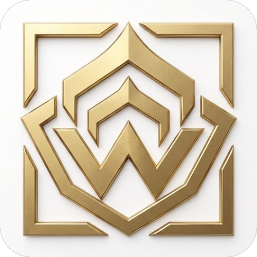

  
  <h1>WireMarket — Warframe Market Browser & Live Worldstate Hub</h1>
  

    <strong>Current Version / Version actuelle :</strong> <code id="readme-version">v1.6.2</code> &nbsp;·&nbsp;
    <strong>Updated / Mis à jour :</strong> <code id="readme-date">2026-11-08</code> &nbsp;·&nbsp;
    <strong>Author / Auteur :</strong> <a href="https://github.com/Nyxo-17">Nyxo_17</a>
  

  

    <a href="#-english-documentation">🇬🇧 <strong>English Documentation</strong></a> &nbsp;|&nbsp;
    <a href="#-documentation-française">🇫🇷 <strong>Documentation Française</strong></a> &nbsp;|&nbsp;
    <a href="https://raw.githubusercontent.com/Nyxo-17/wiremarket_v1/main/WireMarket.zip">⬇ <strong>Download / Télécharger WireMarket.zip</strong></a>
  

---

# 🇬🇧 English Documentation

## 📌 Overview
**WireMarket** (created by **Nyxo_17**) is a standalone, ultra-fast desktop browser and companion hub built specifically for **Warframe Market** (`warframe.market`) and **Warframe Live Worldstate** tracking on Windows.

It combines multi-tab market browsing, real-time price sniping, a multi-item shopping cart with bundle seller detection, a Ducat-to-Platinum calculator, and a complete live Warframe Hub (Planetary Cycles, Void Fissures, Invasions, Steel Path, Arbitrations, Nightwave, Duviri Circuit, Baro Ki'Teer, and Official Warframe News) in a single lightweight native app (`WireMarket.exe`).

---

## 🚀 Quick Start & Installation
1. Download **[`WireMarket.zip`](https://raw.githubusercontent.com/Nyxo-17/wiremarket_v1/main/WireMarket.zip)** from this repository.
2. Extract the archive to any folder and launch **`WireMarket.exe`** (or **`WireMarket.bat`**).
   - *No Python or external runtime installation is required*: `WireMarket.exe` embeds its own native local proxy server and launches a dedicated app window automatically.

---

## ✨ All Features

### 1. 🌐 Multi-Tab Warframe Market Browser & Tab Organizer
- **Dedicated Multi-Tab Interface**: Open multiple items, seller profiles, and market tools side by side without cluttering your main web browser.
- **Tab Reordering & Management System**:
  - **Live Drag & Drop**: Click and drag any tab left or right directly in the top tab bar to reorder open pages in real time.
  - **Pin Tabs (`📌`)**: Right-click any tab to pin it to the left as a compact icon tab protected from accidental closure.
  - **Open Pages Organizer Panel**: Click the tab manager button (next to `+`) to search open tabs, drag-and-drop vertically, move tabs `▲`/`▼`, sort tabs **Alphabetically (`A → Z`)** or **By Category**, and **Close Duplicate Tabs (`🧹`)** in one click.
  - **Right-Click Tab Context Menu**: Pin/Unpin, Move Left/Right/First/Last, Duplicate tab, Reload, Close Duplicates, Close Tabs to the Right, or Close Other Tabs.
- **Instant Omnibox & Catalog Search**: Search across **3,893+ Warframe items** in French or English with instant thumbnail autocomplete.
- **1-Click In-Game Whisper (`/w`)**: Automatically generates and copies the exact `/w SellerName Hi! I want to buy: "..." for Xp (warframe.market)` message to your clipboard (toggleable between EN and FR).

### 2. 🎯 Price Sniper (Background Price Alerts) & Dual Notification Sounds
- **Automated Price Monitoring**: Set a target maximum Platinum price on any item; WireMarket scans the live market in the background (configurable interval from `5s` to `3600s`) and triggers an instant visual toast + audio alert as soon as an in-game seller posts an offer at or below your target price.
- **2 Selectable Notification Sounds**:
  - **🔔 Sound 1: Classic (`notification.mp3`)**
  - **🔔 Sound 2: Bell (`notification-bell.wav`)**
  - Includes a volume slider (`0%–100%`), instant sound preview button, and customizable repeat notifications.

### 3. 🛒 Shopping Cart & Multi-Item Seller Bundler
- **Shopping List & Budget Calculator**: Add any items, sets, mods, or arcanes (with quantity and Rank 0 / Max Rank selection) to your cart. Automatically computes total **Platinum cost** and total **Credit trading tax**.
- **Multi-Item Seller Detector ("Trade Bundling")**: Automatically scans the top in-game sellers for every item in your cart and highlights sellers who have **2 or more of your cart items in stock at the same time**, with a 1-click grouped `/w` message so you can buy multiple items in a single Dojo visit.

### 4. ⚖️ Set vs. Separate Parts Profit Calculator
- On any Prime Set or weapon set page, WireMarket automatically fetches the live lowest in-game prices for both the **Complete Set** and **each individual blueprint/part**, telling you whether it is cheaper to buy the parts separately or more profitable to assemble and sell the full set.

### 5. 🪐 WireMarket Hub — Live Warframe Worldstate (6 Dedicated Tabs)
Click the permanent **WireMarket** logo tab at the top-left to access the real-time Warframe Hub:
- **☀️ Planets & Bounties (`Planètes & Mises à Prix`)**:
  - Live countdowns and visual cards for **Cetus / Earth** (Day/Night), **Orb Vallis / Fortuna** (Warm/Cold), **Cambion Drift / Deimos** (Fass/Vome), **Duviri** (Joy, Anger, Envy, Sorrow, Fear), and **Zariman Ten Zero** (Corpus/Grineer).
  - Live **Bounties (`Mises à Prix`)** for Ostrons, Solaris United, and Entrati with stage counts, enemy levels, and rotating reward pools.
- **⚡ Void Fissures, Archon Hunt & Sortie (`Fissures & Missions`)**:
  - All active **Void Fissures** across Normal, **Steel Path**, **Void Storms (Railjack)**, and **Omnia** tiers (Lith, Meso, Neo, Axi, Requiem, Omnia).
  - **`⚡ Fast Missions Only` Filter**: Instantly filters for Capture, Exterminate, Rescue, Disruption, and Sabotage fissures.
  - Weekly **Archon Hunt** and Daily **Sortie** missions with bosses, modifiers, and 3D planet icons.
- **⚔️ Invasions, Steel Path, Arbitrations & Nightwave (`Invasions, Acier & Nightwave`)**:
  - **Live Invasions**: Faction progress bars, rare rewards (Orokin Catalysts/Reactors, Forma, Exilus, Fieldron, Detonite, Mutagen Mass), and direct **1-click Platinum price links (`Plat ↗`)** for tradable Wraith & Vandal weapon parts.
  - **Steel Path Honors (Teshin)**: Current weekly reward (Umbra Forma blueprint, Kuva, Kitgun Riven, etc.) with the full 8-week schedule + Permanent Store (Evergreens).
  - **Live Arbitration & Vitus Essence Catalog**: Current Arbitration node, faction, bonus, and direct market links to all **Galvanized Mods** and Arbitration mods to check which mod sells for the most Platinum.
  - **Lotus Alerts, Special Events & Nightwave Challenges**: All active daily and weekly Act challenges (`+1,000`, `+4,500`, `+7,000` standing).
- **🗡️ Duviri Circuit Rotations (`Warframes & Armes Duviri`)**:
  - Current week's **Normal Circuit** (3 Warframes) and **Steel Path Circuit** (5 Incarnon Genesis adapters) + full 9-week rotation calendar and direct Warframe Market links.
- **💎 Baro Ki'Teer Void Trader (`Marchand Baro Ki'Teer`)**:
  - Live arrival/departure countdown, relay location, full inventory with Ducat and Credit costs, and automatic **live Platinum price & `Plat / 100 Ducats` profitability comparison**.
- **📰 Official Warframe News, Global Boosters & Darvo (`Actualités News`)**:
  - Live official news feed from Digital Extremes with category filters (*Updates & Hotfixes*, *Prime & Resurgence*, *Streams & Twitch Drops*, *Events & Community*).
  - Displays active **Global Server Boosters** (e.g., Double Affinity / Credits weekends) and **Darvo's Daily Deal** (discount %, remaining stock, Platinum price, countdown).
  - Automatically detects **Prime Resurgence** Warframes mentioned in news articles and provides 1-click buttons to view their Set prices on Warframe Market.

### 6. 🔔 Planetary & Worldstate Audio Alerts
- Toggle automatic background sound alerts for: **Cetus Night**, **Cetus Night 5-min Pre-Alert** (Eidolon prep), **Orb Vallis Warm Cycle**, **Deimos Vome Cycle**, **Baro Ki'Teer Arrival**, **Fast Void Fissures**, **Steel Path Omnia Fissures**, **Rare Invasions (Catalyst/Reactor/Forma)**, **Wraith/Vandal Weapon Invasions**, **Teshin Umbra Forma Week**, and **S-Tier Endurance Arbitrations**.

### 7. 🎨 Overlay Mode, Dual-Color Themes & GitHub Auto-Updater
- **Always on Top (`Alt + P`) & Compact Mini-Overlay (`Alt + M`)**: Keep WireMarket pinned over Warframe in borderless windowed mode.
- **Preset Themes + Custom Dual-Color Theme Engine**: Choose from 6 built-in themes (*Orokin Dark, Tenno Light, Lotus Amethyst, Prime Gold, Kuva Crimson, Corpus Matrix*) or pick your own **Primary (background)** and **Secondary (accent/glow)** colors.
- **1-Click GitHub `.zip` Auto-Updater with Antivirus Rollback Protection**:
  - Checks `Nyxo-17/wiremarket_v1` on GitHub for new releases or commits.
  - Automatically removes Windows `Zone.Identifier` SmartScreen flags and creates a safe `.exe.bak` backup before updating: if a third-party antivirus blocks `.exe` replacement, WireMarket automatically restores the working executable while updating 100% of the HTML/CSS/JS interface without ever breaking your installation.
  - Includes a **"What's New? (Patch Notes / Changelog)"** modal that automatically displays after each update.

---

## ⌨️ Keyboard Shortcuts (EN)
| Shortcut | Action |
| :--- | :--- |
| `Ctrl + T` | Open a new tab |
| `Ctrl + W` | Close the active tab |
| `Ctrl + Tab` / `Ctrl + Shift + Tab` | Switch to next / previous tab |
| `Alt + Shift + ←` / `Alt + Shift + →` | Move active tab Left / Right |
| `Ctrl + K` | Focus quick item search bar |
| `Ctrl + L` | Focus URL / Omnibox address bar |
| `Ctrl + R` / `F5` | Refresh current market data & live stylesheet |
| `Ctrl + D` | Add/remove current page or item from Favorites |
| `Ctrl + Mouse Wheel` (`+` / `-` / `0`) | Zoom in / Zoom out / Reset zoom (`100%`) |
| `Alt + P` | Toggle **Always on Top** (Pin window over game) |
| `Alt + M` | Toggle **Compact Mini-Window Mode** |

---

## 📜 Version History & Changelog (EN)

### `v1.6.2` — `2026-11-08` (Latest)
- **Official Warframe News Hub & Home Strip**: Added the `Actualités (News)` tab in the Hub + live news strip on the Home page with Global Server Boosters, Darvo's Daily Deal, category filters, and automatic Prime Resurgence market links.
- **Open Tabs Reorganization System**: Live horizontal drag-and-drop on the tab bar, right-click tab context menu, tab pinning (`📌`), and the **Open Pages Organizer** popover (search, `▲`/`▼` reorder, sort `A→Z` or by category, and 1-click duplicate tab cleanup).
- **Dual Notification Sounds**: Added choice between **Sound 1: Classic (`notification.mp3`)** and **Sound 2: Bell (`notification-bell.wav`)** in Settings and Alerts pages.
- **Automated Git Pre-Commit Version & `.zip` Builder**: Added `bump_version.py` and `.githooks/pre-commit` to automatically increment the version and rebuild `WireMarket.zip` on every `git commit`.

### `v1.6.0` — `2026-11-08`
- **New Hub Tab — Invasions, Steel Path & Nightwave**: Live Invasions with 1-click Platinum checks on Wraith/Vandal parts, Teshin's weekly Steel Path Honors + Evergreens, Live Arbitration + Galvanized Mods showcase, Lotus Alerts, Events, and Nightwave challenges.
- **GitHub `.zip` Auto-Updater & Patch Notes Modal**: 1-click update checker and installer from GitHub with Antivirus Rollback Protection and automatic "What's New" modal.
- **4 New Worldstate Audio Alerts**: Rare Invasions, Wraith/Vandal Invasions, Teshin Umbra Forma, and S-Tier Arbitrations.

### `v1.5.0` — `2026-11-08`
- **New Hub Tab — Void Fissures, Archon Hunt & Sortie**: Live Normal, Steel Path, Void Storm & Omnia fissures with `⚡ Fast Missions Only` filter.
- **Shopping Cart & Multi-Item Seller Bundler**: Full shopping list with automatic detection of sellers offering multiple items from your cart.
- **Custom Dual-Color Theme Picker**: Independent Primary & Secondary color pickers + Planetary & Fissure audio alerts.

### `v1.4.0` — `2026-11-07`
- **WireMarket Hub, Duviri Circuit & Baro Ki'Teer**: Permanent Hub tab with planetary cycles, bounties, Duviri rotations, and Baro Ki'Teer Ducat/Platinum comparator.

---
---

# 🇫🇷 Documentation Française

## 📌 Présentation
**WireMarket** (créé par **Nyxo_17**) est un navigateur de bureau autonome et ultra-rapide conçu spécialement pour **Warframe Market** (`warframe.market`) et le suivi en temps réel de l'état du monde **Warframe (Worldstate)** sous Windows.

Il réunit dans une seule application légère (`WireMarket.exe`) la navigation multi-onglets sur le marché, un **Price Sniper** (alertes de prix en arrière-plan), un **Panier Multi-Achats** avec détecteur de vendeurs groupés, un comparateur Ducats/Platinum et un **Hub Warframe complet en direct** (Cycles planétaires, Fissures du Néant, Invasions, Route de l'Acier, Arbitrage, Ondes Nocturnes, Circuit de Duviri, Baro Ki'Teer et Actualités officielles Warframe).

---

## 🚀 Installation & Démarrage Rapide
1. Téléchargez **[`WireMarket.zip`](https://raw.githubusercontent.com/Nyxo-17/wiremarket_v1/main/WireMarket.zip)** depuis ce dépôt GitHub.
2. Extrayez le dossier où vous le souhaitez et lancez **`WireMarket.exe`** (ou **`WireMarket.bat`**).
   - *Aucune installation de Python ou de composant externe n'est requise* : `WireMarket.exe` embarque son propre serveur local C# et ouvre automatiquement une fenêtre dédiée.

---

## ✨ Toutes les Fonctionnalités

### 1. 🌐 Navigateur Multi-Onglets Warframe Market & Réorganisation des Pages
- **Navigation Multi-Onglets dédiée** : Consultez simultanément plusieurs items, sets Prime, statistiques et profils de vendeurs.
- **Système complet de Réorganisation des Pages Ouvertes** :
  - **Glisser-Déposer (Drag & Drop) en direct** : Maintenez le clic gauche sur n'importe quel onglet dans la barre supérieure et glissez-le à gauche ou à droite pour changer son ordre instantanément.
  - **Épinglage d'onglets (`📌`)** : Faites un clic droit sur un onglet pour l'épingler à gauche sous forme d'icône compacte protégée contre la fermeture accidentelle.
  - **Panneau « Pages Ouvertes & Réorganisation »** : Cliquez sur le bouton de gestion des pages (à droite du bouton `+`) pour filtrer vos pages ouvertes, les déplacer via glisser-déposer ou avec les flèches `▲`/`▼`, les trier **Par type (`📂`)** ou **Par ordre alphabétique (`🔤 A→Z`)**, et **Fermer les doublons (`🧹`)** en un clic.
  - **Menu Contextuel Clic Droit** : Épingler, Déplacer à gauche/droite/début/fin, Dupliquer la page, Actualiser, Fermer les doublons, Fermer les pages à droite ou Fermer les autres pages.
- **Recherche Omnibox Instantanée** : Autocomplétion en français et en anglais sur les **3 893+ items** du catalogue avec miniatures.
- **Message d'échange `/w` en 1 clic** : Génère et copie automatiquement la commande `/w Pseudo Bonjour ! Je voudrais acheter...` prête à être collée dans le chat Warframe (bascule FR / EN en 1 clic).

### 2. 🎯 Price Sniper (Alertes de Prix) & 2 Sons de Notification au choix
- **Surveillance automatique en arrière-plan** : Définissez un prix cible en Platinum sur n'importe quel item ; WireMarket scanne le marché toutes les X secondes (`5s` à `3600s`) et affiche une alerte visuelle et sonore dès qu'un joueur **En jeu** vend à votre prix.
- **Choix entre 2 Sonneries de Notification** :
  - **🔔 Son 1 : Classique (`notification.mp3`)**
  - **🔔 Son 2 : Cloche / Bell (`notification-bell.wav`)**
  - Réglage du volume (`0%` à `100%`), bouton d'écoute immédiate et répétition automatique paramétrable.

### 3. 🛒 Panier Multi-Achats & Détecteur de Groupage d'Échanges
- **Liste de courses & Calculateur de budget** : Ajoutez vos items (avec quantité et filtre Rang 0 / Rang Max) pour connaître instantanément le **coût total en Platinum** et le **total des taxes d'échange en Crédits**.
- **Détecteur de Vendeurs Multi-Items (« Groupage d'Échanges »)** : Repère automatiquement les vendeurs **En jeu** qui possèdent **au moins 2 items différents de votre panier en même temps**, avec un bouton `/w` groupé pour tout acheter en un seul aller-retour au Dojo.

### 4. ⚖️ Calculateur de Rentabilité « Set Complet vs Pièces Détachées »
- Sur la fiche de n'importe quel Set Prime, compare en direct le prix du **Set complet** face à la somme des **pièces achetées séparément**, et indique l'économie ou le profit d'assemblage en Platinum.

### 5. 🪐 WireMarket Hub — Suivi Warframe en Temps Réel (6 Onglets dédiés)
Cliquez sur l'onglet permanent **WireMarket** en haut à gauche pour accéder aux 6 sections temps réel :
- **☀️ Planètes & Mises à Prix** :
  - Cycles en direct pour **Cetus / Terre** (Jour/Nuit), **Vallée Orbis / Fortuna** (Chaud/Froid), **Puy de Cambion / Deimos** (Fass/Vome), **Duviri** (Spirales d'humeur) et **Zariman Ten Zero** (Corpus/Grineer), ainsi que les **Mises à Prix** (Ostrons, Union Solaris, Entrati).
- **⚡ Fissures & Missions** :
  - Toutes les **Fissures du Néant** actives (Normal, **Route de l'Acier**, **Tempêtes du Néant Railjack**, **Omnia**) avec filtre **`⚡ Missions Rapides uniquement`** (Capture, Extermination, Sauvetage, Perturbation, Sabotage).
  - Suivi de la **Chasse à l'Archonte** hebdomadaire et de la **Sortie** quotidienne avec icônes 3D des planètes.
- **⚔️ Invasions, Acier & Nightwave** :
  - **Invasions en direct** avec barres de progression et boutons **`Plat ↗`** sur les pièces d'armes Wraith/Vandal échangeables.
  - **Honneurs de la Route de l'Acier (Teshin)** : récompense hebdomadaire en cours + calendrier des 8 semaines + Boutique Permanente (Evergreens).
  - **Arbitrage en Direct & Mods Galvanisés** : mission d'Arbitrage active + accès en 1 clic aux prix en Platinum de tous les Mods Galvanisés et Mods d'Arbitrage.
  - **Alertes du Lotus, Événements & Défis des Ondes Nocturnes (Nightwave)**.
- **🗡️ Warframes & Armes (Duviri)** :
  - Rotations hebdomadaires du **Circuit Normal** (Warframes) et de la **Route de l'Acier** (Adaptateurs Incarnon Genesis) avec calendrier complet des 9 semaines.
- **💎 Marchand Baro Ki'Teer** :
  - Compte à rebours d'arrivée/départ, inventaire complet en Ducats et Crédits, et **comparateur automatique du prix en Platinum et du ratio `Plat / 100 Ducats`**.
- **📰 Actualités (News), Boosters Serveur & Offre de Darvo** :
  - Flux d'actualités officielles Warframe en direct filtrable par catégorie (*Mises à jour & Hotfix*, *Prime & Résurgence*, *Streams & Twitch Drops*, *Événements & Communauté*).
  - Affichage des **Boosters Globaux Serveur** actifs (ex: week-end Double Affinité) et de **l'Offre du Jour de Darvo** (% de réduction, stock restant, prix en Platinum).
  - Détection automatique des Warframes de **Résurgence Prime** citées dans les actualités avec boutons directs vers leur fiche Warframe Market.

### 6. 🔔 Alertes Sonores de Cycles Planétaires & Fissures
- Notifications sonores automatiques activables en 1 clic pour : **Nuit sur Cetus**, **Pré-alerte 5 min avant la Nuit sur Cetus** (chasse Eidolon), **Cycle Chaud sur Vénus**, **Cycle Vome sur Deimos**, **Arrivée de Baro Ki'Teer**, **Fissures Rapides**, **Fissures Omnia Route de l'Acier**, **Invasions Rares (Catalyseur/Réacteur/Forma)**, **Invasions d'Armes Wraith/Vandal**, **Forma Umbra chez Teshin**, et **Arbitrage S-Tier**.

### 7. 🎨 Mode Overlay, Thèmes Bicolores & Mise à Jour Automatique GitHub
- **Toujours au premier plan (`Alt + P`) & Mode Compact Mini-Fenêtre (`Alt + M`)** : Gardez WireMarket épinglé par-dessus Warframe.
- **6 Thèmes prédéfinis + Personnalisation Bicolore** : Choisissez indépendamment votre **Couleur Principale** (fond) et votre **Couleur Secondaire** (accents, boutons, icônes, lueur Glow).
- **Système de Mise à Jour `.zip` via GitHub avec Protection Rollback Antivirus** :
  - Vérifie et installe en 1 clic la dernière version depuis `Nyxo-17/wiremarket_v1`.
  - Supprime automatiquement le marqueur Windows `Zone.Identifier` et protège `WireMarket.exe` via un système de sauvegarde `.exe.bak` (Rollback automatique si un antivirus tiers bloque le remplacement de l'exécutable, tout en mettant à jour 100 % de l'interface HTML/CSS/JS).
  - Fenêtre **« Quoi de neuf ? (Patch Notes) »** affichée automatiquement à chaque nouvelle version.

---

## ⌨️ Raccourcis Clavier (FR)
| Raccourci | Action |
| :--- | :--- |
| `Ctrl + T` | Ouvrir un nouvel onglet |
| `Ctrl + W` | Fermer l'onglet actif |
| `Ctrl + Tab` / `Ctrl + Shift + Tab` | Passer à l'onglet suivant / précédent |
| `Alt + Shift + ←` / `Alt + Shift + →` | Déplacer l'onglet actif vers la gauche / la droite |
| `Ctrl + K` | Focus sur la barre de recherche rapide d'item |
| `Ctrl + L` | Focus sur la barre d'adresse URL (Omnibox) |
| `Ctrl + R` / `F5` | Actualiser les ordres du marché et le style |
| `Ctrl + D` | Ajouter / retirer la page ou l'item des Favoris |
| `Ctrl + Molette` (`+` / `-` / `0`) | Zoomer / Dézoomer / Réinitialiser le zoom (`100%`) |
| `Alt + P` | Activer / désactiver **Toujours au premier plan** |
| `Alt + M` | Activer / désactiver le **Mode Compact (Mini-fenêtre)** |

---

## 📜 Historique des Versions & Mises à Jour (FR)

### `v1.6.2` — `08/11/2026` (Version actuelle)
- **Actualités Officielles Warframe (News), Boosters & Darvo** : Ajout de l'onglet `Actualités (News)` dans le Hub + bandeau d'actualités sur la page d'accueil avec Boosters Serveur, Offre de Darvo, filtres par catégorie et liens directs vers les sets de Résurgence Prime.
- **Système de Réorganisation des Pages Ouvertes** : Glisser-déposer horizontal en direct dans la barre d'onglets, menu contextuel clic droit, épinglage d'onglets (`📌`) et panneau **Pages Ouvertes & Réorganisation** (recherche, déplacement `▲`/`▼`, tri `A→Z` ou par catégorie, suppression des doublons).
- **2 Sons de Notification au choix** : Choix entre **Son 1 : Classique (`notification.mp3`)** et **Son 2 : Cloche (`notification-bell.wav`)**.
- **Mise à jour automatique de la version au Commit** : Ajout du script `bump_version.py` et du hook Git `pre-commit` qui incrémente la version et reconstruit `WireMarket.zip` automatiquement à chaque `git commit`.

### `v1.6.0` — `08/11/2026`
- **Nouvel onglet Hub « Invasions, Acier & Nightwave »** : Suivi en direct des Invasions (avec liens Platinum sur les pièces Wraith/Vandal), Rotation hebdomadaire de Teshin (Route de l'Acier) + Boutique Permanente, Arbitrage en direct + Mods Galvanisés, Alertes du Lotus, Événements et Défis Nightwave.
- **Système de Mise à Jour `.zip` GitHub & Fenêtre « Quoi de neuf ? »** : Vérification et installation en 1 clic depuis GitHub avec protection Rollback anti-blocage antivirus.
- **4 nouvelles alertes sonores** : Invasion Rare, Invasion Wraith/Vandal, Forma Umbra chez Teshin, et Arbitrage S-Tier.

### `v1.5.0` — `08/11/2026`
- **Nouvel onglet Hub « Fissures & Missions »** : Fissures du Néant (Normal, Route de l'Acier, Tempêtes Railjack, Omnia) avec filtre `⚡ Missions Rapides uniquement`, Chasse à l'Archonte et Sortie.
- **Panier Multi-Achats & Détecteur de Groupage d'Échanges** : Calcul du budget Platinum/Crédits et détection des vendeurs possédant plusieurs items du panier.
- **Thème Bicolore Personnalisé** & Alertes sonores de cycles planétaires.

### `v1.4.0` — `07/11/2026`
- **WireMarket Hub, Circuit de Duviri & Boutique de Baro Ki'Teer** : Onglet Hub permanent, cycles planétaires, mises à prix, rotations Duviri et comparateur Ducats/Platinum pour Baro Ki'Teer.

