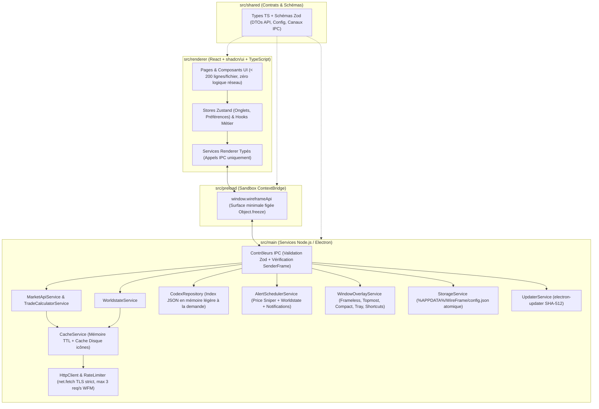

# Cahier des Charges Fonctionnel & Technique — WireFrame v2.0

- **Projet** : WireFrame v2 — Companion, Trading Browser & Codex pour Warframe
- **Auteur** : Maxime (`Nyxo_17`)
- **Stack Cible** : Electron · Node.js · React · `shadcn/ui` (Tailwind CSS + Radix UI) · TypeScript (`strict: true`) · Validation `zod`
- **Statut du document** : `VALIDÉ DÉFINITIF (CDC + 7 Planches Wireframes Excalidraw approuvés)`

---

## 1. Vision Produit & Objectifs de la v2.0

**WireFrame v2** est une application de bureau native Windows (extensible Linux/macOS) conçue pour accompagner les joueurs de **Warframe** sur leur écran principal ou en superposition (*Overlay*) par-dessus le jeu en mode *Plein écran sans bordure*.

Elle réunit **3 besoins métier complémentaires** dans une interface inspirée d'un navigateur multi-onglets ultra-réactif :
1. **Trading optimisé sur Warframe Market** : comparer plusieurs items en parallèle dans des onglets, calculer s'il vaut mieux acheter un Set complet ou ses pièces détachées, regrouper ses achats chez un même vendeur (*Trade Bundler*), surveiller les bonnes affaires en arrière-plan (*Price Sniper*), et générer les commandes `/w` en un clic.
2. **Suivi temps réel de l'univers Warframe (*Worldstate Hub*)** : consulter tous les cycles planétaires, Fissures, Invasions, rotations Teshin / Duviri, Baro Ki'Teer et Actualités officielles, directement enrichis avec la **valeur en Platinum en direct** des récompenses échangeables.
3. **Encyclopédie de Farm (*Codex & Helminth*)** : savoir instantanément où farmer n'importe quelle ressource, Warframe, arme, mod ou relique (missions, rotations, taux de drop en `%`), ses coûts de Fonderie et sa compétence de subsomption **Helminth**.

### Pourquoi la refonte v2 (Electron + React + TypeScript) ?
- **Zéro bricolage système ni serveur HTTP local** : plus aucun port TCP ouvert sur le PC (`127.0.0.1`), plus de dépendance C# / Python.
- **Vraie intégration bureau & jeu** : fenêtre sans bordure fusionnée à la barre d'onglets, mode *Always-on-Top* compatible plein écran sans bordure, raccourcis clavier globaux fonctionnant **sans quitter Warframe (`Alt+Tab` inutile)**, et fonctionnement silencieux dans le **System Tray** Windows.
- **Sécurité & Maintenabilité professionnelles** : isolation stricte Electron (`sandbox` + `contextIsolation`), TLS strict, validation des données d'API via `zod`, et composants React modulaires (`shadcn/ui`).

---

## 2. Ergonomie Globale & Paradigme de Navigation

### 2.1. En-tête épuré en 2 Barres (Style Navigateur Multi-Onglets)

Conformément au choix d'ergonomie retenu, toute la navigation tient dans **2 barres compactes** en haut de la fenêtre Electron (*Frameless*) :

1. **Barre 1 — Barre d'Onglets & Contrôles Fenêtre (`Title & Tabs Bar`, hauteur ~38 px)** :
   - **Bouton Hub Permanent (à gauche)** : onglet fixe non fermable portant le logo WireFrame, basculant instantanément sur le **Hub Temps Réel Warframe**.
   - **Liste d'onglets dynamiques** : chaque fiche d'item, recherche catalogue, page Codex, Panier ou profil joueur peut s'ouvrir dans un onglet dédié.
     - *Actions sur les onglets* : glisser-déposer horizontal pour réordonner, clic molette pour fermer, clic droit (menu contextuel : *Épingler `📌`, Dupliquer, Fermer les doublons, Fermer les autres, Fermer à droite*), bouton `+` (*Nouvel onglet*), et popover **Organisateur d'onglets** (filtrer les onglets ouverts, trier A→Z ou par catégorie, nettoyer les doublons).
   - **Zone de déplacement fenêtre (`app-region: drag`)** sur l'espace libre.
   - **Contrôles natifs de fenêtre Windows (à droite)** : Réduire (`_`), Agrandir/Restaurer (`□`), Fermer (`✕` — réduit dans le *System Tray* ou quitte selon le réglage utilisateur).

2. **Barre 2 — Barre d'Actions & Omnibox Unifiée (`Command & Nav Bar`, hauteur ~44 px)** :
   - **Navigation d'onglet** : boutons *Précédent*, *Suivant*, *Actualiser (`Ctrl+R`)*.
   - **Omnibox Intelligente Centrale (`Ctrl+K` ou `Ctrl+L`)** :
     - Remplace l'ancienne fausse barre `https://warframe.market/...` ET l'ancienne double barre de recherche.
     - Permet de chercher instantanément en **FR ou EN** un item du marché (~3 900+ entrées avec miniature), une entrée du **Codex** (ressource, relique, Warframe), ou une vue interne (`panier`, `baro`, `ducats`, `fissures`...).
     - *Compatibilité copier-coller* : si le joueur colle une vraie URL `https://warframe.market/items/nikana_prime_set`, l'Omnibox la reconnaît et ouvre directement la fiche correspondante.
     - Bouton **Étoile Favori (`Ctrl+D`)** intégré à droite de l'Omnibox lorsque l'onglet affiche un item.
   - **Accès Rapides Métier (avec compteurs en temps réel)** :
     - `Marché` · `Codex` · `Outils ▾` (*Ducanator*, *Contrats Rivens*, *Ordres Récents*, *Favoris*) · `Panier (n)` · `Alertes (n)`.
   - **Réglages Rapides & Overlay** :
     - Sélecteur compact **Plateforme / Crossplay / Langue** (`PC · Crossplay · FR`).
     - Bouton **Épingle Premier Plan (`Alt+P`)** + Bouton **Mode Compact (`Alt+M`)** + Bouton **Paramètres** (avec pastille si une mise à jour est prête).

### 2.2. Mode Desktop (`1440×900`) vs Mode Compact Adaptatif (`460×660`)

| Caractéristique | Mode Desktop Normal (défaut `1440×900`, min `1024×680`) | Mode Compact Overlay (`460×660`, min `380×520`) |
| :--- | :--- | :--- |
| **Usage cible** | Préparation de sessions de trade, comparaison multi-onglets, exploration Codex | Superposé dans un coin de l'écran pendant une mission ou au Dojo Warframe |
| **Always-on-Top** | Optionnel (`Alt+P`) | Activé automatiquement à l'entrée en mode Compact |
| **Barre 1 (Onglets)** | Onglets complets avec icône + titre | Onglets condensés (icône + titre court défilable) + bouton rapide *Agrandir* |
| **Barre 2 (Omnibox)** | Tous les raccourcis visibles sur une ligne | Omnibox prioritaire + menu compact `☰` regroupant les accès secondaires |
| **Grilles & Tableaux** | Multi-colonnes (ex: Vendeurs et Acheteurs côte à côte, grilles 3–4 colonnes) | Empilement vertical 1 colonne (Vendeurs en onglet prioritaire, cartes condensées, bouton `/w` toujours accessible en 1 clic) |
| **Mémorisation** | Mémorise sa taille et sa position d'écran exactes | Mémorise indépendamment sa propre position d'écran (ex: coin supérieur droit) |

### 2.3. Raccourcis Clavier

#### Raccourcis locaux (quand la fenêtre WireFrame a le focus)
- `Ctrl + T` : Ouvrir un nouvel onglet (Accueil Marché)
- `Ctrl + W` : Fermer l'onglet actif (sauf s'il est épinglé ou s'il s'agit du Hub)
- `Ctrl + Tab` / `Ctrl + Shift + Tab` : Onglet suivant / précédent
- `Ctrl + K` ou `Ctrl + L` : Focus sur l'Omnibox de recherche rapide
- `Ctrl + R` / `F5` : Rafraîchir les données temps réel de l'onglet actif (force le contournement du cache)
- `Ctrl + D` : Ajouter / retirer l'item courant des Favoris
- `Ctrl + +` / `Ctrl + -` / `Ctrl + 0` : Zoom natif Chromium (`50 %` à `200 %`, pas de `10 %`)

#### Raccourcis globaux système (actifs même quand Warframe est au premier plan — désactivables dans Paramètres)
- `Alt + Shift + W` : Afficher / Masquer instantanément la fenêtre WireFrame par-dessus le jeu
- `Alt + P` : Basculer l'épinglage *Toujours au premier plan* (*Always-on-Top*)
- `Alt + M` : Basculer entre le *Mode Desktop* et le *Mode Compact (`460×660`)*

---

## 3. Spécifications Fonctionnelles Détaillées par Module

### Module 1 — Composants Transverses (Whisper `/w`, System Tray & Persistance)

1. **Bandeau de commande d'échange (`WhisperBar`)** :
   - Déclenché au clic sur le bouton `Acheter (/w)` d'une offre ou d'un lot groupé du panier.
   - Copie immédiatement le message dans le presse-papiers système via l'API native Electron (`clipboard.writeText`).
   - Format standard respectant la convention Warframe Market :
     - **EN (par défaut)** : `/w <Pseudo> Hi! I want to buy: "<Item En>" (rank <X>) for <Prix> platinum. (warframe.market)`
     - **FR (bascule 1 clic)** : `/w <Pseudo> Bonjour ! Je voudrais acheter : "<Item Fr>" (rang <X>) pour <Prix> platinum. (warframe.market)`
2. **Vie en arrière-plan (`System Tray`)** :
   - Icône permanente près de l'horloge Windows avec menu contextuel : *Afficher / Masquer WireFrame*, *Basculer Mode Compact*, *Mettre en pause les sons d'alerte*, *Quitter complètement*.
   - Permet au *Price Sniper* et aux alertes Worldstate de continuer à tourner à consommation quasi nulle lorsque la fenêtre principale est fermée.
3. **Persistance locale fiable** :
   - Sauvegarde automatique dans `%APPDATA%\WireFrame\config.json` (validée par schéma `zod`, écriture atomique anti-corruption) : onglets ouverts, favoris, panier, alertes configurées, préférences audio, plateforme/langue, thème personnalisé et positions des fenêtres.

---

### Module 2 — Navigateur Warframe Market & Outils de Trading (10 Vues)

#### V1. Accueil Marché / Nouvel Onglet (`wf://market`)
- Barre de recherche centrale mise en avant, bandeau synthétique des **Actualités & Boosters actifs**, grille d'**Items populaires** (*Sets Prime, Arcanes, Mods Galvanisés/Accrus*) et aperçu des **Ordres Récents**.
- Encart discret d'aide rapide (accessible aussi via un bouton `? Guide`) remplaçant l'ancienne page Bienvenue séparée pour aller droit au but.

#### V2. Catalogue Complet (`wf://market/catalog`)
- Grille virtualisée (fluide même sur 3 900+ items) filtrable par recherche texte (FR/EN sans accents) et par tags/catégories (*Warframes Prime, Armes Prime, Mods, Arcanes, Reliques, Adaptateurs Incarnon, Syndicats, Empreintes*).

#### V3. Fiche Détail d'un Item (`wf://market/item/:slug`)
- **En-tête d'item** : miniature officielle, nom FR + nom EN, tags, taxe d'échange en Crédits, valeur en Ducats (si applicable), rang de maîtrise requis, lien rapide vers sa **fiche Codex de Farm** (si l'item est farmable !), et boutons d'action (*Favori*, *+ Panier*, *🎯 Créer Alerte Prix*).
- **Sous-onglet 1 — Ordres en Direct (`Vente` & `Achat`)** :
  - Filtres rapides : Statut joueur (**En jeu uniquement** par défaut, *En jeu + En ligne*, *Tous*), **Rang du Mod/Arcane** (*Tous*, *Rang 0*, *Rang Max*), **Quantité min**, **Réputation vendeur**.
  - Chaque ligne affiche : pseudo cliquable (vers profil), badge de statut, réputation, rang, quantité, prix unitaire en Platinum et bouton `/w` en 1 clic.
- **Encart automatique « Comparateur Set Complet vs Pièces Détachées »** *(affiché dès que l'item appartient à un Set de $\ge 2$ pièces)* :
  - Récupère le meilleur prix *En jeu* du **Set Complet** et le meilleur prix *En jeu* de **chaque pièce requise** (multiplié par le nombre d'exemplaires requis dans la recette, ex: *2× Lames* pour certaines armes doubles !).
  - Calcule :
    $$\Delta = \text{Prix}_{\text{Set Complet}} - \sum_{i} \left(\text{Qté}_i \times \text{Prix}_{\text{Pièce } i}\right)$$
  - Affiche clairement le verdict : **« Économisez X Plat en achetant les pièces séparément »** (ou **« +X Plat de marge potentielle en assemblant et revendant le Set »**).
- **Sous-onglet 2 — Statistiques du Marché (`48 dernières heures` & `90 derniers jours`)** :
  - Graphique interactif propre (prix médian, prix moyen pondéré, min/max et volume d'unités réellement vendues).

#### V4. Panier Multi-Achats & Regroupeur de Vendeurs (`wf://market/cart`)
- Gestion d'une liste d'achats (ajout d'items avec choix de la **quantité** et du **rang souhaité**, suppression, vidage).
- **Calculateur budgétaire automatique** :
  - Coût estimé en **Platinum** basé sur les meilleures offres *En jeu* actuelles.
  - Calcul de la **Taxe d'échange en Crédits** totale à prévoir en jeu.
- **Algorithme *Trade Bundler* (Détecteur de Vendeurs Multi-Items)** :
  - Analyse les meilleures offres *En jeu* de chaque article du panier et identifie tous les vendeurs possédant **au moins 2 articles distincts du panier simultanément**.
  - Affiche pour chaque vendeur groupé : la liste des articles disponibles chez lui, son prix total comparé à l'achat séparé optimal, le nombre d'allers-retours Dojo économisés, et un bouton **`/w` Groupé** listant tous les items dans un seul message.

#### V5. Favoris Marché (`wf://market/favorites`)
- Tableau de bord des items mis en favoris avec actualisation groupée de leur **prix minimum *En jeu***, tendance rapide et accès en 1 clic au `/w` ou à la fiche détail.

#### V6. Ducanator (`wf://market/ducats`)
- Analyse les données horaires de Warframe Market (`/v1/tools/ducats`) pour classer les pièces Prime selon :
  - Ratio **`Ducats / Platinum`** (pour acheter de la "Prime Junk" au meilleur taux avant Baro Ki'Teer),
  - Ratio inverse **`Plat / 100 Ducats`** (pour savoir quelles pièces revendre contre du Platinum plutôt que de les fondre en Ducats),
  - Filtre de **volume minimal vendu** (pour écarter les items rares jamais échangés).

#### V7. Contrats — Enchères de Mods Riven (`wf://market/rivens`)
- Sélecteur d'arme avec autocomplétion + filtres (polarité, rang de maîtrise, nombre max de relances, tri par prix croissant).
- Cartes Riven lisibles : attributs positifs en vert, malus en rouge, prix d'achat direct (*Buyout*) ou enchère en cours, statut du vendeur et bouton `/w`.

#### V8. Ordres Récents (`wf://market/recent`) & V9. Profil Joueur (`wf://market/user/:slug`)
- **Ordres Récents** : flux des dernières offres publiées sur la plateforme sélectionnée.
- **Profil Joueur** : en-tête joueur (avatar, statut en jeu, réputation) et séparation claire de toutes ses offres actives (*Il vend* / *Il achète*).

---

### Module 3 — Centre d'Alertes : *Price Sniper* & Alertes Worldstate (`wf://alerts`)

Contrairement à la `v1` où les timers vivaient dans la page web, l'orchestrateur (`AlertSchedulerService`) tourne dans le **Main Process Node.js** :
1. **Price Sniper (Surveillance de prix par item)** :
   - L'utilisateur définit un item, un rang optionnel, et un **prix plafond en Platinum** (ex: *Arcane Énergétique $\le 450$p*).
   - Scan périodique paramétrable (`15s` à `3600s`, défaut `30s`) respectant strictement le limiteur de débit global de l'API.
   - Dès qu'une offre de vente *En jeu* passe sous le seuil : **Toast interactif** dans l'application (avec bouton `/w` immédiat) + **Notification Windows native** (si fenêtre réduite/arrière-plan) + **Alerte sonore**.
2. **Alertes Sonores d'Événements Warframe (11 déclencheurs activables individuellement)** :
   - *Cycles* : Nuit sur Cetus, Pré-alerte 5 min avant la Nuit sur Cetus (chasse Eidolon), Vallée Orbis Chaude, Deimos Vome.
   - *Missions & Marchands* : Arrivée de Baro Ki'Teer, Fissure Rapide (Capture/Extermination...), Fissure Omnia Route de l'Acier, Invasion Rare (Catalyseur / Réacteur / Forma / Exilus), Invasion d'arme Wraith/Vandal, Semaine Forma Umbra chez Teshin, Arbitrage S-Tier.
3. **Paramètres Audio** : activation/coupure rapide du son, choix entre les sonneries embarquées (`Classique` et `Cloche / Bell`), curseur de volume (`0 %`–`100 %`), bouton *Tester*, et option de répétition tant que l'offre reste disponible.

---

### Module 4 — Hub Temps Réel « WireFrame Info » (`wf://hub`)

Accessible à tout moment depuis l'onglet fixe en haut à gauche, structuré en **6 sous-vues** avec compteurs calculés chaque seconde côté client et resynchronisés périodiquement :

1. **H1. Planètes & Mises à Prix** : cartes visuelles temps réel pour **Cetus / Terre**, **Vallée Orbis (Fortuna)**, **Puy de Cambion (Deimos)**, **Duviri** (5 spirales d'humeur) et **Zariman Ten Zero** (occupant Corpus/Grineer), suivies des **Mises à Prix** actives (*Ostrons*, *Union Solaris*, *Entrati*) et de leurs tables de récompenses.
2. **H2. Fissures & Missions** : toutes les **Fissures du Néant** actives (Normal, Route de l'Acier, Tempêtes Railjack, Omnia) filtrables par ère (*Lith, Meso, Neo, Axi, Requiem, Omnia*) et par toggle **`⚡ Missions Rapides uniquement`**, accompagnées de la **Chasse à l'Archonte** hebdomadaire et de la **Sortie** quotidienne.
3. **H3. Invasions, Acier & Nightwave** :
   - **Invasions** : barres d'avancement des factions et bouton **`Prix Plat ↗`** direct sur les pièces d'armes Wraith/Vandal échangeables.
   - **Honneurs de la Route de l'Acier (Teshin)** : récompense de la semaine en cours + calendrier des 8 semaines + boutique permanente (*Evergreens*).
   - **Arbitrage en direct** + catalogue rapide des **Mods Galvanisés / Arbitrage** pour vérifier lequel est le plus rentable à acheter en Essence Vitus pour le revendre en Platinum.
   - **Alertes du Lotus**, **Événements spéciaux** et **Défis Nightwave (Ondes Nocturnes)** journaliers/hebdomadaires.
4. **H4. Circuit de Duviri** : rotation hebdomadaire active (**3 Warframes** en Normal + **5 Adaptateurs Incarnon Genesis** en Route de l'Acier) + calendrier complet des 9 semaines.
5. **H5. Marchand du Néant Baro Ki'Teer** : compte à rebours d'arrivée/départ, relais, inventaire complet (coût Ducats + Crédits) croisé automatiquement avec le **prix Platinum en direct** sur Warframe Market et le score de rentabilité **`Plat / 100 Ducats`**.
6. **H6. Actualités (News), Boosters & Offre de Darvo** : actualités officielles filtrables par catégorie, **Boosters globaux serveur** en cours, **Offre quotidienne de Darvo** (remise, stock restant, compte à rebours) et liens directs vers les sets de **Résurgence Prime**.

---

### Module 5 — Encyclopédie « Codex, Farm & Helminth » (`wf://codex`)

1. **Explorateur Codex (`wf://codex`)** : navigation par onglets de catégories (**Ressources Farmables**, **Warframes**, **Armes**, **Mods**, **Reliques**) avec recherche instantanée et filtres (Prime / Standard, rareté, ère de relique).
2. **Fiche Détail Codex (`wf://codex/:category/:id`)** :
   - **Où le farmer** : tableau trié par meilleur **taux de drop (`%`)** indiquant planète, nœud de mission, type, rotation (`A / B / C`) ou ennemi/relique source.
   - **Recettes de Fonderie** : composants requis, quantités, crédits et temps de fabrication (avec liens cliquables vers chaque ressource).
   - **Passerelle Marché** : si l'élément est échangeable (ex: partie Prime, Mod, Relique), bouton direct vers sa fiche **Warframe Market** pour comparer le temps de farm à son prix en Platinum.
   - **Infirmerie Helminth** : sur chaque Warframe standard, encart indiquant la **compétence donnée par subsomption au Helminth** + fiche dédiée **Helminth** répertoriant ses compétences exclusives et sécrétions.

---

### Module 6 — Personnalisation Visuelle (`shadcn/ui`) & Mises à Jour

1. **Moteur de Thèmes Bicolores sur variables CSS `shadcn/ui`** :
   - **Thèmes prédéfinis** (*Orokin Dark*, *Tenno Light*, *Lotus Amethyst*, *Prime Gold*, *Kuva Crimson*, *Corpus Matrix*...).
   - **Personnalisateur libre Bicolore** : choix indépendant de la **Couleur Principale** (surfaces, fond, barres) et de la **Couleur Secondaire** (accents, anneaux de focus, badges, boutons primaires) + activation/désactivation de l'effet de **Glow**.
   - Génération automatique des nuances accessibles (contraste texte lisible garanti) injectées proprement en variables CSS racine (`--background`, `--card`, `--border`, `--primary`, `--accent`, `--ring`).
2. **Système de Mise à Jour Natif Sécurisé (`electron-updater`)** :
   - Vérification automatique au lancement (puis toutes les 30 min) auprès des **GitHub Releases officielles** avec vérification cryptographique d'intégrité **SHA-512** (`latest.yml`).
   - Téléchargement différentiel en arrière-plan (*blockmap*) et modale **« Quoi de neuf ? (Notes de Patch) »** affichée après mise à jour.

---

### Module 7 — Extension v2.5 : Alertes Worldstate Personnalisées & Minuteurs en Mode Compact

> **Statut : VALIDÉ par Maxime le 12/11/2026** (section + planche `09-hub-alerts-compact-timers.excalidraw`). Implémentation sur la branche `feat/worldstate-custom-alerts`.

**Constat de départ (v2.4.0)** : le Module 3 propose déjà **11 alertes Worldstate figées** (cases à cocher `WorldAlertToggles`, évaluées dans `worldstate-alerts-evaluator.ts`). Elles ne couvrent que des cas prédéfinis : impossible par exemple d'être prévenu pour « *une fissure Axi Survie en Route de l'Acier* » ou « *une invasion qui donne un Catalyseur Orokin* » seulement. De plus, en Mode Compact, il faut ouvrir le Hub pour connaître l'état des cycles.

#### 7.A — Moteur d'Alertes Worldstate Personnalisées (`wf://alerts`, onglet *Worldstate*)

**Objectif joueur** : définir ses propres règles (« *préviens-moi quand…* ») et être notifié une seule fois par occurrence, même quand WireFrame est réduit dans le System Tray.

1. **Conservation des 11 alertes existantes** : elles restent affichées en tête sous le titre *Alertes rapides* (aucune migration destructive des paramètres actuels).
2. **Règles personnalisées** (maximum **30** règles) créées via un formulaire en 3 étapes : *Source → Conditions → Notification*.

| Source | Conditions disponibles (toutes optionnelles sauf mention) |
| :--- | :--- |
| **Fissure du Néant** | Ères (multi : Lith, Meso, Neo, Axi, Requiem, Omnia) · Types de mission (multi : Survie, Défense, Capture, Extermination…) · Mode (*Normal*, *Route de l'Acier*, *Tempête du Néant*) · Faction · « Missions rapides uniquement » |
| **Invasion** | Catégorie de récompense (multi : Catalyseur Orokin, Réacteur Orokin, Forma, Adaptateur Exilus, Pièce d'arme Wraith/Vandal) **ou** texte libre « la récompense contient… » (FR/EN) |
| **Arbitrage** | Types de mission (multi) · Faction · « S-Tier uniquement » (l'API publique n'expose que le drapeau S-Tier, pas de palier A) |
| **Cycle** *(obligatoire : lieu + état)* | Lieu (Cetus, Vallée Orbis, Puy de Cambion, Zariman) · État ciblé (Nuit, Chaud, Vome, Corpus…) · Pré-alerte de `0` à `30` min avant le début de l'état |
| **Baro Ki'Teer** | Arrivée · Pré-alerte de `1` à `48` h avant l'arrivée · Article présent dans l'inventaire (texte libre FR/EN) |
| **Sortie** | Faction · Boss · Type de mission présent dans l'une des 3 étapes (multi) · Modificateur contenant… (texte libre, ex. *« Éclipse »*) |
| **Chasse à l'Archonte** | Archonte ciblé (multi : *Amar* → Fragment Écarlate, *Nira* → Fragment Ambre, *Boréal* → Fragment Azur) · Type de mission présent dans l'une des étapes (multi) |
| **Mises à prix** | Syndicat (multi : Ostrons, Union Solaris, Entrati) · Récompense possible contenant… (texte libre, ex. *« Arcane »*) · Niveau minimum de la mise à prix |
| **Nightwave (Ondes Nocturnes)** | Type (*Quotidien*, *Hebdomadaire*, *Élite*) · Réputation minimum · Intitulé contenant… (texte libre) |

3. **Aperçu en direct** : bouton **« Tester avec le Worldstate actuel »** dans le formulaire, qui affiche immédiatement le nombre d'occurrences correspondantes en ce moment (ex. *« 2 fissures correspondent : Axi Survie — Mot (Néant)… »*). Le joueur valide ainsi sa règle sans attendre.
4. **Notification** (par règle) : *Toast dans l'application* (toujours actif) · *Notification Windows native* (on/off) · *Son* (on/off, réglages audio globaux du Module 3). Le toast contient un bouton **« Voir dans le Hub »** qui ouvre la sous-vue concernée (et **`Prix Plat ↗`** si la récompense est échangeable).
5. **Anti-spam (déduplication)** : une règle ne se déclenche qu'**une seule fois par occurrence**. La clé d'occurrence est `ruleId + identifiant Worldstate` (id de fissure, invasion, sortie, mise à prix ou défi Nightwave ; date d'expiration pour cycles, Arbitrage et Baro). Les clés expirées sont purgées automatiquement.
6. **Historique des alertes (session uniquement)** : les **50 dernières** alertes déclenchées (Price Sniper + Worldstate) depuis le lancement de WireFrame, conservées **en mémoire seulement** (vidées à la fermeture), avec date, règle d'origine et bouton *Voir*. Bouton *Effacer l'historique*.
7. **Gestion des règles** : liste avec interrupteur on/off, *Dupliquer*, *Modifier*, *Supprimer* (avec confirmation), nom généré automatiquement et modifiable (ex. *« Fissure Axi · Survie · Acier »*).

**Sources de données & rafraîchissement** : aucune nouvelle API. Les règles sont évaluées sur le Worldstate déjà récupéré par `WorldstateService` (`api.warframestat.us`), au même rythme que le scan existant de l'`AlertSchedulerService` (minimum `15 s`), en réutilisant le cache et le limiteur de débit global. **Aucune requête supplémentaire par règle.**

**Règles de gestion & sécurité** :
- Les champs texte libre sont limités à `60` caractères et comparés par **inclusion insensible à la casse et aux accents** (normalisation Unicode). **Aucune expression régulière saisie par l'utilisateur** n'est exécutée (protection contre le *ReDoS*, une attaque où une regex piégée bloque le processeur).
- Chaque règle est validée par un schéma `zod` (`WorldAlertRuleSchema`, union discriminée par `source`) à la sauvegarde **côté Main** ; une règle invalide est refusée avec un message explicite.
- L'évaluation tourne exclusivement dans le **Main Process** (le Renderer ne fait qu'afficher).

**Contrats IPC prévus (`src/shared/`)** :
- Persistance via le canal existant `settings:update` → nouveau champ `alerts.worldRules: WorldAlertRule[]` (défaut `[]`).
- `alerts:world-rule-preview` (*invoke*) : reçoit une règle, la valide (`zod`), renvoie la liste des occurrences correspondantes du Worldstate en cache.
- `alerts:history-get` / `alerts:history-clear` (*invoke*) : lecture et purge de l'historique.
- Événement existant `alerts:on-triggered` enrichi de `ruleId?` et `hubRoute?` (sous-vue cible du bouton *Voir*).

#### 7.B — Widget « Minuteurs » en Mode Compact Overlay (`460×660`)

**Objectif joueur** : voir d'un coup d'œil, par-dessus Warframe, les cycles et minuteurs importants sans ouvrir le Hub.

1. **Emplacement** : bandeau fin repliable (hauteur ≈ `32 px`) placé **en bas de la fenêtre, juste au-dessus de la barre de statut** (et sous le bandeau `/w` quand celui-ci est affiché), visible uniquement en Mode Compact (option *« Afficher aussi en mode Desktop »*, désactivée par défaut — en Desktop, le bouton Discord flottant se décale au-dessus du bandeau).
2. **Contenu** : jusqu'à **6 minuteurs épinglés** sous forme de pastilles `icône + état coloré + compte à rebours` (ex. `🌙 Cetus · Nuit · 12m 04s`). Les pastilles qui ne tiennent pas en largeur sont accessibles par **défilement horizontal** (molette ou glisser), avec un léger dégradé sur les bords pour signaler la suite.
3. **Minuteurs disponibles** : Cetus (Jour/Nuit) · Vallée Orbis (Chaud/Froid) · Puy de Cambion (Fass/Vome) · Zariman (Corpus/Grineer) · Humeur de Duviri · Baro Ki'Teer (arrivée/départ) · Arbitrage (fin de l'heure) · Sortie & Chasse à l'Archonte (réinitialisation) · Réinitialisation quotidienne (`00:00 UTC`). **Défaut** : Cetus, Vallée Orbis, Puy de Cambion, Baro.
4. **Interactions** : clic sur une pastille → ouvre la sous-vue correspondante du Hub. Bouton `⚙` en bout de bandeau → popover de choix et d'ordre des minuteurs (réordonnancement par boutons `↑`/`↓`, accessibles au clavier). Bouton `˄/˅` → replier/déplier (état mémorisé).
5. **Calcul** : comptes à rebours recalculés chaque seconde côté Renderer à partir des dates d'expiration (`hub-countdown.ts` existant), resynchronisés à chaque rafraîchissement du Worldstate. Une fois l'expiration dépassée, la pastille affiche *« Rotation… »* jusqu'à la donnée suivante.
6. **4 états UI** : *Chargement* (pastilles Skeleton) · *Vide* (aucun minuteur épinglé → bouton *« Épingler des minuteurs »*) · *Nominal* · *Erreur / Données périmées* (Worldstate non rafraîchi depuis plus de `5 min` → pastilles grisées + icône hors-ligne + dernier compte à rebours connu).

**Paramètres persistés** : `appearance.compactTimers = { enabled: true, showOnDesktop: false, collapsed: false, pinned: TimerKey[] (max 6) }`, validé par `zod`.

#### 7.C — Hors périmètre de cette extension (proposé pour plus tard)

- Plages horaires silencieuses (« ne pas déranger »).
- Envoi des alertes vers Discord ou le téléphone.
- Conservation de l'historique des alertes entre deux lancements.

#### 7.D — Décisions validées par Maxime (12/11/2026)

| # | Question | Décision |
| :--- | :--- | :--- |
| D1 | Position du bandeau Minuteurs en Compact | **En bas, juste au-dessus de la barre de statut** |
| D2 | Nombre maximum de minuteurs épinglés | **6**, avec défilement horizontal |
| D3 | Historique des alertes conservé après redémarrage | **Non** — session uniquement |
| D4 | Sources des règles personnalisées en v2.5 | **Toutes** : Fissure, Invasion, Arbitrage, Cycle, Baro, Sortie, Chasse à l'Archonte, Mises à prix, Nightwave |

---

### Module 8 — Extension v2.5 : Notifications In-App, Centre de Notifications & Animations

> **Statut : VALIDÉ par Maxime le 12/11/2026** (section + planche `10-notifications-animations.excalidraw`). Implémentation sur la branche `feat/notifications-animations`.

**Choix exprimés par Maxime (12/11/2026)** :
- **A1** : Notifications in-app pour les actions de l'application (*« Copié ! »*, *« Ajouté aux favoris »*, *« Ajouté au panier »*, erreurs réseau, mise à jour disponible…) **+** Centre de notifications sous la cloche 🔔 avec historique de session.
- **A2** : Affichage **en bas à droite, empilées au-dessus du bouton Discord** (qui reste visible).
- **A3** : Animations sur **les 6 catégories** de l'interface (changement de page/onglet, cartes & listes en cascade, micro-interactions survol/clic, fenêtres/menus/popovers, notifications/toasts, barre d'onglets & raccourcis).
- **A4** : Réglage à **3 niveaux** (*Complètes / Réduites / Désactivées*) + respect automatique du réglage Windows *« Afficher les animations »*.

#### 8.A — Notifications in-app (« Toasts » empilés)

**Objectif joueur** : recevoir un retour visuel immédiat, élégant et non bloquant à chaque action clé ou événement d'arrière-plan, avec possibilité de déclencher un aperçu à tout moment depuis les Paramètres.

1. **5 types visuels** :

| Type | Couleur / icône | Durée d'affichage | Exemples |
| :--- | :--- | :--- | :--- |
| **Succès** | Émeraude · `✓` | `4 s` | Favori ajouté/retiré, ajout au panier, règle enregistrée, paramètres exportés/importés |
| **Info** | Accent (`--primary`) · `ℹ` | `4 s` | Commande `/w` ou lien copié, cache vidé, mise à jour disponible, notification de test |
| **Avertissement** | Ambre · `⚠` | `6 s` | Limite de règles atteinte, données Worldstate périmées |
| **Erreur** | Rouge (`--destructive`) · `✕` | `8 s` | Échec réseau / IPC, échec d'import ou de sauvegarde des réglages |
| **Alerte** | Bordure accent · `🔔` | Jusqu'à fermeture | *Price Sniper* et règles *Worldstate* (unifie et remplace `AlertToastBanner`, en conservant les boutons `Copier /w`, `Voir dans le Hub` et `Prix Plat`) |

2. **Pile & positionnement** :
   - En **Desktop (`1440×900`)** : jusqu'à **3 notifications visibles** simultanément en bas à droite (`right-4`), la plus récente en bas, placées **au-dessus du bouton Discord flottant** (et au-dessus du bandeau `/w` ou Minuteurs s'ils sont affichés) afin qu'aucun élément ne se chevauche. Au-delà de 3, un badge **« +N en attente »** indique la file d'attente qui se dépile automatiquement.
   - En **Mode Compact (`460×660`)** : **1 seule notification visible** à la fois, pleine largeur (moins les marges), juste au-dessus du bandeau Minuteurs.
3. **Interactions** : bouton `✕` de fermeture manuelle · **survol souris = mise en pause du compte à rebours** (avec fine barre de progression en bas de la carte) · boutons d'action contextuels optionnels (*Ouvrir le panier*, *Voir dans le Hub*, *Copier /w*, *Prix Plat*).
4. **Anti-spam (fusion des doublons rapides)** : si une notification de même type et même titre est émise moins de **2 secondes** après la précédente, elle ne crée pas de doublon mais incrémente un badge `×2`, `×3` et réinitialise sa barre de durée.
5. **Catalogue des déclencheurs** :
   - Favoris (ajout / retrait), Panier (ajout / retrait / vidage), Règles *Price Sniper* & *Worldstate* (création / modification / duplication / suppression).
   - Presse-papiers (copie commande `/w`, copie de lien).
   - Paramètres & Système (export JSON, import JSON, réinitialisation, purge du cache, mise à jour détectée / prête à installer, bouton **« Tester une notification »**).
   - Erreurs réseau / IPC remontées par les stores.

#### 8.B — Centre de Notifications (cloche 🔔 de la barre de navigation)

1. Le clic sur l'icône 🔔 de `CommandNavBar` ouvre un **Popover « Centre de notifications »** listant les **50 dernières notifications de la session** (actions + alertes *Price Sniper* / *Worldstate*), de la plus récente à la plus ancienne, avec horodatage, icône colorée et bouton d'action rapide éventuel.
2. **Badge de non-lus** : pastille sur la cloche 🔔 indiquant le nombre de notifications non lues (remis à `0` à l'ouverture du popover). Le rappel du nombre de règles actives (*Price Sniper* + *Worldstate*) est affiché dans l'en-tête du popover avec un bouton direct **« Ouvrir le Centre d'Alertes (`wf://alerts`) »**.
3. **Actions du popover** : *Tout marquer comme lu* · *Effacer tout* · accès rapide aux réglages de notifications.
4. **Les 4 états UI obligatoires** :
   - *Chargement* : lignes `Skeleton` lors de l'hydratation initiale.
   - *Vide* : icône + message *« Aucune notification pendant cette session »* + raccourci vers `wf://alerts`.
   - *Nominal* : liste défilante horodatée avec distinction visuelle des éléments non lus.
   - *Erreur* : notifications d'échec réseau/IPC mises en évidence avec bordure/fond teinté rouge et action *Réessayer* si applicable.
5. **Cycle de vie** : historique conservé **en mémoire uniquement** pour la session en cours (cohérent avec la décision D3 du Module 7).

**Paramètres associés** (*Paramètres → Audio & Alertes*) :
- Interrupteur **« Notifications visuelles d'actions (Succès & Info) »** (activé par défaut ; les *Erreurs* et les *Alertes* restent toujours actives).
- Bouton **« Tester une notification »** permettant de faire apparaître immédiatement une notification de démonstration (visuelle + son si activé).

#### 8.C — Système Global d'Animations & Désactivation dans les Paramètres

**Objectif joueur** : rendre chaque interaction fluide, réactive et moderne à 60 FPS+, tout en permettant de réduire ou couper instantanément toutes les animations dans les Paramètres (ou automatiquement selon Windows).

| Catégorie | Niveau **Complètes** *(défaut)* | Niveau **Réduites** | Niveau **Désactivées** |
| :--- | :--- | :--- | :--- |
| **1. Changement de page / d'onglet** | Fondu + léger glissement vertical `8 px` (`180 ms`) | Fondu simple (`120 ms`, sans déplacement) | Instantané (`0 ms`) |
| **2. Cartes & listes** | Apparition en cascade (`25 ms` de décalage par carte, plafonné aux **12 premiers éléments**) | Fondu global uniforme sans cascade | Instantané (`0 ms`) |
| **3. Micro-interactions (survol & clic)** | Boutons : léger enfoncement `scale(0.97)` au clic · Cartes interactives : élévation `-2 px` au survol | Changement de couleur/bordure uniquement | Changement d'état instantané |
| **4. Fenêtres, menus & popovers** | Ouverture/fermeture `scale(0.96 → 1)` + fondu (`150 ms`) sur `Dialog`, `Popover`, `Omnibox` | Fondu simple (`110 ms`) | Instantané (`0 ms`) |
| **5. Notifications (toasts)** | Glissement fluide depuis la droite à l'entrée et vers la droite à la sortie (`200 ms`) | Fondu simple entrée/sortie | Apparition/retrait immédiats |
| **6. Barre d'onglets & raccourcis** | Apparition nouvel onglet en fondu + échelle · surbrillance glissante · soulignement animé des raccourcis | Fondu simple | Instantané (`0 ms`) |

**Réglages dans `Paramètres → Apparence & Thèmes`** :
- Sélecteur segmenté à **3 niveaux** : **`Complètes`** (défaut) · **`Réduites`** · **`Désactivées`**.
- Interrupteur **« Respecter le réglage Windows ( Mouvements réduits ) »** (`respectOsReducedMotion`, activé par défaut) : si Windows signale `prefers-reduced-motion: reduce` et que le niveau choisi est *Complètes*, WireFrame plafonne automatiquement le rendu effectif à **Réduites** (si l'utilisateur a choisi *Désactivées*, tout reste coupé).
- L'interrupteur existant *« Animation d'ouverture Wire au lancement »* reste indépendant (mais respecte aussi le mode *Désactivées* sauf clic manuel sur *Rejouer*).

**Architecture CSS, Performance & Contrats `zod`** :
- Pilotage centralisé dans `applyThemeToDocument` via un attribut racine **`data-motion="full" | "reduced" | "off"`** sur `<html>` (+ écoute temps réel de `window.matchMedia('(prefers-reduced-motion: reduce)')`).
- **100 % CSS accéléré GPU** : seules `transform` et `opacity` sont animées (`120–220 ms`, `cubic-bezier(0.22, 1, 0.36, 1)`), garantissant zéro *layout thrashing*. En mode `data-motion="off"`, toutes les animations et transitions décoratives sont forcées à `0ms` tandis que les **spinners d'activité réseau (`animate-spin` de chargement)** sont préservés pour indiquer que l'application travaille.
- **Schéma `zod` (`src/shared/schemas/settings.schema.ts`)** :
  - `appearance.animationLevel: z.enum(['full', 'reduced', 'off']).default('full')`
  - `appearance.respectOsReducedMotion: z.boolean().default(true)`
  - `audio.actionNotificationsEnabled: z.boolean().default(true)`
- **Aucun nouveau canal IPC requis** : persistance atomique via `settings:update` existant ; orchestration des notifications côté Renderer dans `useNotificationStore` alimenté par les stores et `alerts:on-triggered`.
- **Sécurité** : rendu strictement en nœuds texte React (aucun HTML brut), troncature défensive des chaînes (`title` ≤ 80 car., `message` ≤ 220 car.).

#### 8.D — Hors périmètre (proposé pour plus tard)

- Persistance sur disque de l'historique des notifications entre deux sessions.
- Personnalisation individuelle des durées par type de toast ou positionnement libre aux 4 coins.

### Module 9 — Dégradés de Fond d'Écran de l'Application (`Paramètres → Apparence & Thèmes`)

**Objectif joueur** : permettre de personnaliser l'atmosphère visuelle globale de WireFrame avec des **dégradés de fond d'écran Sci-Fi élégants** (compatibles avec les 20 thèmes bicolores prédéfinis, le mode `Full Black` OLED, les thèmes clairs et les couleurs libres), tout en préservant une lisibilité irréprochable des prix Platinum, minuteries Worldstate et fiches Codex en Desktop (`1440×900`) comme en Mode Compact (`460×660`).

#### 9.A — Galerie des 8 Styles de Dégradés (`BackgroundGradientStyle`)

Accessible directement dans `Paramètres → Apparence & Thèmes` sous la section **« 🌈 Dégradé de Fond d'Écran »** :
1. `none` — **Uni (Aucun dégradé)** : fond plat classique du thème actif.
2. `aurora-top` — **Halo Boréal Supérieur** : lueur radiale diffuse tombant depuis le sommet de la fenêtre (effet verrière d'Orbiteur).
3. `diagonal` — **Diagonale Dynamique** : dégradé linéaire incliné traversant l'application du coin supérieur gauche vers le coin inférieur droit (angle ajustable).
4. `dual-corners` — **Double Énergie (Coins opposés)** : deux halos radiaux complémentaires placés en haut à gauche et en bas à droite.
5. `radial-center` — **Noyau du Néant (Radial centré)** : lueur centrale douce derrière l'espace de travail avec vignettage naturel en périphérie.
6. `horizon-bottom` — **Horizon Planétaire (Bas → Haut)** : halo montant depuis la barre d'état inférieure vers le centre de l'écran.
7. `mesh-nebula` — **Nébuleuse Mesh (Multi-points)** : composition organique à 3 sources lumineuses asymétriques (esprit Empyréen / Railjack).
8. `vertical-split` — **Zénith Linéaire** : transition linéaire douce sur l'axe vertical (ou selon l'angle choisi).

#### 9.B — Personnalisation Fine (Couleur Auto vs Dédiée, Intensité & Angle)

1. **Mode de couleur du dégradé (`colorMode: 'theme-accent' | 'custom'`)** :
   - **`Auto (Accent du thème)`** *(défaut)* : utilise automatiquement la couleur secondaire d'accent du thème actif (`secondaryColor`, ex. Cyan `#26b9d1`, Or Orokin `#eab308`, Violet Lotus `#a855f7`). Changer de thème met instantanément le dégradé en harmonie.
   - **`Couleur dédiée personnalisée`** : active deux sélecteurs `ColorSwatchPicker` (ou teinte principale + teinte secondaire de dégradé `customPrimaryHex` / `customSecondaryHex`) permettant par exemple d'avoir des boutons Cyan sur un fond en dégradé Violet/Bleu Nuit !
2. **Curseur d'Intensité (`intensityPercent` : `5 %` à `65 %`, défaut `26 %`)** :
   - Contrôle l'opacité du calque de dégradé arrière-plan en temps réel, plafonné à `65 %` pour garantir un contraste WCAG lisible sur les tableaux et textes en thème sombre comme en thème clair.
3. **Curseur d'Angle (`angleDeg` : `0°` à `360°`, pas de `15°`, défaut `135°`)** :
   - Actif pour les styles orientables (`diagonal`, `vertical-split`) avec boutons d'angles rapides (`45°`, `90°`, `135°`, `180°`, `225°`, `315°`).
4. **Aperçu visuel en direct sur chaque vignette de style + Bouton `Réinitialiser le dégradé`**.

#### 9.C — Architecture CSS, Contrats `zod` & Zéro Coût GPU

- **Rendu CSS pur sans `canvas` ni boucle JS** :
  - `applyThemeToDocument()` dans `src/renderer/src/lib/theme-engine.ts` calcule la valeur CSS sécurisée `--wf-app-gradient` à partir de chaînes HSL/RGB contrôlées (aucune concaténation arbitraire non validée) et l'applique sur un calque d'arrière-plan fixe `pointer-events-none` dans `App.tsx`, tandis que les surfaces `card` / barres conservent un léger voile translucide (`backdrop` / alpha contrôlé) laissant transparaître subtilement le dégradé.
- **Contrat `zod` dans `src/shared/schemas/settings.schema.ts` (`appearance.backgroundGradient`)** :
  - `style: BackgroundGradientStyleSchema.default('none')`
  - `colorMode: z.enum(['theme-accent', 'custom']).default('theme-accent')`
  - `customColorHex: HexColorSchema.default('#7c3aed')`
  - `customSecondaryHex: HexColorSchema.default('#06b6d4')`
  - `intensityPercent: z.number().int().min(5).max(65).default(26)`
  - `angleDeg: z.number().int().min(0).max(360).default(135)`
- **Aucun nouveau canal IPC requis** : persistance atomique via `settings:update` existant (`StorageService.updateSettings` fusionnant `appearance.backgroundGradient`).

---

## 4. Architecture Technique, Contrats IPC & Sécurité

### 4.1. Séparation Stricte des Couches (Clean Architecture sans serveur HTTP)

### 4.2. Politique Réseau, Cache & Protection Anti-Ban API

L'API officielle `api.warframe.market` impose une limite stricte de **3 requêtes par seconde**. Pour garantir zéro erreur `429 Too Many Requests` (même lors d'un scan *Panier Bundler* ou *Baro Ki'Teer* sur 25 items) :
- **File d'attente centralisée (*Token Bucket Rate Limiter*)** dans `src/main/infrastructure/http/` plafonnée à **3 req/s** avec déduplication des requêtes identiques en vol (*in-flight request coalescing*).
- **Durées de cache (TTL) côté Main Process** :
  - Catalogue complet `/v2/items` : **1 heure** (+ cache disque de secours pour démarrage instantané).
  - Détail d'item & composition de Set : **15 minutes**.
  - Statistiques 48h/90j & Ducats : **5 minutes**.
  - Ordres en direct (`/v2/orders/item/:slug`) : **20 secondes** (contournable via `forceRefresh` sur `Ctrl+R`).
  - Worldstate Warframe (`api.warframestat.us`) : **45 secondes**.
  - Miniatures & icônes d'items : **Cache disque local** dans `app.getPath('sessionData')/asset-cache` (**7 jours**) servi via un protocole interne sécurisé `wf-asset://` en lecture seule (aucun serveur HTTP ouvert).

### 4.3. Contrats des Canaux IPC (`src/shared/ipc-channels.ts`)

Tous les paramètres d'entrée et toutes les réponses API passent par une validation `zod` :

| Domaine | Canaux IPC (`invoke` / événements `on`) | Responsabilité |
| :--- | :--- | :--- |
| **`market`** | `market:getCatalog`, `market:getItemDetail`, `market:getItemOrders`, `market:getItemStats`, `market:getRecentOrders`, `market:getUserProfile`, `market:getDucats`, `market:searchRivens`, `market:analyzeSetVsParts`, `market:analyzeCartBundles` | Données Warframe Market et calculs métier lourds |
| **`worldstate`** | `worldstate:getCurrent`, `worldstate:getBaroWithPrices` | État du monde Warframe et enrichissement Platinum de Baro |
| **`codex`** | `codex:search`, `codex:getItemDetail`, `codex:getHelminthData` | Requêtes rapides paginées dans la base Codex locale sans charger 5 Mo dans chaque onglet React |
| **`alerts`** | `alerts:list`, `alerts:upsertPriceAlert`, `alerts:deletePriceAlert`, `alerts:updateWorldAlerts`, `alerts:onTriggered` *(event Main → Renderer)* | Gestion et réception temps réel des alertes *Price Sniper* et cycles |
| **`settings`** | `settings:get`, `settings:update` | Lecture/écriture typée des préférences utilisateur, panier, favoris et thèmes |
| **`window`** | `window:minimize`, `window:toggleMaximize`, `window:close`, `window:setAlwaysOnTop`, `window:setCompactMode`, `window:setZoom`, `window:openExternalUrl`, `window:onStateChanged` *(event)* | Pilotage natif de la fenêtre, du mode Overlay et ouverture sécurisée de liens externes |
| **`updater`** | `updater:check`, `updater:downloadAndInstall`, `updater:getChangelog`, `updater:onStatus` *(event)* | Cycle de mise à jour `electron-updater` |

### 4.4. Exigences Non-Fonctionnelles & Sécurité Intransigeante

1. **Durcissement Electron obligatoire** :
   - `nodeIntegration: false`, `contextIsolation: true`, `sandbox: true`, `webSecurity: true`.
   - **Content-Security-Policy (CSP)** stricte : `default-src 'self'; img-src 'self' wf-asset: data:; media-src 'self'; style-src 'self' 'unsafe-inline'; script-src 'self'; connect-src 'none'` (le Renderer ne fait **aucune** connexion Internet directe : `connect-src 'none'`, 100 % passe par le Main Process !).
   - **TLS strict** : validation systématique des certificats HTTPS du système d'exploitation.
   - **Ouverture de liens externes filtrée** : seuls les domaines explicitement autorisés (`https://warframe.market/...`, `https://www.warframe.com/...`, `https://wiki.warframe.com/...`) peuvent être ouverts dans le navigateur par défaut de Windows via `shell.openExternal`.
2. **Qualité & Standards de Code** :
   - TypeScript `strict: true`, `noUncheckedIndexedAccess: true`, zéro `any`, zéro `dangerouslySetInnerHTML`.
   - Chaque vue React implémente obligatoirement ses **4 états visuels** : *Chargement (`Skeleton` shadcn)*, *Vide (`EmptyState`)*, *Nominal*, et *Erreur avec bouton Réessayer*.
3. **Conformité stricte Digital Extremes** :
   - Aucune interaction avec la mémoire ou le processus du jeu, aucune macro d'envoi automatique de touches clavier : uniquement la copie dans le presse-papiers initiée par l'utilisateur.

---

## 5. Plan des Maquettes Wireframes Excalidraw (`docs/02-wireframes/` — Synchronisées `v2.6.0`)

L'ensemble des **11 planches Excalidraw** dans `docs/02-wireframes/` documente fidèlement l'état réel de **WireFrame `v2.6.0`**, chacune présentant côte à côte la version **Desktop (`1440×900`)**, son adaptation **Compact Overlay (`460×660`)**, et **les 4 états UI obligatoires** (*Chargement / Skeleton*, *Vide*, *Nominal*, *Erreur*) :

1. `01-app-shell-navigation.excalidraw` : Fenêtre *Frameless* `v2.6.0`, `TitleTabsBar` (défilement molette + chevrons `‹ / ›` + fermeture clic molette), `ClickThroughBanner` (`👻` `Alt+G` + maintien `0.5s`), `CommandNavBar` (`Ctrl+K`, cloche `🔔`, `PC · Cross · FR ▾`, Zoom, `📌`, `👻`, `🗖`, `⚙`), `BookmarksBar` centrée + `Historique` (`Ctrl+H`), Omnibox, Organisateur d'onglets, bandeau `/w`, `CompactTimersBar`, bouton Discord et `StatusBar v2.6.0`.
2. `02-market-home-catalog-item.excalidraw` : Accueil Marché (flux d'annonces récentes en direct, `ViewModeToggle` `[⊞|▭|☰] + [S|M|L]`, badges `Min · Moy · Max` Platinum), Catalogue, Favoris, Profil joueur, et **Fiche Item complète** (Ordres Vente/Achat, Comparateur *Set vs Pièces*, Pont bidirectionnel *Codex*, Statistiques 48h/90j + pagination *Afficher plus*).
3. `03-cart-bundler-ducats-rivens.excalidraw` : **Panier Multi-Achats & Trade Bundler** (`/w` groupé multi-items), **Ducanator** (Max Ducats/Plat & Plat/100 Ducats) et **Contrats Mods Riven** par arme & polarité (`ViewModeToggle [S|M|L]` + *Afficher plus*).
4. `04-hub-worldstate.excalidraw` : **Hub Temps Réel Warframe** (`BookmarksBar` masquée auto sur `wf://hub`) et ses **6 sous-vues** : Planètes & Mises à prix (avec épinglage aux Minuteurs Compacts), Fissures & Archonte/Sortie, Invasions/Teshin/Arbitrage (enrichi des prix Platinum des Mods Essence Vitus) & Nightwave, Circuit Duviri (Normal + Incarnon), Baro Ki'Teer, et News/Darvo/Résurgence Varzia.
5. `05-codex-farm-helminth.excalidraw` : **Codex Hors-Ligne FR/EN (3 296 entrées)** en 5 catégories + **Infirmerie Helminth** (`★ Méta S-Tier` & 6 Sécrétions), aperçu direct des recettes de Fonderie sur les cartes, prix Platinum temps réel sur items échangeables, tables de drop `%` et pont bidirectionnel *Codex ↔ Marché*.
6. `06-alerts-settings-modals.excalidraw` : **Centre d'Alertes unifié** à 3 onglets (*Price Sniper*, *Worldstate*, *Historique session*), **Omnibox globale (`Ctrl+K`)** et **Modale Notes de Patch (`v2.6.0`)**.
7. `07-settings-system-complete.excalidraw` : **Système complet des Paramètres (`SettingsModal`)** en **5 onglets** (*1. Apparence & Thèmes* : 20 thèmes dont `Full Black`/`Full White`, 76 pastilles de couleurs, 8 Dégradés Sci-Fi, Animations 3 niveaux & Zoom ; *2. Audio & Alertes* ; *3. Fenêtre & Raccourcis* avec `👻` & `Alt+G` ; *4. Marché & Échanges* ; *5. Système, MAJ SHA-512 & JSON*) + adaptation Mode Compact `460×660`.
8. `08-splash-startup-animations.excalidraw` : **Animation d'ouverture cinétique (`StartupSplashOverlay`)** — Ondes concentriques du Lotus teintées par le thème actif + rouleau vertical `[Frame → Doc → Companion → Market → Index → Codex → Wire centré]`, clic pour passer et respect de `animationLevel="off"`.
9. `09-hub-alerts-compact-timers.excalidraw` *(Module 7 — validé)* : liste des règles Worldstate + éditeur en 3 étapes sur 9 sources avec aperçu en direct, historique de session, toast enrichi empilé au-dessus de Discord, et bandeau Minuteurs Compacts (6 max).
10. `10-notifications-animations.excalidraw` *(Module 8 — validé)* : pile `NotificationViewport` en bas à droite au-dessus du bouton Discord (5 types visuels, file `+N`, pause au survol, anti-spam `×2`), Popover Centre de notifications sous `🔔`, et storyboard des 6 catégories d'animations (*Complètes / Réduites / Désactivées*).
11. `11-background-gradients.excalidraw` *(Module 9 — validé `v2.6.0`)* : section « ✨ Dégradé de Fond d'Écran » (`BackgroundGradientSection`) avec 8 styles CSS GPU, bascule `Auto (Accent du thème)` vs `Couleurs personnalisées` (2 teintes), curseurs d'Intensité `5–65 %` et d'Angle `0–360°`.

---

## 6. Découpage prévisionnel de l'Implémentation (Après validation CDC + Wireframes)

Une fois le CDC et les 7 planches Excalidraw validés, le code sera construit sur des branches dédiées (`feat/...`) en **6 jalons propres** :
- **Jalon 1 (`feat/core-foundation`)** : Initialisation `electron-vite` + React + TypeScript + `shadcn/ui`, `HttpClient` avec *Rate Limiter*, `StorageService`, `WindowOverlayService` et Contrats `zod` de base.
- **Jalon 2 (`feat/app-shell-tabs`)** : App Shell *Frameless* à 2 barres, moteur d'onglets (drag & drop, épinglage, mode Compact `460×660`), Omnibox, System Tray, raccourcis globaux et Thèmes Bicolores.
- **Jalon 3 (`feat/market-core`)** : Accueil Marché, Catalogue virtualisé, Fiche Item (Ordres, Comparateur Set vs Pièces, Stats), Favoris, Profil joueur et Bandeau `/w`.
- **Jalon 4 (`feat/trading-tools-alerts`)** : Panier Multi-Achats + *Trade Bundler*, Ducanator, Contrats Rivens, et `AlertSchedulerService` (*Price Sniper* + sons + notifications).
- **Jalon 5 (`feat/worldstate-hub`)** : Les 6 sous-vues du Hub Temps Réel Warframe et alertes de cycles/fissures/invasions.
- **Jalon 6 (`feat/codex-and-release`)** : Script Node d'indexation Codex, vues Codex & Helminth, `electron-updater` + pipeline CI/CD GitHub Actions & GitHub Releases.

