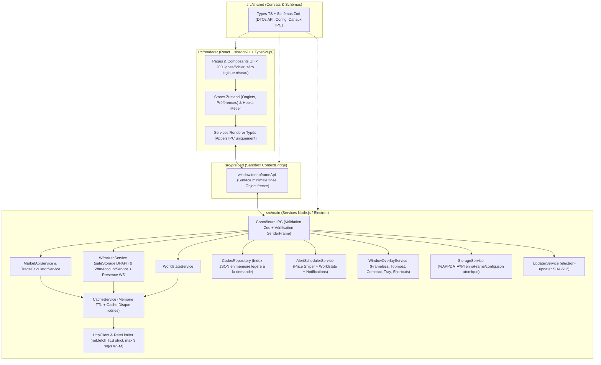

# Cahier des Charges Fonctionnel & Technique — TennoFrame v2.0

- **Projet** : TennoFrame v2 — Companion, Trading Browser & Codex pour Warframe
- **Auteur** : Maxime (`Nyxo_17`)
- **Stack Cible** : Electron · Node.js · React · `shadcn/ui` (Tailwind CSS + Radix UI) · TypeScript (`strict: true`) · Validation `zod`
- **Statut du document** : `VALIDÉ DÉFINITIF (CDC + 7 Planches Wireframes Excalidraw approuvés)`

---

## 1. Vision Produit & Objectifs de la v2.0

**TennoFrame v2** est une application de bureau native Windows (extensible Linux/macOS) conçue pour accompagner les joueurs de **Warframe** sur leur écran principal ou en superposition (*Overlay*) par-dessus le jeu en mode *Plein écran sans bordure*.

Elle réunit **3 besoins métier complémentaires** dans une interface inspirée d'un navigateur multi-onglets ultra-réactif :
1. **Trading optimisé sur Warframe Market** : comparer plusieurs items en parallèle dans des onglets, calculer s'il vaut mieux acheter un Set complet ou ses pièces détachées, regrouper ses achats chez un même vendeur (*Trade Bundler*), surveiller les bonnes affaires en arrière-plan (*Price Sniper*), et générer les commandes `/w` en un clic.
2. **Suivi temps réel de l'univers Warframe (*Worldstate Hub*)** : consulter tous les cycles planétaires, Fissures, Invasions, rotations Teshin / Duviri, Baro Ki'Teer et Actualités officielles, directement enrichis avec la **valeur en Platinum en direct** des récompenses échangeables.
3. **Encyclopédie de Farm (*Codex & Helminth*)** : savoir instantanément où farmer n'importe quelle ressource, Warframe, arme, mod ou relique (missions, rotations, taux de drop en `%`), ses coûts de Fonderie et sa compétence de subsomption **Helminth**.

### Pourquoi la refonte v2 (Electron + React + TypeScript) ?
- **Zéro bricolage système ni serveur HTTP local** : plus aucun port TCP ouvert sur le PC (`127.0.0.1`), plus de dépendance C# / Python.
- **Vraie intégration bureau & jeu** : fenêtre sans bordure fusionnée à la barre d'onglets, mode *Always-on-Top* compatible plein écran sans bordure, raccourcis clavier globaux fonctionnant **sans quitter Warframe (`Alt+Tab` inutile)**, et fonctionnement silencieux dans le **System Tray** Windows.
- **Sécurité & Maintenabilité professionnelles** : isolation stricte Electron (`sandbox` + `contextIsolation`), TLS strict, validation des données d'API via `zod`, et composants React modulaires (`shadcn/ui`).

---

## 2. Ergonomie Globale & Paradigme de Navigation

### 2.1. En-tête épuré en 2 Barres (Style Navigateur Multi-Onglets)

Conformément au choix d'ergonomie retenu, toute la navigation tient dans **2 barres compactes** en haut de la fenêtre Electron (*Frameless*) :

1. **Barre 1 — Barre d'Onglets & Contrôles Fenêtre (`Title & Tabs Bar`, hauteur ~38 px)** :
   - **Bouton Hub Permanent (à gauche)** : onglet fixe non fermable portant le logo TennoFrame, basculant instantanément sur le **Hub Temps Réel Warframe**.
   - **Liste d'onglets dynamiques** : chaque fiche d'item, recherche catalogue, page Codex, Panier ou profil joueur peut s'ouvrir dans un onglet dédié.
     - *Actions sur les onglets* : glisser-déposer horizontal pour réordonner, clic molette pour fermer, clic droit (menu contextuel : *Épingler `📌`, Dupliquer, Fermer les doublons, Fermer les autres, Fermer à droite*), bouton `+` (*Nouvel onglet*), et popover **Organisateur d'onglets** (filtrer les onglets ouverts, trier A→Z ou par catégorie, nettoyer les doublons).
   - **Zone de déplacement fenêtre (`app-region: drag`)** sur l'espace libre.
   - **Contrôles natifs de fenêtre Windows (à droite)** : Réduire (`_`), Agrandir/Restaurer (`□`), Fermer (`✕` — réduit dans le *System Tray* ou quitte selon le réglage utilisateur).

2. **Barre 2 — Barre d'Actions & Omnibox Unifiée (`Command & Nav Bar`, hauteur ~44 px)** :
   - **Navigation d'onglet** : boutons *Précédent*, *Suivant*, *Actualiser (`Ctrl+R`)*.
   - **Omnibox Intelligente Centrale (`Ctrl+K` ou `Ctrl+L`)** :
     - Remplace l'ancienne fausse barre `https://warframe.market/...` ET l'ancienne double barre de recherche.
     - Permet de chercher instantanément en **FR ou EN** un item du marché (~3 900+ entrées avec miniature), une entrée du **Codex** (ressource, relique, Warframe), ou une vue interne (`panier`, `baro`, `ducats`, `fissures`...).
     - *Compatibilité copier-coller* : si le joueur colle une vraie URL `https://warframe.market/items/nikana_prime_set`, l'Omnibox la reconnaît et ouvre directement la fiche correspondante.
     - Bouton **Étoile Favori (`Ctrl+D`)** intégré à droite de l'Omnibox lorsque l'onglet affiche un item.
   - **Accès Rapides Métier (avec compteurs en temps réel)** :
     - `Marché` · `Codex` · `Outils ▾` (*Ducanator*, *Contrats Rivens*, *Ordres Récents*, *Favoris*) · `Panier (n)` · `Alertes (n)`.
   - **Réglages Rapides & Overlay** :
     - Sélecteur compact **Plateforme / Crossplay / Langue** (`PC · Crossplay · FR`).
     - Bouton **Épingle Premier Plan (`Alt+P`)** + Bouton **Mode Compact (`Alt+M`)** + Bouton **Paramètres** (avec pastille si une mise à jour est prête).

### 2.2. Mode Desktop (`1440×900`) vs Mode Compact Adaptatif (`460×660`)

| Caractéristique | Mode Desktop Normal (défaut `1440×900`, min `1024×680`) | Mode Compact Overlay (`460×660`, min `380×520`) |
| :--- | :--- | :--- |
| **Usage cible** | Préparation de sessions de trade, comparaison multi-onglets, exploration Codex | Superposé dans un coin de l'écran pendant une mission ou au Dojo Warframe |
| **Always-on-Top** | Optionnel (`Alt+P`) | Activé automatiquement à l'entrée en mode Compact |
| **Barre 1 (Onglets)** | Onglets complets avec icône + titre | Onglets condensés (icône + titre court défilable) + bouton rapide *Agrandir* |
| **Barre 2 (Omnibox)** | Tous les raccourcis visibles sur une ligne | Omnibox prioritaire + menu compact `☰` regroupant les accès secondaires |
| **Grilles & Tableaux** | Multi-colonnes (ex: Vendeurs et Acheteurs côte à côte, grilles 3–4 colonnes) | Empilement vertical 1 colonne (Vendeurs en onglet prioritaire, cartes condensées, bouton `/w` toujours accessible en 1 clic) |
| **Mémorisation** | Mémorise sa taille et sa position d'écran exactes | Mémorise indépendamment sa propre position d'écran (ex: coin supérieur droit) |

### 2.3. Raccourcis Clavier

#### Raccourcis locaux (quand la fenêtre TennoFrame a le focus)
- `Ctrl + T` : Ouvrir un nouvel onglet (Accueil Marché)
- `Ctrl + W` : Fermer l'onglet actif (sauf s'il est épinglé ou s'il s'agit du Hub)
- `Ctrl + Tab` / `Ctrl + Shift + Tab` : Onglet suivant / précédent
- `Ctrl + K` ou `Ctrl + L` : Focus sur l'Omnibox de recherche rapide
- `Ctrl + R` / `F5` : Rafraîchir les données temps réel de l'onglet actif (force le contournement du cache)
- `Ctrl + D` : Ajouter / retirer l'item courant des Favoris
- `Ctrl + +` / `Ctrl + -` / `Ctrl + 0` : Zoom natif Chromium (`50 %` à `200 %`, pas de `10 %`)

#### Raccourcis globaux système (actifs même quand Warframe est au premier plan — désactivables dans Paramètres)
- `Alt + Shift + W` : Afficher / Masquer instantanément la fenêtre TennoFrame par-dessus le jeu
- `Alt + P` : Basculer l'épinglage *Toujours au premier plan* (*Always-on-Top*)
- `Alt + M` : Basculer entre le *Mode Desktop* et le *Mode Compact (`460×660`)*

---

## 3. Spécifications Fonctionnelles Détaillées par Module

### Module 1 — Composants Transverses (Whisper `/w`, System Tray & Persistance)

1. **Bandeau de commande d'échange (`WhisperBar`)** :
   - Déclenché au clic sur le bouton `Acheter (/w)` d'une offre ou d'un lot groupé du panier.
   - Copie immédiatement le message dans le presse-papiers système via l'API native Electron (`clipboard.writeText`).
   - Format standard respectant la convention Warframe Market :
     - **EN (par défaut)** : `/w <Pseudo> Hi! I want to buy: "<Item En>" (rank <X>) for <Prix> platinum. (warframe.market)`
     - **FR (bascule 1 clic)** : `/w <Pseudo> Bonjour ! Je voudrais acheter : "<Item Fr>" (rang <X>) pour <Prix> platinum. (warframe.market)`
2. **Vie en arrière-plan (`System Tray`)** :
   - Icône permanente près de l'horloge Windows avec menu contextuel : *Afficher / Masquer TennoFrame*, *Basculer Mode Compact*, *Mettre en pause les sons d'alerte*, *Quitter complètement*.
   - Permet au *Price Sniper* et aux alertes Worldstate de continuer à tourner à consommation quasi nulle lorsque la fenêtre principale est fermée.
3. **Persistance locale fiable** :
   - Sauvegarde automatique dans `%APPDATA%\TennoFrame\config.json` (validée par schéma `zod`, écriture atomique anti-corruption) : onglets ouverts, favoris, panier, alertes configurées, préférences audio, plateforme/langue, thème personnalisé et positions des fenêtres.

---

### Module 2 — Navigateur Warframe Market & Outils de Trading (10 Vues)

#### V1. Accueil Marché / Nouvel Onglet (`wf://market`)
- Barre de recherche centrale mise en avant, bandeau synthétique des **Actualités & Boosters actifs**, grille d'**Items populaires** (*Sets Prime, Arcanes, Mods Galvanisés/Accrus*) et aperçu des **Ordres Récents**.
- Encart discret d'aide rapide (accessible aussi via un bouton `? Guide`) remplaçant l'ancienne page Bienvenue séparée pour aller droit au but.

#### V2. Catalogue Complet (`wf://market/catalog`)
- Grille virtualisée (fluide même sur 3 900+ items) filtrable par recherche texte (FR/EN sans accents) et par tags/catégories (*Warframes Prime, Armes Prime, Mods, Arcanes, Reliques, Adaptateurs Incarnon, Syndicats, Empreintes*).

#### V3. Fiche Détail d'un Item (`wf://market/item/:slug`)
- **En-tête d'item** : miniature officielle, nom FR + nom EN, tags, taxe d'échange en Crédits, valeur en Ducats (si applicable), rang de maîtrise requis, lien rapide vers sa **fiche Codex de Farm** (si l'item est farmable !), et boutons d'action (*Favori*, *+ Panier*, *🎯 Créer Alerte Prix*).
- **Sous-onglet 1 — Ordres en Direct (`Vente` & `Achat`)** :
  - Filtres rapides : Statut joueur (**En jeu uniquement** par défaut, *En jeu + En ligne*, *Tous*), **Rang du Mod/Arcane** (*Tous*, *Rang 0*, *Rang Max*), **Quantité min**, **Réputation vendeur**.
  - Chaque ligne affiche : pseudo cliquable (vers profil), badge de statut, réputation, rang, quantité, prix unitaire en Platinum et bouton `/w` en 1 clic.
- **Encart automatique « Comparateur Set Complet vs Pièces Détachées »** *(affiché dès que l'item appartient à un Set de $\ge 2$ pièces)* :
  - Récupère le meilleur prix *En jeu* du **Set Complet** et le meilleur prix *En jeu* de **chaque pièce requise** (multiplié par le nombre d'exemplaires requis dans la recette, ex: *2× Lames* pour certaines armes doubles !).
  - Calcule :
    $$\Delta = \text{Prix}_{\text{Set Complet}} - \sum_{i} \left(\text{Qté}_i \times \text{Prix}_{\text{Pièce } i}\right)$$
  - Affiche clairement le verdict : **« Économisez X Plat en achetant les pièces séparément »** (ou **« +X Plat de marge potentielle en assemblant et revendant le Set »**).
- **Sous-onglet 2 — Statistiques du Marché (`48 dernières heures` & `90 derniers jours`)** :
  - Graphique interactif propre (prix médian, prix moyen pondéré, min/max et volume d'unités réellement vendues).

#### V4. Panier Multi-Achats & Regroupeur de Vendeurs (`wf://market/cart`)
- Gestion d'une liste d'achats (ajout d'items avec choix de la **quantité** et du **rang souhaité**, suppression, vidage).
- **Calculateur budgétaire automatique** :
  - Coût estimé en **Platinum** basé sur les meilleures offres *En jeu* actuelles.
  - Calcul de la **Taxe d'échange en Crédits** totale à prévoir en jeu.
- **Algorithme *Trade Bundler* (Détecteur de Vendeurs Multi-Items)** :
  - Analyse les meilleures offres *En jeu* de chaque article du panier et identifie tous les vendeurs possédant **au moins 2 articles distincts du panier simultanément**.
  - Affiche pour chaque vendeur groupé : la liste des articles disponibles chez lui, son prix total comparé à l'achat séparé optimal, le nombre d'allers-retours Dojo économisés, et un bouton **`/w` Groupé** listant tous les items dans un seul message.

#### V5. Favoris Marché (`wf://market/favorites`)
- Tableau de bord des items mis en favoris avec actualisation groupée de leur **prix minimum *En jeu***, tendance rapide et accès en 1 clic au `/w` ou à la fiche détail.

#### V6. Ducanator (`wf://market/ducats`)
- Analyse les données horaires de Warframe Market (`/v1/tools/ducats`) pour classer les pièces Prime selon :
  - Ratio **`Ducats / Platinum`** (pour acheter de la "Prime Junk" au meilleur taux avant Baro Ki'Teer),
  - Ratio inverse **`Plat / 100 Ducats`** (pour savoir quelles pièces revendre contre du Platinum plutôt que de les fondre en Ducats),
  - Filtre de **volume minimal vendu** (pour écarter les items rares jamais échangés).

#### V7. Contrats — Enchères de Mods Riven (`wf://market/rivens`)
- Sélecteur d'arme avec autocomplétion + filtres (polarité, rang de maîtrise, nombre max de relances, tri par prix croissant).
- Cartes Riven lisibles : attributs positifs en vert, malus en rouge, prix d'achat direct (*Buyout*) ou enchère en cours, statut du vendeur et bouton `/w`.

#### V8. Ordres Récents (`wf://market/recent`) & V9. Profil Joueur (`wf://market/user/:slug`)
- **Ordres Récents** : flux des dernières offres publiées sur la plateforme sélectionnée.
- **Profil Joueur** : en-tête joueur (avatar, statut en jeu, réputation) et séparation claire de toutes ses offres actives (*Il vend* / *Il achète*).

---

### Module 3 — Centre d'Alertes : *Price Sniper* & Alertes Worldstate (`wf://alerts`)

Contrairement à la `v1` où les timers vivaient dans la page web, l'orchestrateur (`AlertSchedulerService`) tourne dans le **Main Process Node.js** :
1. **Price Sniper (Surveillance de prix par item)** :
   - L'utilisateur définit un item, un rang optionnel, et un **prix plafond en Platinum** (ex: *Arcane Énergétique $\le 450$p*).
   - Scan périodique paramétrable (`15s` à `3600s`, défaut `30s`) respectant strictement le limiteur de débit global de l'API.
   - Dès qu'une offre de vente *En jeu* passe sous le seuil : **Toast interactif** dans l'application (avec bouton `/w` immédiat) + **Notification Windows native** (si fenêtre réduite/arrière-plan) + **Alerte sonore**.
2. **Alertes Sonores d'Événements Warframe (11 déclencheurs activables individuellement)** :
   - *Cycles* : Nuit sur Cetus, Pré-alerte 5 min avant la Nuit sur Cetus (chasse Eidolon), Vallée Orbis Chaude, Deimos Vome.
   - *Missions & Marchands* : Arrivée de Baro Ki'Teer, Fissure Rapide (Capture/Extermination...), Fissure Omnia Route de l'Acier, Invasion Rare (Catalyseur / Réacteur / Forma / Exilus), Invasion d'arme Wraith/Vandal, Semaine Forma Umbra chez Teshin, Arbitrage S-Tier.
3. **Paramètres Audio** : activation/coupure rapide du son, choix entre les sonneries embarquées (`Classique` et `Cloche / Bell`), curseur de volume (`0 %`–`100 %`), bouton *Tester*, et option de répétition tant que l'offre reste disponible.

---

### Module 4 — Hub Temps Réel « TennoFrame Info » (`wf://hub`)

Accessible à tout moment depuis l'onglet fixe en haut à gauche, structuré en **6 sous-vues** avec compteurs calculés chaque seconde côté client et resynchronisés périodiquement :

1. **H1. Planètes & Mises à Prix** : cartes visuelles temps réel pour **Cetus / Terre**, **Vallée Orbis (Fortuna)**, **Puy de Cambion (Deimos)**, **Duviri** (5 spirales d'humeur) et **Zariman Ten Zero** (occupant Corpus/Grineer), suivies des **Mises à Prix** actives (*Ostrons*, *Union Solaris*, *Entrati*) et de leurs tables de récompenses.
2. **H2. Fissures & Missions** : toutes les **Fissures du Néant** actives (Normal, Route de l'Acier, Tempêtes Railjack, Omnia) filtrables par ère (*Lith, Meso, Neo, Axi, Requiem, Omnia*) et par toggle **`⚡ Missions Rapides uniquement`**, accompagnées de la **Chasse à l'Archonte** hebdomadaire et de la **Sortie** quotidienne.
3. **H3. Invasions, Acier & Nightwave** :
   - **Invasions** : barres d'avancement des factions et bouton **`Prix Plat ↗`** direct sur les pièces d'armes Wraith/Vandal échangeables.
   - **Honneurs de la Route de l'Acier (Teshin)** : récompense de la semaine en cours + calendrier des 8 semaines + boutique permanente (*Evergreens*).
   - **Arbitrage en direct** + catalogue rapide des **Mods Galvanisés / Arbitrage** pour vérifier lequel est le plus rentable à acheter en Essence Vitus pour le revendre en Platinum.
   - **Alertes du Lotus**, **Événements spéciaux** et **Défis Nightwave (Ondes Nocturnes)** journaliers/hebdomadaires.
4. **H4. Circuit de Duviri** : rotation hebdomadaire active (**3 Warframes** en Normal + **5 Adaptateurs Incarnon Genesis** en Route de l'Acier) + calendrier complet des 9 semaines.
5. **H5. Marchand du Néant Baro Ki'Teer** : compte à rebours d'arrivée/départ, relais, inventaire complet (coût Ducats + Crédits) croisé automatiquement avec le **prix Platinum en direct** sur Warframe Market et le score de rentabilité **`Plat / 100 Ducats`**.
6. **H6. Actualités (News), Boosters & Offre de Darvo** : actualités officielles filtrables par catégorie, **Boosters globaux serveur** en cours, **Offre quotidienne de Darvo** (remise, stock restant, compte à rebours) et liens directs vers les sets de **Résurgence Prime**.

---

### Module 5 — Encyclopédie « Codex, Farm & Helminth » (`wf://codex`)

1. **Explorateur Codex (`wf://codex`)** : navigation par onglets de catégories (**Ressources Farmables**, **Warframes**, **Armes**, **Mods**, **Reliques**) avec recherche instantanée et filtres (Prime / Standard, rareté, ère de relique).
2. **Fiche Détail Codex (`wf://codex/:category/:id`)** :
   - **Où le farmer** : tableau trié par meilleur **taux de drop (`%`)** indiquant planète, nœud de mission, type, rotation (`A / B / C`) ou ennemi/relique source.
   - **Recettes de Fonderie** : composants requis, quantités, crédits et temps de fabrication (avec liens cliquables vers chaque ressource).
   - **Passerelle Marché** : si l'élément est échangeable (ex: partie Prime, Mod, Relique), bouton direct vers sa fiche **Warframe Market** pour comparer le temps de farm à son prix en Platinum.
   - **Infirmerie Helminth** : sur chaque Warframe standard, encart indiquant la **compétence donnée par subsomption au Helminth** + fiche dédiée **Helminth** répertoriant ses compétences exclusives et sécrétions.

---

### Module 6 — Personnalisation Visuelle (`shadcn/ui`) & Mises à Jour

1. **Moteur de Thèmes Bicolores sur variables CSS `shadcn/ui`** :
   - **Thèmes prédéfinis** (*Orokin Dark*, *Tenno Light*, *Lotus Amethyst*, *Prime Gold*, *Kuva Crimson*, *Corpus Matrix*...).
   - **Personnalisateur libre Bicolore** : choix indépendant de la **Couleur Principale** (surfaces, fond, barres) et de la **Couleur Secondaire** (accents, anneaux de focus, badges, boutons primaires) + activation/désactivation de l'effet de **Glow**.
   - Génération automatique des nuances accessibles (contraste texte lisible garanti) injectées proprement en variables CSS racine (`--background`, `--card`, `--border`, `--primary`, `--accent`, `--ring`).
2. **Système de Mise à Jour Natif Sécurisé (`electron-updater`)** :
   - Vérification automatique au lancement (puis toutes les 30 min) auprès des **GitHub Releases officielles** avec vérification cryptographique d'intégrité **SHA-512** (`latest.yml`).
   - Téléchargement différentiel en arrière-plan (*blockmap*) et modale **« Quoi de neuf ? (Notes de Patch) »** affichée après mise à jour.

---

### Module 7 — Extension v2.5 : Alertes Worldstate Personnalisées & Minuteurs en Mode Compact

> **Statut : VALIDÉ par Maxime le 12/11/2026** (section + planche `09-hub-alerts-compact-timers.excalidraw`). Implémentation sur la branche `feat/worldstate-custom-alerts`.

**Constat de départ (v2.4.0)** : le Module 3 propose déjà **11 alertes Worldstate figées** (cases à cocher `WorldAlertToggles`, évaluées dans `worldstate-alerts-evaluator.ts`). Elles ne couvrent que des cas prédéfinis : impossible par exemple d'être prévenu pour « *une fissure Axi Survie en Route de l'Acier* » ou « *une invasion qui donne un Catalyseur Orokin* » seulement. De plus, en Mode Compact, il faut ouvrir le Hub pour connaître l'état des cycles.

#### 7.A — Moteur d'Alertes Worldstate Personnalisées (`wf://alerts`, onglet *Worldstate*)

**Objectif joueur** : définir ses propres règles (« *préviens-moi quand…* ») et être notifié une seule fois par occurrence, même quand TennoFrame est réduit dans le System Tray.

1. **Conservation des 11 alertes existantes** : elles restent affichées en tête sous le titre *Alertes rapides* (aucune migration destructive des paramètres actuels).
2. **Règles personnalisées** (maximum **30** règles) créées via un formulaire en 3 étapes : *Source → Conditions → Notification*.

| Source | Conditions disponibles (toutes optionnelles sauf mention) |
| :--- | :--- |
| **Fissure du Néant** | Ères (multi : Lith, Meso, Neo, Axi, Requiem, Omnia) · Types de mission (multi : Survie, Défense, Capture, Extermination…) · Mode (*Normal*, *Route de l'Acier*, *Tempête du Néant*) · Faction · « Missions rapides uniquement » |
| **Invasion** | Catégorie de récompense (multi : Catalyseur Orokin, Réacteur Orokin, Forma, Adaptateur Exilus, Pièce d'arme Wraith/Vandal) **ou** texte libre « la récompense contient… » (FR/EN) |
| **Arbitrage** | Types de mission (multi) · Faction · « S-Tier uniquement » (l'API publique n'expose que le drapeau S-Tier, pas de palier A) |
| **Cycle** *(obligatoire : lieu + état)* | Lieu (Cetus, Vallée Orbis, Puy de Cambion, Zariman) · État ciblé (Nuit, Chaud, Vome, Corpus…) · Pré-alerte de `0` à `30` min avant le début de l'état |
| **Baro Ki'Teer** | Arrivée · Pré-alerte de `1` à `48` h avant l'arrivée · Article présent dans l'inventaire (texte libre FR/EN) |
| **Sortie** | Faction · Boss · Type de mission présent dans l'une des 3 étapes (multi) · Modificateur contenant… (texte libre, ex. *« Éclipse »*) |
| **Chasse à l'Archonte** | Archonte ciblé (multi : *Amar* → Fragment Écarlate, *Nira* → Fragment Ambre, *Boréal* → Fragment Azur) · Type de mission présent dans l'une des étapes (multi) |
| **Mises à prix** | Syndicat (multi : Ostrons, Union Solaris, Entrati) · Récompense possible contenant… (texte libre, ex. *« Arcane »*) · Niveau minimum de la mise à prix |
| **Nightwave (Ondes Nocturnes)** | Type (*Quotidien*, *Hebdomadaire*, *Élite*) · Réputation minimum · Intitulé contenant… (texte libre) |

3. **Aperçu en direct** : bouton **« Tester avec le Worldstate actuel »** dans le formulaire, qui affiche immédiatement le nombre d'occurrences correspondantes en ce moment (ex. *« 2 fissures correspondent : Axi Survie — Mot (Néant)… »*). Le joueur valide ainsi sa règle sans attendre.
4. **Notification** (par règle) : *Toast dans l'application* (toujours actif) · *Notification Windows native* (on/off) · *Son* (on/off, réglages audio globaux du Module 3). Le toast contient un bouton **« Voir dans le Hub »** qui ouvre la sous-vue concernée (et **`Prix Plat ↗`** si la récompense est échangeable).
5. **Anti-spam (déduplication)** : une règle ne se déclenche qu'**une seule fois par occurrence**. La clé d'occurrence est `ruleId + identifiant Worldstate` (id de fissure, invasion, sortie, mise à prix ou défi Nightwave ; date d'expiration pour cycles, Arbitrage et Baro). Les clés expirées sont purgées automatiquement.
6. **Historique des alertes (session uniquement)** : les **50 dernières** alertes déclenchées (Price Sniper + Worldstate) depuis le lancement de TennoFrame, conservées **en mémoire seulement** (vidées à la fermeture), avec date, règle d'origine et bouton *Voir*. Bouton *Effacer l'historique*.
7. **Gestion des règles** : liste avec interrupteur on/off, *Dupliquer*, *Modifier*, *Supprimer* (avec confirmation), nom généré automatiquement et modifiable (ex. *« Fissure Axi · Survie · Acier »*).

**Sources de données & rafraîchissement** : aucune nouvelle API. Les règles sont évaluées sur le Worldstate déjà récupéré par `WorldstateService` (`api.warframestat.us`), au même rythme que le scan existant de l'`AlertSchedulerService` (minimum `15 s`), en réutilisant le cache et le limiteur de débit global. **Aucune requête supplémentaire par règle.**

**Règles de gestion & sécurité** :
- Les champs texte libre sont limités à `60` caractères et comparés par **inclusion insensible à la casse et aux accents** (normalisation Unicode). **Aucune expression régulière saisie par l'utilisateur** n'est exécutée (protection contre le *ReDoS*, une attaque où une regex piégée bloque le processeur).
- Chaque règle est validée par un schéma `zod` (`WorldAlertRuleSchema`, union discriminée par `source`) à la sauvegarde **côté Main** ; une règle invalide est refusée avec un message explicite.
- L'évaluation tourne exclusivement dans le **Main Process** (le Renderer ne fait qu'afficher).

**Contrats IPC prévus (`src/shared/`)** :
- Persistance via le canal existant `settings:update` → nouveau champ `alerts.worldRules: WorldAlertRule[]` (défaut `[]`).
- `alerts:world-rule-preview` (*invoke*) : reçoit une règle, la valide (`zod`), renvoie la liste des occurrences correspondantes du Worldstate en cache.
- `alerts:history-get` / `alerts:history-clear` (*invoke*) : lecture et purge de l'historique.
- Événement existant `alerts:on-triggered` enrichi de `ruleId?` et `hubRoute?` (sous-vue cible du bouton *Voir*).

#### 7.B — Widget « Minuteurs » en Mode Compact Overlay (`460×660`)

**Objectif joueur** : voir d'un coup d'œil, par-dessus Warframe, les cycles et minuteurs importants sans ouvrir le Hub.

1. **Emplacement** : bandeau fin repliable (hauteur ≈ `32 px`) placé **en bas de la fenêtre, juste au-dessus de la barre de statut** (et sous le bandeau `/w` quand celui-ci est affiché), visible uniquement en Mode Compact (option *« Afficher aussi en mode Desktop »*, désactivée par défaut — en Desktop, le bouton Discord flottant se décale au-dessus du bandeau).
2. **Contenu** : jusqu'à **6 minuteurs épinglés** sous forme de pastilles `icône + état coloré + compte à rebours` (ex. `🌙 Cetus · Nuit · 12m 04s`). Les pastilles qui ne tiennent pas en largeur sont accessibles par **défilement horizontal** (molette ou glisser), avec un léger dégradé sur les bords pour signaler la suite.
3. **Minuteurs disponibles** : Cetus (Jour/Nuit) · Vallée Orbis (Chaud/Froid) · Puy de Cambion (Fass/Vome) · Zariman (Corpus/Grineer) · Humeur de Duviri · Baro Ki'Teer (arrivée/départ) · Arbitrage (fin de l'heure) · Sortie & Chasse à l'Archonte (réinitialisation) · Réinitialisation quotidienne (`00:00 UTC`). **Défaut** : Cetus, Vallée Orbis, Puy de Cambion, Baro.
4. **Interactions** : clic sur une pastille → ouvre la sous-vue correspondante du Hub. Bouton `⚙` en bout de bandeau → popover de choix et d'ordre des minuteurs (réordonnancement par boutons `↑`/`↓`, accessibles au clavier). Bouton `˄/˅` → replier/déplier (état mémorisé).
5. **Calcul** : comptes à rebours recalculés chaque seconde côté Renderer à partir des dates d'expiration (`hub-countdown.ts` existant), resynchronisés à chaque rafraîchissement du Worldstate. Une fois l'expiration dépassée, la pastille affiche *« Rotation… »* jusqu'à la donnée suivante.
6. **4 états UI** : *Chargement* (pastilles Skeleton) · *Vide* (aucun minuteur épinglé → bouton *« Épingler des minuteurs »*) · *Nominal* · *Erreur / Données périmées* (Worldstate non rafraîchi depuis plus de `5 min` → pastilles grisées + icône hors-ligne + dernier compte à rebours connu).

**Paramètres persistés** : `appearance.compactTimers = { enabled: true, showOnDesktop: false, collapsed: false, pinned: TimerKey[] (max 6) }`, validé par `zod`.

#### 7.C — Hors périmètre de cette extension (proposé pour plus tard)

- Plages horaires silencieuses (« ne pas déranger »).
- Envoi des alertes vers Discord ou le téléphone.
- Conservation de l'historique des alertes entre deux lancements.

#### 7.D — Décisions validées par Maxime (12/11/2026)

| # | Question | Décision |
| :--- | :--- | :--- |
| D1 | Position du bandeau Minuteurs en Compact | **En bas, juste au-dessus de la barre de statut** |
| D2 | Nombre maximum de minuteurs épinglés | **6**, avec défilement horizontal |
| D3 | Historique des alertes conservé après redémarrage | **Non** — session uniquement |
| D4 | Sources des règles personnalisées en v2.5 | **Toutes** : Fissure, Invasion, Arbitrage, Cycle, Baro, Sortie, Chasse à l'Archonte, Mises à prix, Nightwave |

---

### Module 8 — Extension v2.5 : Notifications In-App, Centre de Notifications & Animations

> **Statut : VALIDÉ par Maxime le 12/11/2026** (section + planche `10-notifications-animations.excalidraw`). Implémentation sur la branche `feat/notifications-animations`.

**Choix exprimés par Maxime (12/11/2026)** :
- **A1** : Notifications in-app pour les actions de l'application (*« Copié ! »*, *« Ajouté aux favoris »*, *« Ajouté au panier »*, erreurs réseau, mise à jour disponible…) **+** Centre de notifications sous la cloche 🔔 avec historique de session.
- **A2** : Affichage **en bas à droite, empilées au-dessus du bouton Discord** (qui reste visible).
- **A3** : Animations sur **les 6 catégories** de l'interface (changement de page/onglet, cartes & listes en cascade, micro-interactions survol/clic, fenêtres/menus/popovers, notifications/toasts, barre d'onglets & raccourcis).
- **A4** : Réglage à **3 niveaux** (*Complètes / Réduites / Désactivées*) + respect automatique du réglage Windows *« Afficher les animations »*.

#### 8.A — Notifications in-app (« Toasts » empilés)

**Objectif joueur** : recevoir un retour visuel immédiat, élégant et non bloquant à chaque action clé ou événement d'arrière-plan, avec possibilité de déclencher un aperçu à tout moment depuis les Paramètres.

1. **5 types visuels** :

| Type | Couleur / icône | Durée d'affichage | Exemples |
| :--- | :--- | :--- | :--- |
| **Succès** | Émeraude · `✓` | `4 s` | Favori ajouté/retiré, ajout au panier, règle enregistrée, paramètres exportés/importés |
| **Info** | Accent (`--primary`) · `ℹ` | `4 s` | Commande `/w` ou lien copié, cache vidé, mise à jour disponible, notification de test |
| **Avertissement** | Ambre · `⚠` | `6 s` | Limite de règles atteinte, données Worldstate périmées |
| **Erreur** | Rouge (`--destructive`) · `✕` | `8 s` | Échec réseau / IPC, échec d'import ou de sauvegarde des réglages |
| **Alerte** | Bordure accent · `🔔` | Jusqu'à fermeture | *Price Sniper* et règles *Worldstate* (unifie et remplace `AlertToastBanner`, en conservant les boutons `Copier /w`, `Voir dans le Hub` et `Prix Plat`) |

2. **Pile & positionnement** :
   - En **Desktop (`1440×900`)** : jusqu'à **3 notifications visibles** simultanément en bas à droite (`right-4`), la plus récente en bas, placées **au-dessus du bouton Discord flottant** (et au-dessus du bandeau `/w` ou Minuteurs s'ils sont affichés) afin qu'aucun élément ne se chevauche. Au-delà de 3, un badge **« +N en attente »** indique la file d'attente qui se dépile automatiquement.
   - En **Mode Compact (`460×660`)** : **1 seule notification visible** à la fois, pleine largeur (moins les marges), juste au-dessus du bandeau Minuteurs.
3. **Interactions** : bouton `✕` de fermeture manuelle · **survol souris = mise en pause du compte à rebours** (avec fine barre de progression en bas de la carte) · boutons d'action contextuels optionnels (*Ouvrir le panier*, *Voir dans le Hub*, *Copier /w*, *Prix Plat*).
4. **Anti-spam (fusion des doublons rapides)** : si une notification de même type et même titre est émise moins de **2 secondes** après la précédente, elle ne crée pas de doublon mais incrémente un badge `×2`, `×3` et réinitialise sa barre de durée.
5. **Catalogue des déclencheurs** :
   - Favoris (ajout / retrait), Panier (ajout / retrait / vidage), Règles *Price Sniper* & *Worldstate* (création / modification / duplication / suppression).
   - Presse-papiers (copie commande `/w`, copie de lien).
   - Paramètres & Système (export JSON, import JSON, réinitialisation, purge du cache, mise à jour détectée / prête à installer, bouton **« Tester une notification »**).
   - Erreurs réseau / IPC remontées par les stores.

#### 8.B — Centre de Notifications (cloche 🔔 de la barre de navigation)

1. Le clic sur l'icône 🔔 de `CommandNavBar` ouvre un **Popover « Centre de notifications »** listant les **50 dernières notifications de la session** (actions + alertes *Price Sniper* / *Worldstate*), de la plus récente à la plus ancienne, avec horodatage, icône colorée et bouton d'action rapide éventuel.
2. **Badge de non-lus** : pastille sur la cloche 🔔 indiquant le nombre de notifications non lues (remis à `0` à l'ouverture du popover). Le rappel du nombre de règles actives (*Price Sniper* + *Worldstate*) est affiché dans l'en-tête du popover avec un bouton direct **« Ouvrir le Centre d'Alertes (`wf://alerts`) »**.
3. **Actions du popover** : *Tout marquer comme lu* · *Effacer tout* · accès rapide aux réglages de notifications.
4. **Les 4 états UI obligatoires** :
   - *Chargement* : lignes `Skeleton` lors de l'hydratation initiale.
   - *Vide* : icône + message *« Aucune notification pendant cette session »* + raccourci vers `wf://alerts`.
   - *Nominal* : liste défilante horodatée avec distinction visuelle des éléments non lus.
   - *Erreur* : notifications d'échec réseau/IPC mises en évidence avec bordure/fond teinté rouge et action *Réessayer* si applicable.
5. **Cycle de vie** : historique conservé **en mémoire uniquement** pour la session en cours (cohérent avec la décision D3 du Module 7).

**Paramètres associés** (*Paramètres → Audio & Alertes*) :
- Interrupteur **« Notifications visuelles d'actions (Succès & Info) »** (activé par défaut ; les *Erreurs* et les *Alertes* restent toujours actives).
- Bouton **« Tester une notification »** permettant de faire apparaître immédiatement une notification de démonstration (visuelle + son si activé).

#### 8.C — Système Global d'Animations & Désactivation dans les Paramètres

**Objectif joueur** : rendre chaque interaction fluide, réactive et moderne à 60 FPS+, tout en permettant de réduire ou couper instantanément toutes les animations dans les Paramètres (ou automatiquement selon Windows).

| Catégorie | Niveau **Complètes** *(défaut)* | Niveau **Réduites** | Niveau **Désactivées** |
| :--- | :--- | :--- | :--- |
| **1. Changement de page / d'onglet** | Fondu + léger glissement vertical `8 px` (`180 ms`) | Fondu simple (`120 ms`, sans déplacement) | Instantané (`0 ms`) |
| **2. Cartes & listes** | Apparition en cascade (`25 ms` de décalage par carte, plafonné aux **12 premiers éléments**) | Fondu global uniforme sans cascade | Instantané (`0 ms`) |
| **3. Micro-interactions (survol & clic)** | Boutons : léger enfoncement `scale(0.97)` au clic · Cartes interactives : élévation `-2 px` au survol | Changement de couleur/bordure uniquement | Changement d'état instantané |
| **4. Fenêtres, menus & popovers** | Ouverture/fermeture `scale(0.96 → 1)` + fondu (`150 ms`) sur `Dialog`, `Popover`, `Omnibox` | Fondu simple (`110 ms`) | Instantané (`0 ms`) |
| **5. Notifications (toasts)** | Glissement fluide depuis la droite à l'entrée et vers la droite à la sortie (`200 ms`) | Fondu simple entrée/sortie | Apparition/retrait immédiats |
| **6. Barre d'onglets & raccourcis** | Apparition nouvel onglet en fondu + échelle · surbrillance glissante · soulignement animé des raccourcis | Fondu simple | Instantané (`0 ms`) |

**Réglages dans `Paramètres → Apparence & Thèmes`** :
- Sélecteur segmenté à **3 niveaux** : **`Complètes`** (défaut) · **`Réduites`** · **`Désactivées`**.
- Interrupteur **« Respecter le réglage Windows ( Mouvements réduits ) »** (`respectOsReducedMotion`, activé par défaut) : si Windows signale `prefers-reduced-motion: reduce` et que le niveau choisi est *Complètes*, TennoFrame plafonne automatiquement le rendu effectif à **Réduites** (si l'utilisateur a choisi *Désactivées*, tout reste coupé).
- L'interrupteur existant *« Animation d'ouverture Wire au lancement »* reste indépendant (mais respecte aussi le mode *Désactivées* sauf clic manuel sur *Rejouer*).

**Architecture CSS, Performance & Contrats `zod`** :
- Pilotage centralisé dans `applyThemeToDocument` via un attribut racine **`data-motion="full" | "reduced" | "off"`** sur `<html>` (+ écoute temps réel de `window.matchMedia('(prefers-reduced-motion: reduce)')`).
- **100 % CSS accéléré GPU** : seules `transform` et `opacity` sont animées (`120–220 ms`, `cubic-bezier(0.22, 1, 0.36, 1)`), garantissant zéro *layout thrashing*. En mode `data-motion="off"`, toutes les animations et transitions décoratives sont forcées à `0ms` tandis que les **spinners d'activité réseau (`animate-spin` de chargement)** sont préservés pour indiquer que l'application travaille.
- **Schéma `zod` (`src/shared/schemas/settings.schema.ts`)** :
  - `appearance.animationLevel: z.enum(['full', 'reduced', 'off']).default('full')`
  - `appearance.respectOsReducedMotion: z.boolean().default(true)`
  - `audio.actionNotificationsEnabled: z.boolean().default(true)`
- **Aucun nouveau canal IPC requis** : persistance atomique via `settings:update` existant ; orchestration des notifications côté Renderer dans `useNotificationStore` alimenté par les stores et `alerts:on-triggered`.
- **Sécurité** : rendu strictement en nœuds texte React (aucun HTML brut), troncature défensive des chaînes (`title` ≤ 80 car., `message` ≤ 220 car.).

#### 8.D — Hors périmètre (proposé pour plus tard)

- Persistance sur disque de l'historique des notifications entre deux sessions.
- Personnalisation individuelle des durées par type de toast ou positionnement libre aux 4 coins.

### Module 9 — Dégradés de Fond d'Écran de l'Application (`Paramètres → Apparence & Thèmes`)

**Objectif joueur** : permettre de personnaliser l'atmosphère visuelle globale de TennoFrame avec des **dégradés de fond d'écran Sci-Fi élégants** (compatibles avec les 20 thèmes bicolores prédéfinis, le mode `Full Black` OLED, les thèmes clairs et les couleurs libres), tout en préservant une lisibilité irréprochable des prix Platinum, minuteries Worldstate et fiches Codex en Desktop (`1440×900`) comme en Mode Compact (`460×660`).

#### 9.A — Galerie des 8 Styles de Dégradés (`BackgroundGradientStyle`)

Accessible directement dans `Paramètres → Apparence & Thèmes` sous la section **« 🌈 Dégradé de Fond d'Écran »** :
1. `none` — **Uni (Aucun dégradé)** : fond plat classique du thème actif.
2. `aurora-top` — **Halo Boréal Supérieur** : lueur radiale diffuse tombant depuis le sommet de la fenêtre (effet verrière d'Orbiteur).
3. `diagonal` — **Diagonale Dynamique** : dégradé linéaire incliné traversant l'application du coin supérieur gauche vers le coin inférieur droit (angle ajustable).
4. `dual-corners` — **Double Énergie (Coins opposés)** : deux halos radiaux complémentaires placés en haut à gauche et en bas à droite.
5. `radial-center` — **Noyau du Néant (Radial centré)** : lueur centrale douce derrière l'espace de travail avec vignettage naturel en périphérie.
6. `horizon-bottom` — **Horizon Planétaire (Bas → Haut)** : halo montant depuis la barre d'état inférieure vers le centre de l'écran.
7. `mesh-nebula` — **Nébuleuse Mesh (Multi-points)** : composition organique à 3 sources lumineuses asymétriques (esprit Empyréen / Railjack).
8. `vertical-split` — **Zénith Linéaire** : transition linéaire douce sur l'axe vertical (ou selon l'angle choisi).

#### 9.B — Personnalisation Fine (Couleur Auto vs Dédiée, Intensité & Angle)

1. **Mode de couleur du dégradé (`colorMode: 'theme-accent' | 'custom'`)** :
   - **`Auto (Accent du thème)`** *(défaut)* : utilise automatiquement la couleur secondaire d'accent du thème actif (`secondaryColor`, ex. Cyan `#26b9d1`, Or Orokin `#eab308`, Violet Lotus `#a855f7`). Changer de thème met instantanément le dégradé en harmonie.
   - **`Couleur dédiée personnalisée`** : active deux sélecteurs `ColorSwatchPicker` (ou teinte principale + teinte secondaire de dégradé `customPrimaryHex` / `customSecondaryHex`) permettant par exemple d'avoir des boutons Cyan sur un fond en dégradé Violet/Bleu Nuit !
2. **Curseur d'Intensité (`intensityPercent` : `5 %` à `65 %`, défaut `26 %`)** :
   - Contrôle l'opacité du calque de dégradé arrière-plan en temps réel, plafonné à `65 %` pour garantir un contraste WCAG lisible sur les tableaux et textes en thème sombre comme en thème clair.
3. **Curseur d'Angle (`angleDeg` : `0°` à `360°`, pas de `15°`, défaut `135°`)** :
   - Actif pour les styles orientables (`diagonal`, `vertical-split`) avec boutons d'angles rapides (`45°`, `90°`, `135°`, `180°`, `225°`, `315°`).
4. **Aperçu visuel en direct sur chaque vignette de style + Bouton `Réinitialiser le dégradé`**.

#### 9.C — Architecture CSS, Contrats `zod` & Zéro Coût GPU

- **Rendu CSS pur sans `canvas` ni boucle JS** :
  - `applyThemeToDocument()` dans `src/renderer/src/lib/theme-engine.ts` calcule la valeur CSS sécurisée `--wf-app-gradient` à partir de chaînes HSL/RGB contrôlées (aucune concaténation arbitraire non validée) et l'applique sur un calque d'arrière-plan fixe `pointer-events-none` dans `App.tsx`, tandis que les surfaces `card` / barres conservent un léger voile translucide (`backdrop` / alpha contrôlé) laissant transparaître subtilement le dégradé.
- **Contrat `zod` dans `src/shared/schemas/settings.schema.ts` (`appearance.backgroundGradient`)** :
  - `style: BackgroundGradientStyleSchema.default('none')`
  - `colorMode: z.enum(['theme-accent', 'custom']).default('theme-accent')`
  - `customColorHex: HexColorSchema.default('#7c3aed')`
  - `customSecondaryHex: HexColorSchema.default('#06b6d4')`
  - `intensityPercent: z.number().int().min(5).max(65).default(26)`
  - `angleDeg: z.number().int().min(0).max(360).default(135)`
- **Aucun nouveau canal IPC requis** : persistance atomique via `settings:update` existant (`StorageService.updateSettings` fusionnant `appearance.backgroundGradient`).

---

### Module 10 — Système d'Extensions (Paramètres), Sources Exhaustives du Codex & Extension « Codex Farm Overlay »

#### 10.A — Système d'Extensions Modulaires sous forme de Liste dans les Paramètres (`ExtensionsSettingsTab`)

- **Nouvel onglet dédié `🧩 Extensions` dans `SettingsModal` (6ᵉ onglet de la barre latérale des Paramètres)** :
  - Présenté sous forme de **liste verticale structurée** avec barre de recherche (`🔍 Filtrer les extensions…`) et pastilles de filtrage rapide (`[Toutes]`, `[Activées]`, `[En jeu / Overlay]`, `[Codex & Farm]`).
  - **Architecture 100 % intégrée et sécurisée (*First-Party Extension Registry*)** :
    - Aucun chargement de code distant arbitraire ni `eval()` (`CSP script-src 'self'` strictement préservée) : chaque extension est un module interne fortement typé et validé par `zod` dans `settings.extensions`.
    - Lorsqu'une extension est **désactivée (`OFF`)** dans la liste : ses contrôles UI contextuels sont masqués dans l'application, ses raccourcis globaux dédiés sont désenregistrés, et aucune fenêtre secondaire n'est instanciée en mémoire (`0 Mo` de coût RAM/CPU).
    - Lorsqu'une extension est **activée (`ON`)** : ses points d'entrée s'affichent automatiquement dans les vues concernées et un panneau **`[⚙ Configurer ▾]`** dépliable directement sous la ligne de l'extension dans la liste permet d'ajuster finement ses options.
  - **Première extension phare intégrée dans la liste : `🎯 Codex Farm Overlay`** :
    - Ligne de liste affichant : icône `🎯`, titre **`Codex Farm Overlay`**, badges `Officielle · v1.0.0` · `Codex & En jeu` · statut `● Activée / ○ Désactivée`, résumé clair, bouton **`[⚙ Configurer ▾]`**, bouton rapide **`[🎯 Ouvrir / Masquer l'Overlay]`** et interrupteur maître **`Switch`**.
    - Tiroir de configuration intégré sous la ligne : réglage du mode *Souris traversante (`👻 Click-Through`)*, raccourci global (`Alt+O`), densité par défaut (`[S | M | L]`), opacité du fond (`40 % – 98 %`) et compteur/purge des objectifs suivis (`N / 12`).

#### 10.B — Résolution Exhaustive des Sources d'Obtention (`CodexAcquisitionResolver`)

- **Problème métier résolu** :
  - Les tables de butin publiques de Digital Extremes ne répertorient que les récompenses aléatoires (RNG) de fin de mission, d'assassinat de boss ou de mise à prix. Par conséquent, de nombreux objets et composants du Codex — comme le **Schéma Principal d'Ember** (achetable directement en Crédits dans la Boutique en jeu de Warframe), l'intégralité de **Volt** (Laboratoire Tenno du Dojo) ou les schémas liés aux **Quêtes Warframe** — apparaissaient sans localisation d'obtention, tandis que certaines ressources de Fonderie (`Cellule Orokin`) perdaient leurs tables de drop ou subissaient une pollution de drops *Conclave* (`Cristal d'Argon`).
- **Taxonomie unifiée des 6 canaux d'acquisition (`CodexAcquisitionSourceType`)** :
  1. **`shop` (`🛒 Boutique en jeu Warframe`)** : Schémas principaux ou armes achetables directement dans la Console du Marché de l'Orbiteur en **Crédits** (ex: *Ember — Schéma Principal : 25 000 Crédits · 100 %*, *Gauss — Schéma Principal : 30 000 Crédits*, *Mirage — Schéma Principal : 35 000 Crédits*, *Excalibur, Mag, Rhino, Loki, Frost, Trinity, Oberon, Limbo, Mesa, Chroma, Fulmin, Hek, Soma, Atomos…*) ou armes exclusives Marché.
  2. **`quest` (`📜 Quêtes Warframe & Rachat Céphalon Simaris`)** : Nom exact traduit en français (et anglais selon la langue active) de la quête octroyant le schéma ou l'arme complète (`100 %`), enrichi de la mention de rachat auprès du *Céphalon Simaris* lorsque applicable (ex: *Quête « Messages Cachés »* pour *Mirage*, *« Le Stratagème de Glast »* pour *Nidus*, *« La Nouvelle Guerre »* pour *Nataruk*, *« Le Sacrifice »* pour *Excalibur Umbra*, *« L'Hymne d'Octavia »* pour *Octavia*, *« Cœur de Deimos »* pour *Xaku*, *« Le Protocole Moribond »* pour *Protea*, *« Appel du Tempestarii »* pour *Sevagoth*, *« Ombres de Jade »* pour *Jade*, *« La Veillée de Saya »* pour *Gara*, *« Le Masque du Revenant »* pour *Revenant*, etc.).
  3. **`dojo` (`🏯 Dojo de Clan — Laboratoires`)** : Identification précise du laboratoire de recherche à `100 %` (*Laboratoire Tenno* pour *Volt, Banshee, Zephyr, Wukong, Nezha…*, *Labo Chimique* pour *Ignis Wraith*, *Labo d'Énergie*, *Labo Biologique*, *Labo des Orphelins des Conduits / VentKids* pour *Yareli*).
  4. **`duviri` & `syndicate` (`✨ Circuit Normal de Duviri, Syndicats & Marchands`)** : Rotation hebdomadaire garantie (`100 %`) du *Circuit Normal de Duviri* pour les Warframes standards éligibles (dont *Ember*), Syndicats de faction et de mondes ouverts (*Ostrons, Union Solaris, Entrati, Irréductibles, Cavia, L'Hexagone*), *Boutique des Ondes Nocturnes*, *Baro Ki'Teer* et *Résurgence Prime (Varzia — Aya)*.
  5. **`drop` (`⚔ Missions, Boss, Mises à prix & Ennemis`)** : Planète / Nœud traduit + type de mission / Boss + Rotation (`A`, `B`, `C`) + **pourcentage exact de drop** (`38.72 %`, `22.56 %`, `7.52 %`, etc.) et niveau de rareté.
  6. **`relic` (`◈ Reliques du Néant`)** : Taux exacts selon le raffinage (*Intacte → Éclatante*) et indicateur *Disponible / En Soute (Vaulted)*.
- **Assainissement des recettes de Fonderie dans `CodexRepository`** :
  - **Jointure automatique `resSlug → db.resources`** : Tout composant de fabrication pointant vers une ressource du Codex (ex: `Cellule Orokin ×1` sur *Ember*) hérite automatiquement des meilleures localisations PVE de `db.resources` lorsqu'aucun drop propre n'est attaché au composant.
  - **Filtrage anti-pollution Conclave** : Exclusion des drops de ressources génériques en mode *Conclave* (`Cristal d'Argon` sur *Neptune / Cephalon Capture*) qui polluaient les fiches de Warframes et d'Armes PVE.

#### 10.C — Sélecteur Granulaire d'Affichage dans le Codex (« Tout un équipement », « Pièces à la carte » ou « Objet en particulier »)

- **Conditionné par l'extension `Codex Farm Overlay` (`settings.extensions.codexFarmOverlay.extensionEnabled`)** :
  - Si l'extension est activée dans `Paramètres → 🧩 Extensions`, la barre d'action dédiée s'affiche dans l'en-tête du Codex (`wf://codex`) et de chaque fiche détail (`wf://codex/item/:category/:id`) :
    - Interrupteur maître **`[🎯 Overlay Farm : Affiché / Masqué]`** (synchronisé en temps réel avec le raccourci clavier global configurable **`Alt+O`**).
    - Bouton **`[🎯 Choisir quoi afficher (N)]`** ouvrant le **Sélecteur Granulaire d'Objectifs (`CodexOverlaySelectorPopover`)**.
  - Si l'extension est désactivée, le Codex reste épuré (avec un lien discret optionnel *« Activer l'extension Overlay Farm dans Paramètres → Extensions »*).
- **Trois modes de sélection complémentaires** :
  1. **Équipement complet en 1 clic** (ex: **`Ember`**) : le bouton **`[☑ Afficher tous les composants d'Ember (4)]`** ajoute simultanément *Schéma Principal* + *Neuroptiques* + *Châssis* + *Systèmes*, avec une case optionnelle **`[☐ Inclure les ressources de Fonderie (Cellule Orokin, Plastides…)]`**.
  2. **Sélection à la carte par sous-pièce / ressource** : chaque ligne de composant de la fiche Codex possède sa propre case/épingle **`[🎯]`** permettant de ne suivre, par exemple, que le *Schéma Principal* (`Boutique · 25 000 Cr · 100 %`) et les *Systèmes d'Ember* (`Tethys, Saturne · 22.56 %`) si les *Neuroptiques* et le *Châssis* sont déjà possédés.
  3. **Objet unique en particulier** : bouton **`[🎯 Épingler à l'Overlay]`** disponible sur n'importe quel objet individuel du Codex (Arme de quête comme *Nataruk*, Ressource comme *Cellule Orokin*, Mod comme *Continuité*, Relique ou Arcane).
- **Gestion fluide de la liste suivie (max 12 entrées)** :
  - Possibilité de cocher **`✓ Obtenu`** sur une pièce directement depuis le Codex ou depuis l'overlay en jeu (l'entrée est barrée/repliée avec compteur de progression `2/4 obtenus`), de réordonner ou de vider la liste en un clic.

#### 10.D — Fenêtre « Codex Farm Overlay » Flottante en Jeu (`FarmOverlayWindowService`)

- **Architecture de fenêtre secondaire durcie & 100 % conforme CGU Digital Extremes** :
  - Seconde `BrowserWindow` Electron légère (`/?view=codex-farm-overlay`) gérée par `FarmOverlayWindowService` dans `src/main/services/` :
    - `frame: false`, `alwaysOnTop: true` (niveau `'screen-saver'` compatible *Fenêtré sans bordure*), `skipTaskbar: true`, dimensions mémorisées (défaut `380×420`, redimensionnable).
    - Durcissement identique à la fenêtre principale : `nodeIntegration: false`, `contextIsolation: true`, `sandbox: true`, `webSecurity: true`, CSP stricte `connect-src 'none'`.
    - **Zéro interaction avec `Warframe.x64.exe`** : affichage passif de données locales Codex uniquement.
- **Ergonomie en mission Warframe** :
  - **Mode Souris Traversante `👻` (*Click-Through* Win32)** : activable d'un clic sur `👻` dans la barre de titre de l'overlay ou automatiquement verrouillable pour que 100 % des clics et mouvements de caméra traversent l'overlay en combat ; déverrouillage au maintien `0.5s` sur la pilule `🔓` ou via le raccourci global **`Alt+O`** (afficher/masquer l'overlay).
  - **Contrôles compacts intégrés** : poignée de déplacement *drag*, sélecteur de taille **`[S | M | L]`**, curseur d'opacité d'arrière-plan (`40 % – 98 %`), puces de filtrage rapide par cible (`[Tout (4)] [Ember] [Nataruk]`), case **`✓ Obtenu`** par ligne et bouton `✕` (masquer).
  - **Informations affichées sur chaque carte de l'overlay** :
    - Icône `wf-asset://` + Nom de l'équipement / composant (`Ember — Schéma Principal`, `Ember — Systèmes`, `Nataruk`).
    - **Badge de source coloré + Nom exact de la Quête, de la Boutique, du Dojo ou du Nœud de mission** (ex: `🛒 Boutique Warframe · 25 000 Crédits`, `📜 Quête : La Nouvelle Guerre`, `📜 Quête : Messages Cachés (+ Simaris)`, `⚔ Saturne / Tethys · Gén. Sargas Ruk (Assassinat)`).
    - **Taux d'obtention mis en avant (`% de drop`)** : badge `100 %` vert émeraude pour les sources garanties (Boutique, Quête, Dojo, Circuit Duviri) ou pourcentage exact (`38.72 %`, `22.56 %`, `7.52 %`) avec **sa barre de couleur de probabilité placée directement sous le badge `%`** et tri automatique des meilleures localisations.

#### 10.E — Contrats IPC & Schémas `zod` (`codex.schema.ts` & `settings.schema.ts`)

- **Enrichissement `src/shared/schemas/codex.schema.ts`** :
  - `CodexAcquisitionSourceSchema` : `{ type: 'shop' | 'quest' | 'dojo' | 'duviri' | 'syndicate' | 'drop' | 'relic', labelFr, labelEn, sublabelFr?, sublabelEn?, chancePct: number, rarity?, costCredits?, isGuaranteed: boolean }`.
  - Ajout de `acquisitionSources: CodexAcquisitionSource[]` sur `CodexItemDetail` et sur chaque `CodexComponent`.
- **Persistance & Synchronisation Temps Réel (`settings.extensions` & `settings.codexFarmOverlay`)** :
  - `extensions: { codexFarmOverlay: boolean }` (activation de l'extension dans l'onglet `🧩 Extensions` des Paramètres ; si `false`, la fenêtre secondaire est détruite et le raccourci `Alt+O` désenregistré).
  - `codexFarmOverlay` : `enabled: boolean` (visibilité courante de la fenêtre overlay quand l'extension est active), `clickThrough: boolean`, `size: 'sm' | 'md' | 'lg'`, `opacityPercent: number (40..98)`, `bounds: { x, y, width, height }`, `shortcutToggle: string` (défaut `'Alt+O'`), `pinnedEntries: CodexOverlayPinnedEntry[]` (max 12 entrées typées avec `obtained: boolean` et sources pré-résolues).
  - Canaux IPC dédiés dans `overlay` (`src/shared/ipc-channels.ts`) : `overlay:getState`, `overlay:setEnabled`, `overlay:updateState`, `overlay:setClickThrough`, et événement `overlay:onStateChanged` diffusant instantanément tout changement entre la fenêtre principale TennoFrame, l'onglet `🧩 Extensions` des Paramètres et la fenêtre flottante *Codex Farm Overlay*.

### 3.8. Module 11 — Bestiaire Complet des Mobs & Répertoire des Marchands dans le Codex (`👾 Mobs` & `🏪 Marchands`)

#### 11.A — Objectif Métier Joueur

Jusqu'à présent, le Codex hors-ligne de TennoFrame couvrait les objets finaux (*Ressources, Warframes, Armes, Mods, Reliques*) et l'Infirmerie Helminth, mais ne répondait pas directement à deux questions quotidiennes majeures des joueurs Warframe :
1. **« Où trouver tel Mob / Eximus / Boss dans le jeu et que lâche-t-il ? »** — Indispensable pour chasser un mod de posture ou rare sur une unité précise (ex: *Bombardier Lourd Corrompu*, * Maniaque Grineer*, *Nox*, *Thrax*, *Juggernaut*), accomplir un défi Ondes Nocturnes / Riven ou compléter les cibles de synthèse du Céphalon Simaris.
2. **« Où trouver tel Marchand / Syndicat dans le jeu et que vend-il exactement (et à quel prix) ? »** — Le Système Origine compte plus de 40 vendeurs répartis entre les Relais Tenno, le Bazar de Maroo, Cetus, Fortuna, le Necralisk, le Sanctum Anatomica, le Chrysalithe, Duviri, le Camp du Voyageur et Höllvanie (1999), chacun avec sa propre monnaie ou réputation. Pouvoir localiser instantanément chaque marchand **et** chercher un objet (ex: *« Extrait de Nitain »*, *« Citrine »*, *« Ignis Wraith »*, *« Holoclef »*, *« Arcane »*) à travers toutes les boutiques du jeu fait gagner un temps considérable.

Ce module ajoute **deux nouveaux onglets de premier niveau dans le Codex** (`wf://codex`) :
- **`👾 Mobs`** (*Bestiaire complet FR/EN : ennemis standards, unités lourdes/Eximus, chasseurs/assassins et boss + planètes/missions d'apparition + résistances + tables de drop `%`*),
- **`🏪 Marchands`** (*Répertoire complet FR/EN des marchands & syndicats + localisation exacte Planète / Hub / Zone / Quête requise + catalogue complet filtrable de tout ce qu'ils vendent*).

#### 11.B — Sources de Données Officielles & Indexation Hors-Ligne (`resources/codex-mobs-vendors.json`)

Conformément aux règles d'architecture (§4 : zéro appel réseau depuis le Renderer, zéro blocage du thread principal), les données sont pré-compilées hors-ligne via un script dédié (`scripts/extract-mobs-vendors.mjs`) dans un index JSON typé (`resources/codex-mobs-vendors.json`, embarqué dans `extraResources` d'`electron-builder.yml`) croisant trois sources communautaires et officielles Digital Extremes :
1. **`WFCD/warframe-items` (`Enemy.json` — ~638 unités)** : identifiants `uniqueName`, statistiques de base (`health`, `shield`, `armor`), faction (`type`), masque binaire de régions d'apparition (`regionBits`), icône officielle (`imageName` servie via le protocole cache disque existant `wf-asset://wfstat/img/`), vulnérabilités/résistances élémentaires (`resistances`) et drops associés.
2. **`calamity-inc/warframe-public-export-plus` (`ExportEnemies.json`, `ExportRegions.json`, `ExportVendors.json`, `ExportSyndicates.json`, `dict.fr.json`, `dict.en.json`)** : traductions officielles FR/EN à 100 %, résolution des régions et nœuds du Système Origine, manifestes de boutiques PNJ (`ExportVendors` : articles vendus, coûts en crédits, ressources, jetons ou monnaies spéciales) et récompenses de syndicats par palier de rang (`ExportSyndicates` : `favours`, coût en réputation et rang requis).
3. **`WFCD/warframe-drop-data` (`enemyModTables.json`, `enemyBlueprintTables.json`, `resourceByAvatar.json`, `syndicates.json`)** : taux de drop officiels exacts (`chancePct`) des mods, schémas et ressources par unité ennemie, et compléments d'offres syndicales.
4. **Métadonnées curées des Hubs & Marchands spéciaux** : agrégation propre des sous-manifestes techniques DE par véritable PNJ en jeu (ex: fusion des manifestes de pêche et échanges de *La Fille* au Necralisk) et enrichissement des localisations exactes (Planète, Hub/Relais, Salle/Zone PNJ, Quête de déblocage) pour les marchands spéciaux (*Baro Ki'Teer, Varzia, Maroo, Darvo, Teshin, Boutique d'Arbitrage, Céphalon Simaris, Ergo Glast, Nora Night, Kahl-175 / Chipper, Acrithis, Famille Entrati, Loid & Cavia, Irréductibles du Zariman, L'Hexagone 1999*).

L'index `codex-mobs-vendors.json` est chargé **à la demande (lazy-load asynchrone)** et mis en cache en mémoire par `CodexRepository` côté Main Process, garantissant un démarrage instantané (`0 ms` d'impact au lancement) et des recherches `< 5 ms`.

#### 11.C — Spécification Fonctionnelle de l'Onglet Codex `👾 Mobs` (`category: 'mobs'`)

- **Barre de navigation Codex étendue à 8 onglets** :
  `Ressources` · `Warframes` · `Armes` · `Mods` · `Reliques` · **`👾 Mobs`** · **`🏪 Marchands`** · `Helminth`.
- **Recherche & Filtres dédiés aux Mobs** :
  - **Recherche instantanée FR/EN multi-critères** : filtre simultanément sur le **nom FR/EN du mob**, la **planète / région d'apparition** (ex: *« Deimos »*, *« Néant »*, *« Höllvanie »*) et le **nom des objets/mods lâchés** (taper *« État Surchargé »* ou *« Cellule Orokin »* affiche immédiatement tous les mobs qui le droppent !).
  - **Barre de puces Factions** : `Toutes` · `Grineer` · `Corpus` · `Infestés` · `Orokin / Corrompus` · `Sentients` · `Narmer` · `Murmure` · `Duviri` · `Scaldra` · `Techrot` · `Stalker & Chasseurs`.
  - **Filtre de rang d'unité** : `Tous` · `Unités Standard` · `Eximus & Unités Lourdes` · `Boss & Assassins`.
- **Cartes Catalogue Mobs (`[⊞ Carrée | ▭ Rect | ☰ Liste] + [S | M | L]`)** :
  - Portrait `wf-asset://`, nom FR (+ sous-titre EN si différent), badge coloré de **Faction** et de **Type d'unité** (*Standard / Eximus / Boss*),
  - **Taux d'apparition principal (`% de chance de spawn` + petite barre de couleur sous le `%`)** via `ChanceBadgeWithUnderBar`,
  - Aperçu direct **« 📍 Planètes d'apparition »** (jusqu'à 3 puces planètes + `+N`),
  - Aperçu des **meilleurs drops (`%` + barre de couleur)** du mob et bouton rapide **`🎯` Épingler à l'Overlay**.
- **Fiche Détail Mob (`CodexDetailView`)** :
  1. **Bloc « 📍 Où le trouver & % de Chance de Spawn »** : liste détaillée des localisations d'apparition décodées (Planètes, Nœuds/Missions recommandés et conditions spéciales : *Alarme, Fissure, Route de l'Acier, Marque d'Assassinat, Rotation*) affichant pour chaque lieu **son `%` de chance de spawn exact ou estimé accompagné de sa petite barre de couleur sous le `%`** (`ChanceBadgeWithUnderBar`, ex: *100 % sur nœud d'Assassinat*, *25 %–35 % en Survie Néant*, *5 %–20 % Eximus*, *1.5 %–3.5 % Chasseurs Stalker/Zanuka/G3*).
  2. **Bloc « 🛡 Défenses de Base & Vulnérabilités Élémentaires »** : Santé, Bouclier et Armure de base, accompagnés des badges de **Faiblesses recommandées (`++`)** et **Résistances (`--`)** (ex: *Grineer : ++ Corrosif / Chaleur*, *Murmure : ++ Électrique / Radiation*).
  3. **Bloc « ⚔ Tables de Drop du Mob (`%` + petite barre de couleur) »** : liste triée par probabilité décroissante de tous les Mods, Schémas, Composants et Ressources lâchés par le mob, avec `ChanceBadgeWithUnderBar` (**barre de couleur de rareté placée directement sous le `%`**), clic `↗` vers la fiche Codex de l'objet droppé, et bouton **`🎯` Suivre ce mob en Overlay** (affiche en jeu le nom du mob, ses lieux + `%` de spawn et ses drops `%` avec leur barre de couleur !).

#### 11.D — Spécification Fonctionnelle de l'Onglet Codex `🏪 Marchands` (`category: 'vendors'`)

- **Recherche & Filtres « Boutique Globale »** :
  - **Recherche transversale intelligente FR/EN** : interroge à la fois le **nom du marchand / syndicat / hub / planète** ET l'**inventaire complet de tout ce qu'il vend** !
    - *Exemple métier* : si le joueur tape *« Citrine »*, TennoFrame remonte immédiatement **Otak (Necralisk — Deimos)** en affichant en aperçu sur sa carte : *« Vend : Citrine — Schéma (500 Cristaux Rania + 500 Belric) + 3 pièces »* ! S'il tape *« Nitain »*, il remonte **Nora Night (Boutique Crédits Ondes Nocturnes : 15 Crédits ×5)**.
  - **Barre de puces Zones / Hubs** : `Tous les Marchands` · `Relais & Bazar de Maroo` · `Syndicats Principaux (6)` · `Cetus (Terre)` · `Fortuna (Vénus)` · `Necralisk & Sanctum (Deimos)` · `Chrysalithe & Duviri` · `Höllvanie 1999 & Camp`.
- **Cartes Catalogue Marchands** :
  - Portrait / Emblème du marchand ou syndicat, Nom FR/EN, rôle / titre (ex: *« Minage, Géologie & Fragments de Citrine »*),
  - Encadré **« 📍 Planète & Hub »** (ex: `📍 Deimos · Necralisk`), badges des **monnaies acceptées**, compteur du **nombre d'articles vendus** (ex: `64 articles`) et aperçu d'article correspondant lorsqu'une recherche d'objet est active.
- **Fiche Détail Marchand (`CodexDetailView`)** :
  1. **Panneau « 📍 Où le trouver & Conditions d'accès »** :
     - **Planète / Région** (ex: *Zariman Ten Zero*, *Deimos*, *Terre*, *Mars*, *Höllvanie (1999)*, *Tout Relais Tenno*),
     - **Hub / Relais** (ex: *Chrysalithe*, *Necralisk*, *Sanctum Anatomica*, *Bazar de Maroo*, *Centre Commercial d'Höllvanie*),
     - **Emplacement exact dans le Hub** (ex: *Salle nord du Relais — Conclave*, *Entrée du Sanctum Anatomica*, *Voyage rapide : Menu Échap → Voyager vers…*),
     - **Quête ou Palier requis** (ex: *Quête « Les Anges du Zariman »*, *Quête « Murmures dans les Murs »*, *Quête « L'Hexagone (1999) »*, *Toutes les nœuds de la Carte Céleste terminés pour l'Arbitrage*),
     - **Devises utilisées** : badges détaillant comment obtenir la monnaie du marchand (ex: *Pinces de Pathos → Boss Orowyrm Duviri*, *Essences Vitus → Alertes d'Arbitrage*, *Holoclefs Corrompues → Tempêtes du Néant Railjack*).
  2. **Catalogue interactif « 🛒 Ce qu'il vend » (`VendorOfferingsSection`)** :
     - Barre de recherche locale dans la boutique du marchand + onglets de filtrage rapide : `Tout (N)` · `Warframes & Armes` · `Mods & Arcanes` · `Ressources & Reliques` · `Scènes & Divers` + tri (`Par défaut / Rang`, `Prix croissant`, `Nom A→Z`).
     - Chaque ligne d'article affiche :
       - Miniature `wf-asset://` (quand disponible), **Nom FR** (+ sous-titre EN) et badge de catégorie,
       - **Rang requis** éventuel (ex: `Rang 5 · Associé / Illuminé`, `PM 8`),
       - **Prix exact complet** avec montants formatés et nom de la monnaie / ressource / réputation (ex: `25 000 Réputation`, `20 Essences Vitus`, `40 Holoclefs Corrompues`, `350 Cristaux de Belric + 350 Cristaux de Rania`, `15 Pinces de Pathos`),
       - **Pont Codex & Prix Platinum** : si l'article vendu correspond à une entrée Codex ou un item échangeable sur Warframe Market, affichage d'un bouton `↗ Fiche Codex` et/ou `↗ Voir Prix Plat` (idéal pour repérer les Mods/Arcanes de Syndicats les plus rentables à revendre en Platinum !),
       - **Bouton `🎯` Épingler à l'Overlay Farm** : ajoute l'offre du marchand dans la fenêtre flottante *Codex Farm Overlay* en jeu (`100 %` garanti avec barre verte sous le `%`, localisation du marchand et coût exact à réunir !).

#### 11.E — Contrats IPC & Validation `zod` (`src/shared/schemas/codex.schema.ts`)

- **Extension des catégories Codex** :
  - `CodexCategorySchema = z.enum(['resources', 'warframes', 'weapons', 'mods', 'relics', 'mobs', 'vendors'])`.
- **Extension des paramètres de recherche (`CodexSearchParamsSchema`)** :
  - Ajout optionnel rétrocompatible de `factionFilter?: string` (filtrage par faction sur `mobs`), `unitTierFilter?: 'all' | 'standard' | 'eximus' | 'boss'` et `hubFilter?: string` (filtrage par hub/région sur `vendors`).
- **Enrichissement des résumés et détails (`CodexItemSummarySchema` & `CodexItemDetailSchema`)** :
  - Sur `CodexItemSummarySchema` : champs légers optionnels `mobFaction?: string`, `mobUnitTier?: 'standard' | 'eximus' | 'boss'`, `mobSpawnChancePct?: number`, `spawnPlanetsFr?: string[]`, `topDropPreviewFr?: string`, `topDropChancePct?: number`, `vendorHubFr?: string`, `vendorPlanetFr?: string`, `vendorCurrenciesFr?: string[]`, `vendorOfferingsCount?: number`, `matchedOfferingPreview?: string` (lorsqu'un marchand remonte grâce à la recherche d'un article qu'il vend).
  - Sur `CodexItemDetailSchema` :
    - `mobInfo?: CodexMobInfo` (`factionFr`, `factionEn`, `unitTier`, `health`, `shield`, `armor`, `planetsFr[]`, `planetsEn[]`, `spawns: CodexMobSpawnLocation[]` avec `{ locationFr, locationEn, conditionFr?, spawnChancePct }`, `spawnNotesFr?`, `weaknessesFr[]`, `resistancesFr[]`),
    - `vendorInfo?: CodexVendorInfo` (`roleFr`, `roleEn`, `planetFr`, `planetEn`, `hubFr`, `hubEn`, `zoneFr`, `unlockQuestFr?`, `syndicateNameFr?`, `currencies: { nameFr, howToGetFr? }[]`, `offerings: CodexVendorOffering[]`),
    - `CodexVendorOfferingSchema` : `{ id, nameFr, nameEn, category: 'equipment' | 'mod_arcane' | 'resource_relic' | 'cosmetic_misc', imageName?, rankRequiredFr?, costs: { amount: number, currencyFr: string }[], linkedCodexId?, linkedWfmSlug? }`.
- Aucune ouverture réseau supplémentaire, aucun nouveau canal IPC risqué : `codex:search` et `codex:getItemDetail` transportent nativement ces données validées de bout en bout par `zod`.

---

### 3.12. Module 12 — Connexion Optionnelle au Compte Warframe Market, Profil Personnel Complet & Mise en Vente d'Items (`wf://wfm-account`)

#### 12.A — Objectif Métier & Caractère 100 % Optionnel

- Permettre aux joueurs qui le souhaitent de **connecter optionnellement leur compte `warframe.market`** directement dans **TennoFrame** afin de :
  1. **Consulter l'intégralité de leur profil Warframe Market** (identité vérifiée, avatar, réputation, valeur totale de leur stock en Platinum, annonces de vente et d'achat actives ou masquées, avis reçus et répartition de leur inventaire marchand),
  2. **Piloter leur statut de présence en direct** (`🟢 En jeu`, `🟣 En ligne`, `⚫ Invisible`) depuis l'en-tête de TennoFrame sans garder un onglet navigateur ouvert sur `warframe.market`,
  3. **Mettre en vente des items (`WTS`) ou publier des ordres d'achat (`WTB`)** en quelques secondes avec **aide au prix en temps réel**, et gérer leurs ventes au Dojo en 1 clic (`✓ Vendu -1`, modification de prix/quantité, masquage/visibilité, suppression).
- **100 % Optionnel (Zéro verrouillage)** : TennoFrame reste **intégralement utilisable sans compte** pour toutes les fonctionnalités existantes (navigation Marché public, Hub Worldstate, Codex/Helminth, Overlays en jeu, Panier Bundler, Ducanator, Price Sniper). Aucun écran de connexion forcé n'est affiché au démarrage.

#### 12.B — Authentification Sécurisée & Gestion du Statut Temps Réel (`CommandNavBar` & `WfmAuthModal`)

- **Puce Compte WFM dans la `CommandNavBar` & Raccourci `BookmarksBar`** :
  - **État Non connecté** : bouton discret `👤 Connexion WFM` dans la barre de commande (et entrée `Mon Profil WFM` dans les favoris de navigation).
  - **État Connecté** : puce compacte `🟢 <PseudoEnJeu> ▾` affichant la pastille de statut en direct, le pseudo vérifié, un menu déroulant rapide (`🟢 En jeu`, `🟣 En ligne`, `⚫ Invisible`, `👤 Ouvrir Mon Profil WFM`, `➕ Mettre un item en vente`, `🚪 Se déconnecter`).
- **Modale de Connexion Sécurisée (`WfmSignInModal`) — Double Connexion 100 % Automatique + Secours Navigateur Principal** :
  1. **Onglet 1 — « Dans l'app (E-mail & Mot de passe WFM) »** : authentification directe via `POST https://api.warframe.market/v1/auth/signin` (HTTPS TLS strict côté Main Process uniquement). Le mot de passe n'est **jamais** stocké ni journalisé ; seul le jeton de session `JWT` obtenu est chiffré sur disque via **Electron `safeStorage` (Windows DPAPI)**.
  2. **Onglet 2 — « 🌐 Page Web Officielle Warframe Market (Auto : Steam, Discord, Google, PSN, Xbox) »** : ouvre une fenêtre `BrowserWindow` isolée et durcie (`nodeIntegration: false`, `contextIsolation: true`, `sandbox: true`, `webSecurity: true`, partition éphémère en RAM sans `preload`, liste blanche HTTPS stricte pour `warframe.market` et ses fournisseurs SSO officiels) sur `https://warframe.market/auth/signin`. Dès que l'utilisateur se connecte, le Main Process détecte automatiquement le cookie `JWT` valide, vérifie `/v2/me`, chiffre la session via `safeStorage` (DPAPI), purge la partition éphémère et referme la fenêtre tout seul (**zéro copier-coller**).
  3. **Option avancée repliable — « Navigateur principal Windows + Jeton »** : bouton `↗ Ouvrir warframe.market dans mon navigateur principal` (`shell.openExternal`) accompagné d'un champ optionnel de collage de jeton `JWT` (car un navigateur externe isole ses cookies en l'absence d'OAuth2 public chez WFM).
  - Bandeau de transparence sécurité affiché clairement dans la modale : *« Connexion 100 % optionnelle · Mot de passe jamais conservé · Session chiffrée localement par Windows DPAPI (`safeStorage`) »*.
  - **Respect strict Anti-Bot / CAPTCHA** : aucune automatisation ni contournement ; l'utilisateur interagit lui-même normalement dans la fenêtre web officielle si `warframe.market` le demande.
- **Synchronisation du Statut en Direct (`wss://ws.warframe.market/socket`)** :
  - Connexion WebSocket sécurisée (`TLS`, sous-protocole `wfm`) gérée exclusivement dans le Main Process (`WfmPresenceService`) lorsque l'utilisateur est connecté et choisit `En jeu` ou `En ligne`, avec reconnexion exponentielle propre et fermeture immédiate au passage sur `Invisible` ou à la déconnexion.

#### 12.C — Page « Mon Profil Warframe Market » (`wf://wfm-account`)

Accessible via la puce d'en-tête, la barre de raccourcis ou l'Omnibox (`wf://wfm-account`), la vue affiche tout le profil personnel du joueur :

1. **Bannière d'Identité & KPIs du Profil** :
   - **Identité complète** (`GET /v2/me` + `GET /v2/user/:slug`) : Avatar officiel WFM (`wf-asset://`), Pseudo en jeu (`ingameName`), statut de vérification en jeu, Plateforme & badge Crossplay (`PC · Crossplay`), Palier de Maîtrise (`PM`), Langue (`FR`), date d'inscription / dernière activité, bouton `↗ Voir profil public` et bouton `🚪 Déconnexion`.
   - **Sélecteur de présence en 1 clic** : `[🟢 En jeu]` · `[🟣 En ligne]` · `[⚫ Invisible]` + bouton d'action primaire **`➕ Mettre un item en vente`**.
   - **4 Cartes Métriques (KPIs)** :
     - **Réputation** : score total `★ +N` et accès rapide aux avis récents,
     - **Valeur Totale en Vente** : somme en Platinum (`∑ prix × quantité`) de toutes les annonces de vente visibles (+ sous-total des annonces masquées),
     - **Annonces Actives** : compteur `Ventes visibles / totales` et `Ordres d'achat (WTB)`,
     - **Ventes de la Session** : compteur d'items marqués `✓ Vendu` et Platinum encaissé pendant la session TennoFrame courante.
2. **Sous-onglet 1 — `💰 Mes Ventes (WTS)`** *(vue par défaut)* :
   - Barre d'outils : recherche locale FR/EN dans ses annonces, filtre (`Toutes`, `Visibles uniquement`, `Masquées`), tri (`Plus récentes`, `Prix décroissant`, `Valeur stock`, `Nom A→Z`), bouton global `Tout masquer / Tout afficher` optionnel et `ViewModeToggle`.
   - Chaque ligne / carte d'annonce affiche :
     - Miniature `wf-asset://`, **Nom FR** (+ sous-titre EN) cliquable vers `wf://market/item/:slug`,
     - Badges d'attributs (`Rang 8/10`, `Éclatante`, `Sculpture 2★/2★`, `Lot min`),
     - **Édition rapide en ligne** (`PATCH /v2/order/:id`) : champ **Prix Plat** (`-` / saisie directe / `+`) et champ **Quantité** (`-` / saisie directe / `+`) avec sauvegarde explicite ou validation `Entrée`,
     - **Repère de compétitivité optionnel** : badge indiquant l'écart ou le prix le plus bas `En jeu` actuel au clic sur `Comparer`,
     - **Switch `Visible`** (`true` / `false`) permettant de suspendre ou réactiver une annonce instantanément,
     - **Bouton `✓ Vendu (-1)`** : clôture 1 unité (`POST /v2/order/:id/close` ou décrémentation / suppression si `quantité = 1`), met à jour le compteur de session et affiche un toast de confirmation,
     - **Bouton `🗑 Supprimer`** (`DELETE /v2/order/:id`).
3. **Sous-onglet 2 — `🛒 Mes Achats (WTB)`** :
   - Gestion identique pour les ordres d'achat publiés par le joueur (`type: 'buy'`), avec bouton `+ Créer un ordre d'achat` et bouton `✓ Acheté (-1)`.
4. **Sous-onglet 3 — `⭐ Profil Complet, Réputation & Répartition du Stock`** :
   - Détails étendus du profil WFM : présentation / bio du compte, paramètres compte détectés (plateforme, région, crossplay, statut bannissement/avertissement éventuel en lecture seule),
   - **Répartition visuelle du portefeuille en vente** par famille d'items (*Sets & Pièces Prime*, *Mods & Arcanes*, *Reliques*, *Autres*) en nombre d'annonces et valeur Platinum,
   - **Liste des derniers avis de réputation reçus** sur le profil du joueur.

#### 12.D — Mise en Vente d'Items (`CreateWfmOrderModal`) & Intégration Transversale

- **2 Points d'accès rapides (strictement réservés à un compte connecté)** :
  1. Depuis **`wf://wfm-account`** (et le menu rapide de la puce profil connectée) via **`➕ Mettre un item en vente`** (recherche libre d'item),
  2. Depuis **n'importe quelle Fiche Item du Marché (`wf://market/item/:slug`)** et les **items échangeables du Codex** via un bouton dédié **`💰 Mettre en vente`** affiché **uniquement lorsque l'utilisateur est connecté à son compte Warframe Market**.
  - **Garde de sécurité stricte (« Zéro vente hors-connexion »)** : tant que l'utilisateur n'est pas authentifié à son compte `warframe.market`, aucun bouton ni modale de mise en vente n'est accessible dans l'UI, et le Main Process (`WfmAccountService`) rejette systématiquement tout appel IPC de création/modification/clôture d'annonce sans session valide.
- **Formulaire intelligent & contextuel (`POST /v2/order`)** :
  - **Recherche auto-complétée bilingue FR/EN** dans le catalogue local WFM (icône, nom FR, nom EN, catégorie).
  - **Sélecteur de type d'ordre** : `Vendre (WTS)` *(défaut)* ou `Acheter (WTB)`.
  - **Champs dynamiques pilotés par les métadonnées de l'item** :
    - **Prix unitaire en Platinum** (`entier ≥ 1`),
    - **Quantité** (`entier ≥ 1`, défaut `1`),
    - **Rang du Mod / Arcane** (`0` jusqu'à `maxRank` de l'item, avec raccourcis `[Rang 0]` et `[Rang Max]` — affiché uniquement si `maxRank > 0`),
    - **Sous-type / Raffinement** (`Intacte`, `Exceptionnelle`, `Impeccable`, `Éclatante` ou variante — affiché uniquement si l'item possède `subtypes`),
    - **Étoiles Ayatan** (`amberStars`, `cyanStars` — affiché uniquement pour les Sculptures Ayatan),
    - **Quantité par échange (`perTrade`)** optionnelle (pour la vente par lots de reliques/poissons/gemmes),
    - **Visibilité initiale** : `Visible immédiatement sur le marché` (`true`, défaut) ou `Brouillon masqué` (`false`).
- **Panneau intégré « 📊 Aide au Prix en Direct »** :
  - Dès qu'un item (et son rang/sous-type) est sélectionné, la modale affiche un encadré comparatif temps réel basé sur `/v2/orders/item/:slug` :
    - **Prix le plus bas `🟢 En jeu`** (ex: `45 p`),
    - **Top 5 vendeurs `🟢 En jeu`** (ex: `45p · 46p · 48p · 50p · 50p`),
    - **Prix médian / moyen 48h** (ex: `47 p`),
    - **3 Boutons d'auto-remplissage en 1 clic** : **`[ S'aligner : 45p ]`**, **`[ Vente rapide -1p : 44p ]`**, **`[ Moyenne : 47p ]`**.
- **Prévention des doublons** :
  - Si une annonce du joueur existe déjà pour le même item + même type + même rang/sous-type, la modale l'indique clairement (*« Vous vendez déjà cet item (×2 à 48p) »*) et propose de **fusionner / mettre à jour l'annonce existante** via `PATCH /v2/order/:id`.

#### 12.E — Adaptation Mode Compact Overlay (`460×660`) & 4 États UI Obligatoires

- **Mode Compact (`460×660`)** :
  - Barre condensée en haut de `wf://wfm-account` : sélecteur de statut `[🟢 En jeu ▾]`, résumé `18 ventes · 1 420p` et bouton compact `[+ Vendre]`.
  - Liste verticale compacte d'annonces pensée pour les échanges au Dojo : nom de l'item, prix éditable rapide, switch visibilité et bouton **`[✓ Vendu -1]`** accessible en 1 clic sans quitter Warframe des yeux.
- **4 États UI Obligatoires** :
  1. **Chargement (`Skeleton`)** : squelettes `shadcn` de la bannière profil, des 4 cartes KPI et des lignes d'annonces pendant la vérification de session / lecture `/v2/orders/my`.
  2. **État Vide / Non Connecté (`EmptyState`)** :
     - *Si non connecté* : présentation claire et sobre des avantages du compte WFM optionnel avec bouton `[Se connecter à Warframe Market]` (sans bloquer le reste de l'app),
     - *Si connecté mais 0 annonce* : illustration vide avec bouton `[➕ Mettre mon premier item en vente]`.
  3. **État Nominal** : profil complet chargé, statut temps réel actif, édition/clôture/création d'annonces instantanée.
  4. **État d'Erreur (`ErrorState`)** : gestion distincte et explicite de **Session expirée (`401` → bouton `Se reconnecter`)**, **Limite de débit / API WFM en maintenance (`429/503` → bouton `Réessayer`)**, et **Validation `zod` / Champs invalides** sur la création d'annonce.

#### 12.F — Architecture Sécurité & Contrats IPC (`wfmAuth` & `wfmAccount`)

- **Isolation & Chiffrement (`Security by Design`)** :
  - Nouveau service Main Process `WfmAuthService` : chiffrement/déchiffrement du jeton via `safeStorage.encryptString` / `safeStorage.decryptString` dans `%APPDATA%/TennoFrame/wfm-session.enc` (permissions utilisateur courant uniquement). Si `safeStorage.isEncryptionAvailable()` est `false` sur un environnement dégradé, le jeton n'est conservé **qu'en mémoire vive (session éphémère)** et jamais écrit en clair sur disque !
  - Nouveau service Main Process `WfmAccountService` & `WfmPresenceService` : exécution des requêtes authentifiées via le `RateLimiter` partagé (`≤ 3 req/s`) et maintien optionnel du WebSocket de statut.
  - Le Renderer ne manipule que des DTOs strictement validés par `zod` (`src/shared/schemas/wfm-account.schema.ts`) : `WfmSessionState`, `WfmProfileOverview`, `WfmOwnOrder`, `CreateWfmOrderInput`, `UpdateWfmOrderInput`.

---

### Module 13 — Barre de Recherche Cumulative à Pastilles (`Tokenized Filter Bar` / `Additive Chip Search`)

#### 13.A — Objectif Métier & Principe UX

Permettre au joueur d'empiler successivement plusieurs critères de recherche dans une **barre unique à pastilles (chips) conservées**, sans qu'une nouvelle saisie n'écrase la précédente :
- **Scénario type** :
  1. Le joueur tape `volt` puis valide (`Entrée` ou bouton `Rechercher`) → `volt` se fige en pastille **`[ 📦 Item : volt × ]`** et la zone de texte redevient vide pour accueillir le critère suivant.
  2. Le joueur tape ensuite le pseudo d'un vendeur (`TennoTrader42`) et valide → une seconde pastille **`[ 👤 Vendeur : TennoTrader42 × ]`** s'ajoute à côté de la première.
  3. Les résultats affichent immédiatement **l'intersection exacte (`ET` logique)** : uniquement les annonces en rapport avec `volt` vendues par `TennoTrader42` (idéal pour acheter plusieurs pièces en un seul échange au Dojo).
  4. Chaque pastille est supprimable individuellement en 1 clic (`×`) ou au clavier (`Backspace` quand la saisie est vide) : supprimer `[ 📦 volt × ]` conserve `[ 👤 TennoTrader42 × ]` et affiche toute la boutique de ce vendeur.

#### 13.B — Types de Pastilles (`MarketFilterChip`) & Menu d'Autocomplétion Contextuel

La barre accepte et distingue visuellement **5 familles de pastilles typées** :
1. **`item` (`📦 Item / Mot-clé`, bleu)** : filtre bilingue FR/EN sans accents sur le nom d'item, le slug ou la famille d'équipement (plusieurs pastilles `item` se combinent en `ET`, ex. `[📦 volt]` + `[📦 prime]` + `[📦 sys]`).
2. **`seller` (`👤 Vendeur`, violet)** : pseudo en jeu ou `slug` Warframe Market d'un joueur (ex. `[👤 Vendeur : TennoTrader42 ×]`). Cliquer sur un pseudo dans les annonces récentes permet aussi d'ajouter sa pastille en 1 clic.
3. **`category` (`🏷️ Catégorie`, cyan)** : `Set Prime`, `Warframe`, `Arme`, `Mod`, `Arcane`, `Relique`.
4. **`maxPrice` (`💎 Prix max`, ambre)** : plafond en Platinum unitaire (ex. `[💎 ≤ 30 Plat ×]`, détecté automatiquement si l'utilisateur tape `<=30`, `<30`, `30p` ou `max:30`).
5. **`status` & `orderType` (`🟢 Statut / Type`, émeraude)** : présence vendeur (`En jeu`, `En jeu + En ligne`, `Tous`) et sens d'annonce (`Ventes WTS` par défaut ou `Achats WTB`).

**Menu contextuel intelligent pendant la frappe** :
- Dès que l'utilisateur saisit un terme (ex. `TennoTrader42` ou `volt`), un menu déroulant sous la barre lui permet de choisir explicitement comment figer la pastille :
  - `↵ 📦 Filtrer par Item / Mot-clé : « ... »` *(avec aperçu du nombre d'items du catalogue correspondants)*,
  - `👤 Filtrer par Vendeur Warframe Market : « ... »` *(mis en premier choix automatique si préfixé par `@` ou `vendeur:` ou si aucun item du catalogue ne correspond au texte saisi !)*,
  - Suggestions rapides d'items exacts du catalogue et de vendeurs vus récemment.

#### 13.C — Moteur d'Intersection, Sources API & Respect Strict du Rate Limit (`3 req/s`)

1. **Mode Catalogue Pur (uniquement des pastilles `item` et/ou `category`, sans filtre vendeur/prix/offres)** :
   - Exécuté localement en `< 2 ms` sur le catalogue `/v2/items` en mémoire (TTL 1 h).
   - Bouton bascule **`[ ⚡ Voir les offres en direct ]`** disponible dès que le filtre cible `≤ 8` items précis (ex. `[📦 volt] + [📦 prime]`).
2. **Mode Annonces Croisées par Vendeur (au moins 1 pastille `seller` active)** :
   - Appelle le canal IPC `market:searchFacetedOrders` qui interroge `MarketApiService.getUserProfile(slug)` (`/v2/user/:slug` + `/v2/orders/user/:slug`, cache 30 s, avec résolution insensible à la casse / tirets du pseudo).
   - Croise côté Main Process toutes les offres visibles du vendeur avec l'ensemble des pastilles `item`, `category`, `maxPrice`, `status` et `orderType`.
   - Affiche en tête de résultats une **carte récapitulative du vendeur** (Avatar `wf-asset://`, statut `🟢 En jeu`, Réputation, PM, bouton `Voir profil complet`) suivie des offres correspondantes avec boutons **`/w`** et **`+ Panier 🛒`**.
3. **Mode Annonces Croisées Multi-Items sans Vendeur (pastilles `item` + `maxPrice` / `status` / bascule *Offres en direct*)** :
   - Si les pastilles `item` + `category` ciblent entre `1` et `6` items du catalogue, `MarketApiService.searchFacetedOrders` agrège leurs carnets d'ordres `/v2/orders/item/:slug` via le `RateLimitedHttpClient` (`3 req/s`, TTL 20 s) et applique les pastilles `maxPrice`, `status` et `orderType`. Si plus de 6 items correspondent (ex. juste `[📦 prime]` = 400+ items), l'UI invite à affiner avec un mot supplémentaire ou un nom de vendeur pour éviter tout balayage réseau massif.

#### 13.D — Intégration Vues, Mode Compact (`460×660`) & 4 États UI

- **Points d'intégration** :
  - **Accueil Marché (`wf://market-home`)** : la barre principale permet de composer ses premières pastilles et d'ouvrir directement la recherche croisée dans `wf://market-catalog` ; le filtre des *Annonces Récentes* adopte aussi les pastilles rapides.
  - **Catalogue & Recherche Croisée (`wf://market-catalog`)** : vue principale hébergeant la `MarketTokenFilterBar` complète (Mode Catalogue ↔ Mode Offres Croisées).
  - **Profil Joueur (`wf://market/user/:slug`)** : bouton `🔍 Filtrer dans la recherche à pastilles` pré-remplissant `[👤 Vendeur : <pseudo>]` + filtre multi-mots local.
- **Adaptation Mode Compact (`460×660`)** :
  - Pastilles condensées (`h-6`, texte `11px`) avec retour à la ligne propre, menu d'autocomplétion adapté à `420px` de large et lignes d'annonces compactes conservant le prix Platinum et le bouton `/w` en 1 clic.
- **4 États UI Obligatoires** :
  1. *Chargement (`Skeleton`)* pendant l'interrogation du vendeur ou des carnets d'ordres,
  2. *Vide (`EmptyState`)* expliquant quelle intersection ne donne aucun résultat avec boutons rapides pour retirer une pastille en 1 clic,
  3. *Nominal* (Catalogue filtré ou Offres croisées triées par prix croissant + présence `En jeu`),
  4. *Erreur (`ErrorState`)* (vendeur introuvable sur Warframe Market ou erreur réseau API avec bouton `Réessayer` ou suppression rapide de la pastille fautive).

---

## 4. Architecture Technique, Contrats IPC & Sécurité

### 4.1. Séparation Stricte des Couches (Clean Architecture sans serveur HTTP)

### 4.2. Politique Réseau, Cache & Protection Anti-Ban API

L'API officielle `api.warframe.market` impose une limite stricte de **3 requêtes par seconde**. Pour garantir zéro erreur `429 Too Many Requests` (même lors d'un scan *Panier Bundler* ou *Baro Ki'Teer* sur 25 items) :
- **File d'attente centralisée (*Token Bucket Rate Limiter*)** dans `src/main/infrastructure/http/` plafonnée à **3 req/s** avec déduplication des requêtes identiques en vol (*in-flight request coalescing*).
- **Durées de cache (TTL) côté Main Process** :
  - Catalogue complet `/v2/items` : **1 heure** (+ cache disque de secours pour démarrage instantané).
  - Détail d'item & composition de Set : **15 minutes**.
  - Statistiques 48h/90j & Ducats : **5 minutes**.
  - Ordres en direct (`/v2/orders/item/:slug`) : **20 secondes** (contournable via `forceRefresh` sur `Ctrl+R`).
  - Worldstate Warframe (`api.warframestat.us`) : **45 secondes**.
  - Miniatures & icônes d'items : **Cache disque local** dans `app.getPath('sessionData')/asset-cache` (**7 jours**) servi via un protocole interne sécurisé `wf-asset://` en lecture seule (aucun serveur HTTP ouvert).

### 4.3. Contrats des Canaux IPC (`src/shared/ipc-channels.ts`)

Tous les paramètres d'entrée et toutes les réponses API passent par une validation `zod` :

| Domaine | Canaux IPC (`invoke` / événements `on`) | Responsabilité |
| :--- | :--- | :--- |
| **`market`** | `market:getCatalog`, `market:getItemDetail`, `market:getItemOrders`, `market:getItemStats`, `market:getRecentOrders`, `market:getUserProfile`, `market:searchFacetedOrders`, `market:getDucats`, `market:searchRivens`, `market:analyzeSetVsParts`, `market:analyzeCartBundles` | Données Warframe Market, recherche cumulative à pastilles croisées et calculs métier lourds |
| **`wfmAccount`** | `wfmAccount:getSession`, `wfmAccount:signInCredentials`, `wfmAccount:signInWeb`, `wfmAccount:signInToken`, `wfmAccount:signOut`, `wfmAccount:setStatus`, `wfmAccount:getOverview`, `wfmAccount:createOrder`, `wfmAccount:updateOrder`, `wfmAccount:closeOrderUnit`, `wfmAccount:deleteOrder`, `wfmAccount:onSessionChanged` *(event Main → Renderer)* | Connexion optionnelle WFM chiffrée (`safeStorage` DPAPI, formulaire in-app + fenêtre Web auto SSO + jeton secours), statut temps réel (`En jeu / En ligne / Invisible`), profil complet & mise en vente / gestion d'annonces |
| **`worldstate`** | `worldstate:getCurrent`, `worldstate:getBaroWithPrices` | État du monde Warframe et enrichissement Platinum de Baro |
| **`codex`** | `codex:search`, `codex:getItemDetail`, `codex:getHelminthData` | Requêtes rapides paginées dans la base Codex locale (Ressources, Warframes, Armes, Mods, Reliques, **Mobs** & **Marchands**) sans charger plusieurs Mo dans chaque onglet React |
| **`alerts`** | `alerts:list`, `alerts:upsertPriceAlert`, `alerts:deletePriceAlert`, `alerts:updateWorldAlerts`, `alerts:onTriggered` *(event Main → Renderer)* | Gestion et réception temps réel des alertes *Price Sniper* et cycles |
| **`settings`** | `settings:get`, `settings:update` | Lecture/écriture typée des préférences utilisateur, panier, favoris et thèmes |
| **`window`** | `window:minimize`, `window:toggleMaximize`, `window:close`, `window:setAlwaysOnTop`, `window:setCompactMode`, `window:setZoom`, `window:openExternalUrl`, `window:onStateChanged` *(event)* | Pilotage natif de la fenêtre, du mode Overlay et ouverture sécurisée de liens externes |
| **`overlay`** | `overlay:getState`, `overlay:setEnabled`, `overlay:updateState`, `overlay:setClickThrough`, `overlay:onStateChanged` *(event)* | Pilotage temps réel de la fenêtre secondaire *Codex Farm Overlay* en jeu et synchronisation de la sélection d'objets/pièces |
| **`updater`** | `updater:check`, `updater:downloadAndInstall`, `updater:getChangelog`, `updater:onStatus` *(event)* | Cycle de mise à jour `electron-updater` |

### 4.4. Exigences Non-Fonctionnelles & Sécurité Intransigeante

1. **Durcissement Electron obligatoire** :
   - `nodeIntegration: false`, `contextIsolation: true`, `sandbox: true`, `webSecurity: true`.
   - **Content-Security-Policy (CSP)** stricte : `default-src 'self'; img-src 'self' wf-asset: data:; media-src 'self'; style-src 'self' 'unsafe-inline'; script-src 'self'; connect-src 'none'` (le Renderer ne fait **aucune** connexion Internet directe : `connect-src 'none'`, 100 % passe par le Main Process !).
   - **TLS strict** : validation systématique des certificats HTTPS du système d'exploitation.
   - **Chiffrement OS des jetons (`safeStorage`)** : tout jeton de session optionnel (`warframe.market`) est chiffré via DPAPI Windows dans le Main Process et n'est jamais exposé au Renderer ni inclus dans les exports JSON.
   - **Ouverture de liens externes filtrée** : seuls les domaines explicitement autorisés (`https://warframe.market/...`, `https://www.warframe.com/...`, `https://wiki.warframe.com/...`) peuvent être ouverts dans le navigateur par défaut de Windows via `shell.openExternal`.
2. **Qualité & Standards de Code** :
   - TypeScript `strict: true`, `noUncheckedIndexedAccess: true`, zéro `any`, zéro `dangerouslySetInnerHTML`.
   - Chaque vue React implémente obligatoirement ses **4 états visuels** : *Chargement (`Skeleton` shadcn)*, *Vide (`EmptyState`)*, *Nominal*, et *Erreur avec bouton Réessayer*.
3. **Conformité stricte Digital Extremes** :
   - Aucune interaction avec la mémoire ou le processus du jeu, aucune macro d'envoi automatique de touches clavier : uniquement la copie dans le presse-papiers initiée par l'utilisateur.

---

## 5. Plan des Maquettes Wireframes Excalidraw (`docs/02-wireframes/` — Synchronisées `v2.9+`)

L'ensemble des **15 planches Excalidraw** dans `docs/02-wireframes/` documente fidèlement l'architecture de **TennoFrame**, chacune présentant côte à côte la version **Desktop (`1440×900`)**, son adaptation **Compact Overlay (`460×660`)**, et **les 4 états UI obligatoires** (*Chargement / Skeleton*, *Vide*, *Nominal*, *Erreur*) :

1. `01-app-shell-navigation.excalidraw` : Fenêtre *Frameless* `v2.6.0`, `TitleTabsBar` (défilement molette + chevrons `‹ / ›` + fermeture clic molette), `ClickThroughBanner` (`👻` `Alt+G` + maintien `0.5s`), `CommandNavBar` (`Ctrl+K`, cloche `🔔`, `PC · Cross · FR ▾`, Zoom, `📌`, `👻`, `🗖`, `⚙`), `BookmarksBar` centrée + `Historique` (`Ctrl+H`), Omnibox, Organisateur d'onglets, bandeau `/w`, `CompactTimersBar`, bouton Discord et `StatusBar v2.6.0`.
2. `02-market-home-catalog-item.excalidraw` : Accueil Marché (flux d'annonces récentes en direct, `ViewModeToggle` `[⊞|▭|☰] + [S|M|L]`, badges `Min · Moy · Max` Platinum), Catalogue, Favoris, Profil joueur, et **Fiche Item complète** (Ordres Vente/Achat, Comparateur *Set vs Pièces*, Pont bidirectionnel *Codex*, Statistiques 48h/90j + pagination *Afficher plus*).
3. `03-cart-bundler-ducats-rivens.excalidraw` : **Panier Multi-Achats & Trade Bundler** (`/w` groupé multi-items), **Ducanator** (Max Ducats/Plat & Plat/100 Ducats) et **Contrats Mods Riven** par arme & polarité (`ViewModeToggle [S|M|L]` + *Afficher plus*).
4. `04-hub-worldstate.excalidraw` : **Hub Temps Réel Warframe** (`BookmarksBar` masquée auto sur `wf://hub`) et ses **6 sous-vues** : Planètes & Mises à prix (avec épinglage aux Minuteurs Compacts), Fissures & Archonte/Sortie, Invasions/Teshin/Arbitrage (enrichi des prix Platinum des Mods Essence Vitus) & Nightwave, Circuit Duviri (Normal + Incarnon), Baro Ki'Teer, et News/Darvo/Résurgence Varzia.
5. `05-codex-farm-helminth.excalidraw` : **Codex Hors-Ligne FR/EN (3 296 entrées)** en 5 catégories + **Infirmerie Helminth** (`★ Méta S-Tier` & 6 Sécrétions), aperçu direct des recettes de Fonderie sur les cartes, prix Platinum temps réel sur items échangeables, tables de drop `%` et pont bidirectionnel *Codex ↔ Marché*.
6. `06-alerts-settings-modals.excalidraw` : **Centre d'Alertes unifié** à 3 onglets (*Price Sniper*, *Worldstate*, *Historique session*), **Omnibox globale (`Ctrl+K`)** et **Modale Notes de Patch (`v2.6.0`)**.
7. `07-settings-system-complete.excalidraw` : **Système complet des Paramètres (`SettingsModal`)** en **6 onglets** (*1. Apparence & Thèmes* : 20 thèmes dont `Full Black`/`Full White`, 76 pastilles de couleurs, 8 Dégradés Sci-Fi, Animations 3 niveaux & Zoom ; *2. Audio & Alertes* ; *3. Fenêtre & Raccourcis* avec `👻` & `Alt+G` ; *4. Marché & Échanges* ; *5. 🧩 Extensions sous forme de liste* incluant `Codex Farm Overlay` ; *6. Système, MAJ SHA-512 & JSON*) + adaptation Mode Compact `460×660`.
8. `08-splash-startup-animations.excalidraw` : **Animation d'ouverture cinétique (`StartupSplashOverlay`)** — Ondes concentriques du Lotus teintées par le thème actif + rouleau vertical `[Frame → Doc → Companion → Market → Index → Codex → Tenno centré]`, clic pour passer et respect de `animationLevel="off"`.
9. `09-hub-alerts-compact-timers.excalidraw` *(Module 7 — validé)* : liste des règles Worldstate + éditeur en 3 étapes sur 9 sources avec aperçu en direct, historique de session, toast enrichi empilé au-dessus de Discord, et bandeau Minuteurs Compacts (6 max).
10. `10-notifications-animations.excalidraw` *(Module 8 — validé)* : pile `NotificationViewport` en bas à droite au-dessus du bouton Discord (5 types visuels, file `+N`, pause au survol, anti-spam `×2`), Popover Centre de notifications sous `🔔`, et storyboard des 6 catégories d'animations (*Complètes / Réduites / Désactivées*).
11. `11-background-gradients.excalidraw` *(Module 9 — validé `v2.6.0`)* : section « ✨ Dégradé de Fond d'Écran » (`BackgroundGradientSection`) avec 8 styles CSS GPU, bascule `Auto (Accent du thème)` vs `Couleurs personnalisées` (2 teintes), curseurs d'Intensité `5–65 %` et d'Angle `0–360°`.
12. `12-codex-sources-farm-overlay.excalidraw` *(Module 10 — Système d'Extensions, Sources Exhaustives du Codex & Extension « Codex Farm Overlay »)* : **Modale Paramètres → Onglet `🧩 Extensions` sous forme de liste** (avec l'extension `🎯 Codex Farm Overlay` affichée, activable et configurable dedans), fiche Codex enrichie des 6 canaux d'acquisition (`🛒 Boutique Warframe` ex: *Ember — Schéma Principal 25 000 Cr · 100 %*, `📜 Quêtes FR + Simaris`, `🏯 Dojo`, `✨ Circuit Duviri`, `⚔ Missions/Boss + %`, `◈ Reliques`), **Sélecteur Granulaire** (*Équipement complet*, *Pièces à la carte* ou *Objet unique*), **Simulation Écran en Jeu Warframe + Fenêtre flottante « Codex Farm Overlay »** (barre de couleur sous le `%`, `👻 Click-Through`, `Alt+O`, `[S|M|L]`, cochage `✓ Obtenu`), Mode Compact `460×660` et les 4 états UI.
13. `13-codex-mobs-vendors.excalidraw` *(Module 11 — Bestiaire Complet des Mobs & Répertoire des Marchands dans le Codex)* : barre Codex à **8 onglets** (`Ressources · Warframes · Armes · Mods · Reliques · 👾 Mobs · 🏪 Marchands · Helminth`), **Vue Desktop `1440×900` de l'onglet `👾 Mobs`** (filtres Factions & Rang d'unité, recherche par mob/planète/drop, cartes Bestiaire + Fiche Détail Mob avec planètes/missions d'apparition, défenses/faiblesses élémentaires et table de drop `%` avec barre colorée sous le `%`), **Vue Desktop `1440×900` de l'onglet `🏪 Marchands`** (recherche transversale par nom de marchand OU nom d'article vendu, filtres Hubs/Planètes, cartes Marchands + Fiche Détail Marchand avec localisation exacte Planète/Hub/Salle/Quête requise, devises acceptées et catalogue filtrable « Ce qu'il vend » avec coûts exacts, rang requis, pont Codex/Plat et épinglage `🎯`), **Adaptation Mode Compact `460×660` + Aperçu `Codex Farm Overlay` en jeu** (cartes Mob & Offre Marchand épinglées) et **les 4 états UI obligatoires**.
14. `14-wfm-account-profile-listings.excalidraw` *(Module 12 — Connexion Optionnelle Warframe Market, Profil Complet & Mise en Vente d'Items)* : **Puce d'en-tête `CommandNavBar`** (`👤 Connexion WFM` vs `🟢 Nyxo17 ▾` avec statut temps réel `En jeu / En ligne / Invisible`), **Vue Desktop `1440×900` « Mon Profil Warframe Market » (`wf://wfm-account`)** (bannière identité complète + 4 KPIs Réputation / Valeur Stock Plat / Annonces / Ventes session, onglets `💰 Mes Ventes` / `🛒 Mes Achats` / `⭐ Profil Complet & Avis`, édition rapide prix/quantité/visibilité et bouton `✓ Vendu -1`), **Vue Desktop `1440×900` Fiche Item + Modale intelligente « Mettre un item en vente »** (champs dynamiques Rang/Raffinement/Ayatan, panneau **📊 Aide au Prix en Direct** avec Top 5 `En jeu` et boutons `[S'aligner] [-1p] [Moyenne]`, détection de doublon), **Modale de Connexion Sécurisée Optionnelle** (`Email/Mot de passe` + `Fenêtre Web WFM Auto` + `Jeton secours` chiffré via `safeStorage` DPAPI), **Adaptation Mode Compact `460×660`** et **les 4 états UI obligatoires**.
15. `15-progressive-tokenized-search.excalidraw` *(Module 13 — Barre de Recherche Cumulative à Pastilles `Tokenized Filter Bar`)* : **Schéma du parcours en 3 étapes** (`[📦 volt ×]` → saisie `TennoTrader42` → intersection `[📦 volt ×] + [👤 TennoTrader42 ×]`), **Vue Desktop `1440×900` de `MarketCatalogView`** (barre `MarketTokenFilterBar` avec pastilles typées, menu d'autocomplétion contextuel Item vs Vendeur vs Prix, carte vendeur ciblé et résultats d'offres croisées avec `/w` et `+ Panier`), **Adaptation Mode Compact `460×660`** et **les 4 états UI obligatoires**.

---

## 6. Découpage prévisionnel de l'Implémentation (Après validation CDC + Wireframes)

Une fois le CDC et les 7 planches Excalidraw validés, le code sera construit sur des branches dédiées (`feat/...`) en **6 jalons propres** :
- **Jalon 1 (`feat/core-foundation`)** : Initialisation `electron-vite` + React + TypeScript + `shadcn/ui`, `HttpClient` avec *Rate Limiter*, `StorageService`, `WindowOverlayService` et Contrats `zod` de base.
- **Jalon 2 (`feat/app-shell-tabs`)** : App Shell *Frameless* à 2 barres, moteur d'onglets (drag & drop, épinglage, mode Compact `460×660`), Omnibox, System Tray, raccourcis globaux et Thèmes Bicolores.
- **Jalon 3 (`feat/market-core`)** : Accueil Marché, Catalogue virtualisé, Fiche Item (Ordres, Comparateur Set vs Pièces, Stats), Favoris, Profil joueur et Bandeau `/w`.
- **Jalon 4 (`feat/trading-tools-alerts`)** : Panier Multi-Achats + *Trade Bundler*, Ducanator, Contrats Rivens, et `AlertSchedulerService` (*Price Sniper* + sons + notifications).
- **Jalon 5 (`feat/worldstate-hub`)** : Les 6 sous-vues du Hub Temps Réel Warframe et alertes de cycles/fissures/invasions.
- **Jalon 6 (`feat/codex-and-release`)** : Script Node d'indexation Codex, vues Codex & Helminth, `electron-updater` + pipeline CI/CD GitHub Actions & GitHub Releases.

