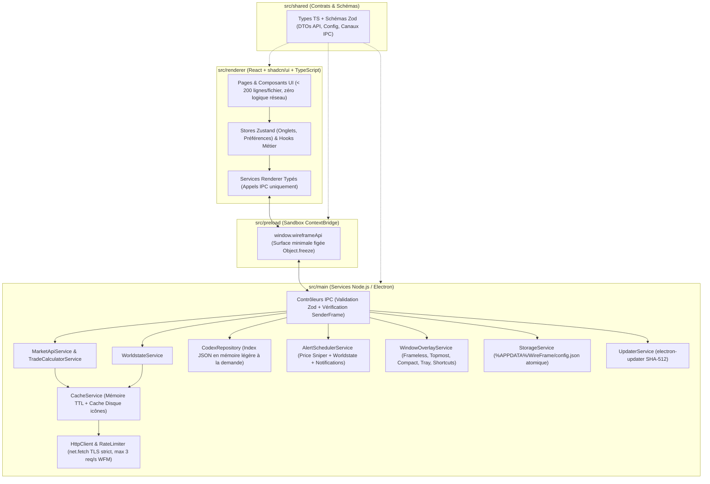

# Cahier des Charges Fonctionnel & Technique — WireFrame v2.0

- **Projet** : WireFrame v2 — Companion, Trading Browser & Codex pour Warframe
- **Auteur** : Maxime (`Nyxo_17`)
- **Stack Cible** : Electron · Node.js · React · `shadcn/ui` (Tailwind CSS + Radix UI) · TypeScript (`strict: true`) · Validation `zod`
- **Statut du document** : `VALIDÉ DÉFINITIF (CDC + 7 Planches Wireframes Excalidraw approuvés)`

---

## 1. Vision Produit & Objectifs de la v2.0

**WireFrame v2** est une application de bureau native Windows (extensible Linux/macOS) conçue pour accompagner les joueurs de **Warframe** sur leur écran principal ou en superposition (*Overlay*) par-dessus le jeu en mode *Plein écran sans bordure*.

Elle réunit **3 besoins métier complémentaires** dans une interface inspirée d'un navigateur multi-onglets ultra-réactif :
1. **Trading optimisé sur Warframe Market** : comparer plusieurs items en parallèle dans des onglets, calculer s'il vaut mieux acheter un Set complet ou ses pièces détachées, regrouper ses achats chez un même vendeur (*Trade Bundler*), surveiller les bonnes affaires en arrière-plan (*Price Sniper*), et générer les commandes `/w` en un clic.
2. **Suivi temps réel de l'univers Warframe (*Worldstate Hub*)** : consulter tous les cycles planétaires, Fissures, Invasions, rotations Teshin / Duviri, Baro Ki'Teer et Actualités officielles, directement enrichis avec la **valeur en Platinum en direct** des récompenses échangeables.
3. **Encyclopédie de Farm (*Codex & Helminth*)** : savoir instantanément où farmer n'importe quelle ressource, Warframe, arme, mod ou relique (missions, rotations, taux de drop en `%`), ses coûts de Fonderie et sa compétence de subsomption **Helminth**.

### Pourquoi la refonte v2 (Electron + React + TypeScript) ?
- **Zéro bricolage système ni serveur HTTP local** : plus aucun port TCP ouvert sur le PC (`127.0.0.1`), plus de dépendance C# / Python.
- **Vraie intégration bureau & jeu** : fenêtre sans bordure fusionnée à la barre d'onglets, mode *Always-on-Top* compatible plein écran sans bordure, raccourcis clavier globaux fonctionnant **sans quitter Warframe (`Alt+Tab` inutile)**, et fonctionnement silencieux dans le **System Tray** Windows.
- **Sécurité & Maintenabilité professionnelles** : isolation stricte Electron (`sandbox` + `contextIsolation`), TLS strict, validation des données d'API via `zod`, et composants React modulaires (`shadcn/ui`).

---

## 2. Ergonomie Globale & Paradigme de Navigation

### 2.1. En-tête épuré en 2 Barres (Style Navigateur Multi-Onglets)

Conformément au choix d'ergonomie retenu, toute la navigation tient dans **2 barres compactes** en haut de la fenêtre Electron (*Frameless*) :

1. **Barre 1 — Barre d'Onglets & Contrôles Fenêtre (`Title & Tabs Bar`, hauteur ~38 px)** :
   - **Bouton Hub Permanent (à gauche)** : onglet fixe non fermable portant le logo WireFrame, basculant instantanément sur le **Hub Temps Réel Warframe**.
   - **Liste d'onglets dynamiques** : chaque fiche d'item, recherche catalogue, page Codex, Panier ou profil joueur peut s'ouvrir dans un onglet dédié.
     - *Actions sur les onglets* : glisser-déposer horizontal pour réordonner, clic molette pour fermer, clic droit (menu contextuel : *Épingler `📌`, Dupliquer, Fermer les doublons, Fermer les autres, Fermer à droite*), bouton `+` (*Nouvel onglet*), et popover **Organisateur d'onglets** (filtrer les onglets ouverts, trier A→Z ou par catégorie, nettoyer les doublons).
   - **Zone de déplacement fenêtre (`app-region: drag`)** sur l'espace libre.
   - **Contrôles natifs de fenêtre Windows (à droite)** : Réduire (`_`), Agrandir/Restaurer (`□`), Fermer (`✕` — réduit dans le *System Tray* ou quitte selon le réglage utilisateur).

2. **Barre 2 — Barre d'Actions & Omnibox Unifiée (`Command & Nav Bar`, hauteur ~44 px)** :
   - **Navigation d'onglet** : boutons *Précédent*, *Suivant*, *Actualiser (`Ctrl+R`)*.
   - **Omnibox Intelligente Centrale (`Ctrl+K` ou `Ctrl+L`)** :
     - Remplace l'ancienne fausse barre `https://warframe.market/...` ET l'ancienne double barre de recherche.
     - Permet de chercher instantanément en **FR ou EN** un item du marché (~3 900+ entrées avec miniature), une entrée du **Codex** (ressource, relique, Warframe), ou une vue interne (`panier`, `baro`, `ducats`, `fissures`...).
     - *Compatibilité copier-coller* : si le joueur colle une vraie URL `https://warframe.market/items/nikana_prime_set`, l'Omnibox la reconnaît et ouvre directement la fiche correspondante.
     - Bouton **Étoile Favori (`Ctrl+D`)** intégré à droite de l'Omnibox lorsque l'onglet affiche un item.
   - **Accès Rapides Métier (avec compteurs en temps réel)** :
     - `Marché` · `Codex` · `Outils ▾` (*Ducanator*, *Contrats Rivens*, *Ordres Récents*, *Favoris*) · `Panier (n)` · `Alertes (n)`.
   - **Réglages Rapides & Overlay** :
     - Sélecteur compact **Plateforme / Crossplay / Langue** (`PC · Crossplay · FR`).
     - Bouton **Épingle Premier Plan (`Alt+P`)** + Bouton **Mode Compact (`Alt+M`)** + Bouton **Paramètres** (avec pastille si une mise à jour est prête).

### 2.2. Mode Desktop (`1440×900`) vs Mode Compact Adaptatif (`460×660`)

| Caractéristique | Mode Desktop Normal (défaut `1440×900`, min `1024×680`) | Mode Compact Overlay (`460×660`, min `380×520`) |
| :--- | :--- | :--- |
| **Usage cible** | Préparation de sessions de trade, comparaison multi-onglets, exploration Codex | Superposé dans un coin de l'écran pendant une mission ou au Dojo Warframe |
| **Always-on-Top** | Optionnel (`Alt+P`) | Activé automatiquement à l'entrée en mode Compact |
| **Barre 1 (Onglets)** | Onglets complets avec icône + titre | Onglets condensés (icône + titre court défilable) + bouton rapide *Agrandir* |
| **Barre 2 (Omnibox)** | Tous les raccourcis visibles sur une ligne | Omnibox prioritaire + menu compact `☰` regroupant les accès secondaires |
| **Grilles & Tableaux** | Multi-colonnes (ex: Vendeurs et Acheteurs côte à côte, grilles 3–4 colonnes) | Empilement vertical 1 colonne (Vendeurs en onglet prioritaire, cartes condensées, bouton `/w` toujours accessible en 1 clic) |
| **Mémorisation** | Mémorise sa taille et sa position d'écran exactes | Mémorise indépendamment sa propre position d'écran (ex: coin supérieur droit) |

### 2.3. Raccourcis Clavier

#### Raccourcis locaux (quand la fenêtre WireFrame a le focus)
- `Ctrl + T` : Ouvrir un nouvel onglet (Accueil Marché)
- `Ctrl + W` : Fermer l'onglet actif (sauf s'il est épinglé ou s'il s'agit du Hub)
- `Ctrl + Tab` / `Ctrl + Shift + Tab` : Onglet suivant / précédent
- `Ctrl + K` ou `Ctrl + L` : Focus sur l'Omnibox de recherche rapide
- `Ctrl + R` / `F5` : Rafraîchir les données temps réel de l'onglet actif (force le contournement du cache)
- `Ctrl + D` : Ajouter / retirer l'item courant des Favoris
- `Ctrl + +` / `Ctrl + -` / `Ctrl + 0` : Zoom natif Chromium (`50 %` à `200 %`, pas de `10 %`)

#### Raccourcis globaux système (actifs même quand Warframe est au premier plan — désactivables dans Paramètres)
- `Alt + Shift + W` : Afficher / Masquer instantanément la fenêtre WireFrame par-dessus le jeu
- `Alt + P` : Basculer l'épinglage *Toujours au premier plan* (*Always-on-Top*)
- `Alt + M` : Basculer entre le *Mode Desktop* et le *Mode Compact (`460×660`)*

---

## 3. Spécifications Fonctionnelles Détaillées par Module

### Module 1 — Composants Transverses (Whisper `/w`, System Tray & Persistance)

1. **Bandeau de commande d'échange (`WhisperBar`)** :
   - Déclenché au clic sur le bouton `Acheter (/w)` d'une offre ou d'un lot groupé du panier.
   - Copie immédiatement le message dans le presse-papiers système via l'API native Electron (`clipboard.writeText`).
   - Format standard respectant la convention Warframe Market :
     - **EN (par défaut)** : `/w <Pseudo> Hi! I want to buy: "<Item En>" (rank <X>) for <Prix> platinum. (warframe.market)`
     - **FR (bascule 1 clic)** : `/w <Pseudo> Bonjour ! Je voudrais acheter : "<Item Fr>" (rang <X>) pour <Prix> platinum. (warframe.market)`
2. **Vie en arrière-plan (`System Tray`)** :
   - Icône permanente près de l'horloge Windows avec menu contextuel : *Afficher / Masquer WireFrame*, *Basculer Mode Compact*, *Mettre en pause les sons d'alerte*, *Quitter complètement*.
   - Permet au *Price Sniper* et aux alertes Worldstate de continuer à tourner à consommation quasi nulle lorsque la fenêtre principale est fermée.
3. **Persistance locale fiable** :
   - Sauvegarde automatique dans `%APPDATA%\WireFrame\config.json` (validée par schéma `zod`, écriture atomique anti-corruption) : onglets ouverts, favoris, panier, alertes configurées, préférences audio, plateforme/langue, thème personnalisé et positions des fenêtres.

---

### Module 2 — Navigateur Warframe Market & Outils de Trading (10 Vues)

#### V1. Accueil Marché / Nouvel Onglet (`wf://market`)
- Barre de recherche centrale mise en avant, bandeau synthétique des **Actualités & Boosters actifs**, grille d'**Items populaires** (*Sets Prime, Arcanes, Mods Galvanisés/Accrus*) et aperçu des **Ordres Récents**.
- Encart discret d'aide rapide (accessible aussi via un bouton `? Guide`) remplaçant l'ancienne page Bienvenue séparée pour aller droit au but.

#### V2. Catalogue Complet (`wf://market/catalog`)
- Grille virtualisée (fluide même sur 3 900+ items) filtrable par recherche texte (FR/EN sans accents) et par tags/catégories (*Warframes Prime, Armes Prime, Mods, Arcanes, Reliques, Adaptateurs Incarnon, Syndicats, Empreintes*).

#### V3. Fiche Détail d'un Item (`wf://market/item/:slug`)
- **En-tête d'item** : miniature officielle, nom FR + nom EN, tags, taxe d'échange en Crédits, valeur en Ducats (si applicable), rang de maîtrise requis, lien rapide vers sa **fiche Codex de Farm** (si l'item est farmable !), et boutons d'action (*Favori*, *+ Panier*, *🎯 Créer Alerte Prix*).
- **Sous-onglet 1 — Ordres en Direct (`Vente` & `Achat`)** :
  - Filtres rapides : Statut joueur (**En jeu uniquement** par défaut, *En jeu + En ligne*, *Tous*), **Rang du Mod/Arcane** (*Tous*, *Rang 0*, *Rang Max*), **Quantité min**, **Réputation vendeur**.
  - Chaque ligne affiche : pseudo cliquable (vers profil), badge de statut, réputation, rang, quantité, prix unitaire en Platinum et bouton `/w` en 1 clic.
- **Encart automatique « Comparateur Set Complet vs Pièces Détachées »** *(affiché dès que l'item appartient à un Set de $\ge 2$ pièces)* :
  - Récupère le meilleur prix *En jeu* du **Set Complet** et le meilleur prix *En jeu* de **chaque pièce requise** (multiplié par le nombre d'exemplaires requis dans la recette, ex: *2× Lames* pour certaines armes doubles !).
  - Calcule :
    $$\Delta = \text{Prix}_{\text{Set Complet}} - \sum_{i} \left(\text{Qté}_i \times \text{Prix}_{\text{Pièce } i}\right)$$
  - Affiche clairement le verdict : **« Économisez X Plat en achetant les pièces séparément »** (ou **« +X Plat de marge potentielle en assemblant et revendant le Set »**).
- **Sous-onglet 2 — Statistiques du Marché (`48 dernières heures` & `90 derniers jours`)** :
  - Graphique interactif propre (prix médian, prix moyen pondéré, min/max et volume d'unités réellement vendues).

#### V4. Panier Multi-Achats & Regroupeur de Vendeurs (`wf://market/cart`)
- Gestion d'une liste d'achats (ajout d'items avec choix de la **quantité** et du **rang souhaité**, suppression, vidage).
- **Calculateur budgétaire automatique** :
  - Coût estimé en **Platinum** basé sur les meilleures offres *En jeu* actuelles.
  - Calcul de la **Taxe d'échange en Crédits** totale à prévoir en jeu.
- **Algorithme *Trade Bundler* (Détecteur de Vendeurs Multi-Items)** :
  - Analyse les meilleures offres *En jeu* de chaque article du panier et identifie tous les vendeurs possédant **au moins 2 articles distincts du panier simultanément**.
  - Affiche pour chaque vendeur groupé : la liste des articles disponibles chez lui, son prix total comparé à l'achat séparé optimal, le nombre d'allers-retours Dojo économisés, et un bouton **`/w` Groupé** listant tous les items dans un seul message.

#### V5. Favoris Marché (`wf://market/favorites`)
- Tableau de bord des items mis en favoris avec actualisation groupée de leur **prix minimum *En jeu***, tendance rapide et accès en 1 clic au `/w` ou à la fiche détail.

#### V6. Ducanator (`wf://market/ducats`)
- Analyse les données horaires de Warframe Market (`/v1/tools/ducats`) pour classer les pièces Prime selon :
  - Ratio **`Ducats / Platinum`** (pour acheter de la "Prime Junk" au meilleur taux avant Baro Ki'Teer),
  - Ratio inverse **`Plat / 100 Ducats`** (pour savoir quelles pièces revendre contre du Platinum plutôt que de les fondre en Ducats),
  - Filtre de **volume minimal vendu** (pour écarter les items rares jamais échangés).

#### V7. Contrats — Enchères de Mods Riven (`wf://market/rivens`)
- Sélecteur d'arme avec autocomplétion + filtres (polarité, rang de maîtrise, nombre max de relances, tri par prix croissant).
- Cartes Riven lisibles : attributs positifs en vert, malus en rouge, prix d'achat direct (*Buyout*) ou enchère en cours, statut du vendeur et bouton `/w`.

#### V8. Ordres Récents (`wf://market/recent`) & V9. Profil Joueur (`wf://market/user/:slug`)
- **Ordres Récents** : flux des dernières offres publiées sur la plateforme sélectionnée.
- **Profil Joueur** : en-tête joueur (avatar, statut en jeu, réputation) et séparation claire de toutes ses offres actives (*Il vend* / *Il achète*).

---

### Module 3 — Centre d'Alertes : *Price Sniper* & Alertes Worldstate (`wf://alerts`)

Contrairement à la `v1` où les timers vivaient dans la page web, l'orchestrateur (`AlertSchedulerService`) tourne dans le **Main Process Node.js** :
1. **Price Sniper (Surveillance de prix par item)** :
   - L'utilisateur définit un item, un rang optionnel, et un **prix plafond en Platinum** (ex: *Arcane Énergétique $\le 450$p*).
   - Scan périodique paramétrable (`15s` à `3600s`, défaut `30s`) respectant strictement le limiteur de débit global de l'API.
   - Dès qu'une offre de vente *En jeu* passe sous le seuil : **Toast interactif** dans l'application (avec bouton `/w` immédiat) + **Notification Windows native** (si fenêtre réduite/arrière-plan) + **Alerte sonore**.
2. **Alertes Sonores d'Événements Warframe (11 déclencheurs activables individuellement)** :
   - *Cycles* : Nuit sur Cetus, Pré-alerte 5 min avant la Nuit sur Cetus (chasse Eidolon), Vallée Orbis Chaude, Deimos Vome.
   - *Missions & Marchands* : Arrivée de Baro Ki'Teer, Fissure Rapide (Capture/Extermination...), Fissure Omnia Route de l'Acier, Invasion Rare (Catalyseur / Réacteur / Forma / Exilus), Invasion d'arme Wraith/Vandal, Semaine Forma Umbra chez Teshin, Arbitrage S-Tier.
3. **Paramètres Audio** : activation/coupure rapide du son, choix entre les sonneries embarquées (`Classique` et `Cloche / Bell`), curseur de volume (`0 %`–`100 %`), bouton *Tester*, et option de répétition tant que l'offre reste disponible.

---

### Module 4 — Hub Temps Réel « WireFrame Info » (`wf://hub`)

Accessible à tout moment depuis l'onglet fixe en haut à gauche, structuré en **6 sous-vues** avec compteurs calculés chaque seconde côté client et resynchronisés périodiquement :

1. **H1. Planètes & Mises à Prix** : cartes visuelles temps réel pour **Cetus / Terre**, **Vallée Orbis (Fortuna)**, **Puy de Cambion (Deimos)**, **Duviri** (5 spirales d'humeur) et **Zariman Ten Zero** (occupant Corpus/Grineer), suivies des **Mises à Prix** actives (*Ostrons*, *Union Solaris*, *Entrati*) et de leurs tables de récompenses.
2. **H2. Fissures & Missions** : toutes les **Fissures du Néant** actives (Normal, Route de l'Acier, Tempêtes Railjack, Omnia) filtrables par ère (*Lith, Meso, Neo, Axi, Requiem, Omnia*) et par toggle **`⚡ Missions Rapides uniquement`**, accompagnées de la **Chasse à l'Archonte** hebdomadaire et de la **Sortie** quotidienne.
3. **H3. Invasions, Acier & Nightwave** :
   - **Invasions** : barres d'avancement des factions et bouton **`Prix Plat ↗`** direct sur les pièces d'armes Wraith/Vandal échangeables.
   - **Honneurs de la Route de l'Acier (Teshin)** : récompense de la semaine en cours + calendrier des 8 semaines + boutique permanente (*Evergreens*).
   - **Arbitrage en direct** + catalogue rapide des **Mods Galvanisés / Arbitrage** pour vérifier lequel est le plus rentable à acheter en Essence Vitus pour le revendre en Platinum.
   - **Alertes du Lotus**, **Événements spéciaux** et **Défis Nightwave (Ondes Nocturnes)** journaliers/hebdomadaires.
4. **H4. Circuit de Duviri** : rotation hebdomadaire active (**3 Warframes** en Normal + **5 Adaptateurs Incarnon Genesis** en Route de l'Acier) + calendrier complet des 9 semaines.
5. **H5. Marchand du Néant Baro Ki'Teer** : compte à rebours d'arrivée/départ, relais, inventaire complet (coût Ducats + Crédits) croisé automatiquement avec le **prix Platinum en direct** sur Warframe Market et le score de rentabilité **`Plat / 100 Ducats`**.
6. **H6. Actualités (News), Boosters & Offre de Darvo** : actualités officielles filtrables par catégorie, **Boosters globaux serveur** en cours, **Offre quotidienne de Darvo** (remise, stock restant, compte à rebours) et liens directs vers les sets de **Résurgence Prime**.

---

### Module 5 — Encyclopédie « Codex, Farm & Helminth » (`wf://codex`)

1. **Explorateur Codex (`wf://codex`)** : navigation par onglets de catégories (**Ressources Farmables**, **Warframes**, **Armes**, **Mods**, **Reliques**) avec recherche instantanée et filtres (Prime / Standard, rareté, ère de relique).
2. **Fiche Détail Codex (`wf://codex/:category/:id`)** :
   - **Où le farmer** : tableau trié par meilleur **taux de drop (`%`)** indiquant planète, nœud de mission, type, rotation (`A / B / C`) ou ennemi/relique source.
   - **Recettes de Fonderie** : composants requis, quantités, crédits et temps de fabrication (avec liens cliquables vers chaque ressource).
   - **Passerelle Marché** : si l'élément est échangeable (ex: partie Prime, Mod, Relique), bouton direct vers sa fiche **Warframe Market** pour comparer le temps de farm à son prix en Platinum.
   - **Infirmerie Helminth** : sur chaque Warframe standard, encart indiquant la **compétence donnée par subsomption au Helminth** + fiche dédiée **Helminth** répertoriant ses compétences exclusives et sécrétions.

---

### Module 6 — Personnalisation Visuelle (`shadcn/ui`) & Mises à Jour

1. **Moteur de Thèmes Bicolores sur variables CSS `shadcn/ui`** :
   - **Thèmes prédéfinis** (*Orokin Dark*, *Tenno Light*, *Lotus Amethyst*, *Prime Gold*, *Kuva Crimson*, *Corpus Matrix*...).
   - **Personnalisateur libre Bicolore** : choix indépendant de la **Couleur Principale** (surfaces, fond, barres) et de la **Couleur Secondaire** (accents, anneaux de focus, badges, boutons primaires) + activation/désactivation de l'effet de **Glow**.
   - Génération automatique des nuances accessibles (contraste texte lisible garanti) injectées proprement en variables CSS racine (`--background`, `--card`, `--border`, `--primary`, `--accent`, `--ring`).
2. **Système de Mise à Jour Natif Sécurisé (`electron-updater`)** :
   - Vérification automatique au lancement (puis toutes les 30 min) auprès des **Releases officielles CI/CD** (GitLab / GitHub Releases) avec vérification cryptographique d'intégrité **SHA-512** (`latest.yml`).
   - Téléchargement différentiel en arrière-plan (*blockmap*) et modale **« Quoi de neuf ? (Notes de Patch) »** affichée après mise à jour.

---

## 4. Architecture Technique, Contrats IPC & Sécurité

### 4.1. Séparation Stricte des Couches (Clean Architecture sans serveur HTTP)

### 4.2. Politique Réseau, Cache & Protection Anti-Ban API

L'API officielle `api.warframe.market` impose une limite stricte de **3 requêtes par seconde**. Pour garantir zéro erreur `429 Too Many Requests` (même lors d'un scan *Panier Bundler* ou *Baro Ki'Teer* sur 25 items) :
- **File d'attente centralisée (*Token Bucket Rate Limiter*)** dans `src/main/infrastructure/http/` plafonnée à **3 req/s** avec déduplication des requêtes identiques en vol (*in-flight request coalescing*).
- **Durées de cache (TTL) côté Main Process** :
  - Catalogue complet `/v2/items` : **1 heure** (+ cache disque de secours pour démarrage instantané).
  - Détail d'item & composition de Set : **15 minutes**.
  - Statistiques 48h/90j & Ducats : **5 minutes**.
  - Ordres en direct (`/v2/orders/item/:slug`) : **20 secondes** (contournable via `forceRefresh` sur `Ctrl+R`).
  - Worldstate Warframe (`api.warframestat.us`) : **45 secondes**.
  - Miniatures & icônes d'items : **Cache disque local** dans `app.getPath('sessionData')/asset-cache` (**7 jours**) servi via un protocole interne sécurisé `wf-asset://` en lecture seule (aucun serveur HTTP ouvert).

### 4.3. Contrats des Canaux IPC (`src/shared/ipc-channels.ts`)

Tous les paramètres d'entrée et toutes les réponses API passent par une validation `zod` :

| Domaine | Canaux IPC (`invoke` / événements `on`) | Responsabilité |
| :--- | :--- | :--- |
| **`market`** | `market:getCatalog`, `market:getItemDetail`, `market:getItemOrders`, `market:getItemStats`, `market:getRecentOrders`, `market:getUserProfile`, `market:getDucats`, `market:searchRivens`, `market:analyzeSetVsParts`, `market:analyzeCartBundles` | Données Warframe Market et calculs métier lourds |
| **`worldstate`** | `worldstate:getCurrent`, `worldstate:getBaroWithPrices` | État du monde Warframe et enrichissement Platinum de Baro |
| **`codex`** | `codex:search`, `codex:getItemDetail`, `codex:getHelminthData` | Requêtes rapides paginées dans la base Codex locale sans charger 5 Mo dans chaque onglet React |
| **`alerts`** | `alerts:list`, `alerts:upsertPriceAlert`, `alerts:deletePriceAlert`, `alerts:updateWorldAlerts`, `alerts:onTriggered` *(event Main → Renderer)* | Gestion et réception temps réel des alertes *Price Sniper* et cycles |
| **`settings`** | `settings:get`, `settings:update` | Lecture/écriture typée des préférences utilisateur, panier, favoris et thèmes |
| **`window`** | `window:minimize`, `window:toggleMaximize`, `window:close`, `window:setAlwaysOnTop`, `window:setCompactMode`, `window:setZoom`, `window:openExternalUrl`, `window:onStateChanged` *(event)* | Pilotage natif de la fenêtre, du mode Overlay et ouverture sécurisée de liens externes |
| **`updater`** | `updater:check`, `updater:downloadAndInstall`, `updater:getChangelog`, `updater:onStatus` *(event)* | Cycle de mise à jour `electron-updater` |

### 4.4. Exigences Non-Fonctionnelles & Sécurité Intransigeante

1. **Durcissement Electron obligatoire** :
   - `nodeIntegration: false`, `contextIsolation: true`, `sandbox: true`, `webSecurity: true`.
   - **Content-Security-Policy (CSP)** stricte : `default-src 'self'; img-src 'self' wf-asset: data:; media-src 'self'; style-src 'self' 'unsafe-inline'; script-src 'self'; connect-src 'none'` (le Renderer ne fait **aucune** connexion Internet directe : `connect-src 'none'`, 100 % passe par le Main Process !).
   - **TLS strict** : validation systématique des certificats HTTPS du système d'exploitation.
   - **Ouverture de liens externes filtrée** : seuls les domaines explicitement autorisés (`https://warframe.market/...`, `https://www.warframe.com/...`, `https://wiki.warframe.com/...`) peuvent être ouverts dans le navigateur par défaut de Windows via `shell.openExternal`.
2. **Qualité & Standards de Code** :
   - TypeScript `strict: true`, `noUncheckedIndexedAccess: true`, zéro `any`, zéro `dangerouslySetInnerHTML`.
   - Chaque vue React implémente obligatoirement ses **4 états visuels** : *Chargement (`Skeleton` shadcn)*, *Vide (`EmptyState`)*, *Nominal*, et *Erreur avec bouton Réessayer*.
3. **Conformité stricte Digital Extremes** :
   - Aucune interaction avec la mémoire ou le processus du jeu, aucune macro d'envoi automatique de touches clavier : uniquement la copie dans le presse-papiers initiée par l'utilisateur.

---

## 5. Plan des Maquettes Wireframes Excalidraw (`docs/02-wireframes/`)

Avant tout développement, nous allons produire et valider ensemble **7 planches Excalidraw** dans `docs/02-wireframes/`, chacune présentant côte à côte la version **Desktop (`1440×900`)** et son adaptation **Compact Overlay (`460×660`)** :

1. `01-app-shell-navigation.excalidraw` : Fenêtre *Frameless*, les 2 barres supérieures, Omnibox ouverte, Organisateur d'onglets, bandeau `/w`, et comparaison directe Desktop vs Compact `460×660`.
2. `02-market-home-catalog-item.excalidraw` : Accueil Marché, Grille Catalogue, et **Fiche Item complète** (Ordres Vente/Achat, Comparateur *Set vs Pièces*, Statistiques 48h/90j + états *Skeleton/Erreur*).
3. `03-cart-bundler-ducats-rivens.excalidraw` : **Panier Multi-Achats & Détecteur de Vendeurs Groupés**, Ducanator et Contrats Rivens.
4. `04-hub-worldstate.excalidraw` : Le **Hub Temps Réel** et l'agencement de ses 6 sous-vues (Cycles & Mises à prix, Fissures & Archonte/Sortie, Invasions/Teshin/Arbitrage/Nightwave, Duviri, Baro Ki'Teer, News & Darvo).
5. `05-codex-farm-helminth.excalidraw` : Explorateur Codex par catégories, Fiche Détail de Farm (tables de drop `%` + Fonderie) et vue **Infirmerie Helminth**.
6. `06-alerts-settings-modals.excalidraw` : Centre d'Alertes (*Price Sniper* + Alertes Cycles) et Modale **Notes de Patch / Mise à jour**.
7. `07-settings-system-complete.excalidraw` : **Système complet des Paramètres** (Modale `shadcn Dialog` structurée avec barre latérale en 5 catégories : *1. Apparence & Thèmes Bicolores*, *2. Audio & Notifications*, *3. Fenêtre, System Tray & Raccourcis Globaux éditables*, *4. Marché & Échanges*, *5. Mises à jour SHA-512, Export/Import JSON & Cache* + adaptation en `Sheet` plein écran pour le Mode Compact `460×660`).

---

## 6. Découpage prévisionnel de l'Implémentation (Après validation CDC + Wireframes)

Une fois le CDC et les 7 planches Excalidraw validés, le code sera construit sur des branches dédiées (`feat/...`) en **6 jalons propres** :
- **Jalon 1 (`feat/core-foundation`)** : Initialisation `electron-vite` + React + TypeScript + `shadcn/ui`, `HttpClient` avec *Rate Limiter*, `StorageService`, `WindowOverlayService` et Contrats `zod` de base.
- **Jalon 2 (`feat/app-shell-tabs`)** : App Shell *Frameless* à 2 barres, moteur d'onglets (drag & drop, épinglage, mode Compact `460×660`), Omnibox, System Tray, raccourcis globaux et Thèmes Bicolores.
- **Jalon 3 (`feat/market-core`)** : Accueil Marché, Catalogue virtualisé, Fiche Item (Ordres, Comparateur Set vs Pièces, Stats), Favoris, Profil joueur et Bandeau `/w`.
- **Jalon 4 (`feat/trading-tools-alerts`)** : Panier Multi-Achats + *Trade Bundler*, Ducanator, Contrats Rivens, et `AlertSchedulerService` (*Price Sniper* + sons + notifications).
- **Jalon 5 (`feat/worldstate-hub`)** : Les 6 sous-vues du Hub Temps Réel Warframe et alertes de cycles/fissures/invasions.
- **Jalon 6 (`feat/codex-and-release`)** : Script Node d'indexation Codex, vues Codex & Helminth, `electron-updater` + pipeline CI/CD GitLab/GitHub Releases.

